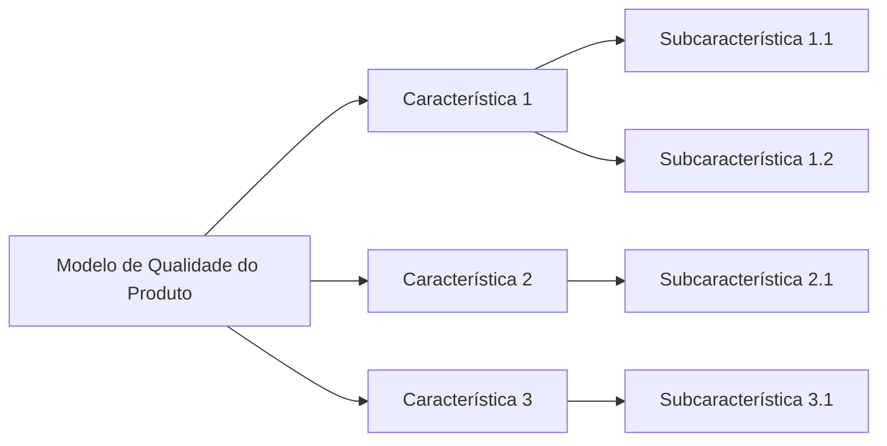

# Modelo de Qualidade

<!-- Critério 4. Nível máximo: adaptações justificadas por contexto e stakeholders + diagrama ligado às subcaracterísticas. -->

## 1. Modelo base

Modelo de qualidade de produto da ISO/IEC 25010 (SQuaRE). [Informar a versão utilizada: 2011 ou 2023.]

## 2. Adaptações ao software

| Elemento do modelo | Adaptação | Justificativa (contexto / stakeholder) |
| :--- | :--- | :--- |
| [característica ou subcaracterística] | [mantida / removida / renomeada / detalhada] | [por quê] |
| [...] | [...] | [...] |

## 3. Representação gráfica

*Figura 2 - Modelo de qualidade adaptado. Fonte: elaboração da equipe, com base na ISO/IEC 25010.*

A seleção e a priorização das características estão em [Características de Qualidade](caracteristicasDeQualidade.md).

---

## Histórico de versão

| Nome do Membro | Contribuição | Data | Commit |
| :--- | :--- | :--- | :--- |
| [Gustavo Fornaciari](https://github.com/GUGOFO) | Criação do molde da página | 15/10 | [hash](URL-do-commit) |

