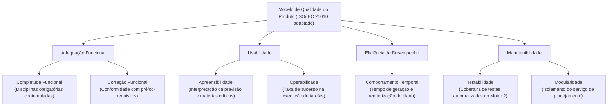

# Modelo de Qualidade

<!-- Critério 4. Nível máximo: adaptações justificadas por contexto e stakeholders + diagrama ligado às subcaracterísticas. -->

## 1. Modelo base

O modelo adotado como referência é o **Modelo de Qualidade de Produto da norma ISO/IEC 25010:2011 (SQuaRE)**, complementado pelas definições métricas da **ISO/IEC 25023:2016**. A norma estrutura a qualidade interna e externa em características e subcaracterísticas mensuráveis.

## 2. Adaptações ao software

Para a avaliação da funcionalidade **Planejar formatura** do No Fluxo UnB, o modelo geral foi adaptado com base no propósito da ferramenta, nos perfis de estudantes e nas necessidades dos mantenedores:

| Elemento do modelo | Adaptação | Justificativa (contexto / stakeholder) |
| :--- | :--- | :--- |
| **Adequação funcional** | Mantida com foco em **Completude funcional** e **Correção funcional** | O núcleo do software é gerar um plano academicamente válido. Incorreções em pré-requisitos, co-requisitos ou disciplinas faltantes inviabilizam a utilidade para o estudante. |
| **Usabilidade** | Mantida com foco em **Apreensibilidade (Learnability)** e **Operabilidade (Operability)** | A interface apresenta grafos interativos de alta densidade cognitiva. O estudante precisa conseguir localizar sua previsão de formatura e entender as matérias críticas sem suporte humano. |
| **Eficiência de desempenho** | Mantida com foco em **Comportamento temporal (Time behaviour)** | A geração do plano não pode gerar tempos excessivos de espera na requisição à API ou travamentos na renderização do grafo de disciplinas no navegador. |
| **Manutenibilidade** | Mantida com foco em **Testabilidade (Testability)** e **Modularidade** | Como projeto open-source e base para as melhorias da equipe na disciplina, a capacidade de testar e alterar o algoritmo do Motor 2 de forma isolada é essencial para os desenvolvedores. |
| **Confiabilidade** | Removida do escopo prioritário | Falhas lógicas de geração de planos são tratadas diretamente como não conformidades funcionais (adequação funcional). |
| **Segurança** | Removida do escopo de testes diretos | Autenticação e dados delegados ao Supabase; restrições contratuais impedem testes intrusivos. Privacidade é tratada via premissa de dados sintéticos. |
| **Compatibilidade e Portabilidade** | Removidas do escopo prioritário | Foco estabelecido na versão desktop (navegadores modernos) devido a restrições de prazo e relevância. |

## 3. Representação gráfica

*Figura 6 - Modelo de qualidade adaptado para a funcionalidade Planejar formatura. Fonte: elaboração da equipe, com base na ISO/IEC 25010.*

A seleção e a priorização detalhada das características estão em [Características de Qualidade](caracteristicasDeQualidade.md).

---

## Histórico de versão

| Nome do Membro | Contribuição | Data | Commit |
| :--- | :--- | :--- | :--- |
| [Gustavo Fornaciari](https://github.com/GUGOFO) | Criação do molde da página | 15/10 | [828688f](https://github.com/FCTE-Qualidade-de-Software-1/2026-2_T02_JEAN_SAMMET/commit/828688feb645eebfcd428e11b4b9f87585253b9b) |
| [Artur Fernandes Galdino](https://github.com/Gotc2607) | Definição das adaptações do modelo, subcaracterísticas e diagrama | 16/10 | [e48c91a](https://github.com/FCTE-Qualidade-de-Software-1/2026-2_T02_JEAN_SAMMET/commit/e48c91a) |