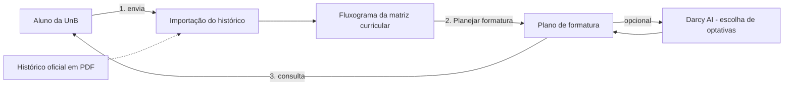

# Software Escolhido: No Fluxo UnB

## 1. Identificação

| Item | Descrição |
| :--- | :--- |
| Nome | No Fluxo UnB |
| Link | [no-fluxo.crianex.com](https://no-fluxo.crianex.com) |
| Descrição oficial | "Visualize, monte e personalize fluxogramas de qualquer curso com o poder da IA. Mais agilidade para estudar, entender e avançar." |
| Repositório / código-fonte | [confirmar se é público] |
| Licença | [confirmar] |
| Versão avaliada | [data de acesso: outubro/2026; confirmar se há número de versão] |
| Tecnologias identificadas | Biblioteca Svelte Flow para o grafo (visível na interface); aplicação web com metadados para uso em dispositivos móveis. Demais tecnologias: [confirmar] |

## 2. Tipo de produto

**Classificação:** aplicação web (cliente executado no navegador) de apoio ao planejamento acadêmico, com um recurso de inteligência artificial.

**Justificativa:** o software é acessado por URL, sem instalação. Ele recebe o histórico acadêmico do aluno e devolve visualizações do fluxograma do curso e de um plano de formatura. Não é biblioteca nem API pública: o usuário final interage por interface gráfica.

## 3. Descrição estruturada

### 3.1 Fluxo de uso avaliado

O fluxo escolhido para esta avaliação tem três passos:

1. **Enviar o histórico** (Figura 1): o aluno envia o PDF do histórico oficial da UnB ou preenche os dados manualmente.
2. **Visualizar o fluxograma** (Figura 2): o sistema monta toda a grade da matriz curricular do aluno, com o que já foi cursado e o que falta.
3. **Planejar formatura** (Figura 3): ao clicar no botão "Planejar formatura", o sistema gera a sequência de matérias até a formatura. **Esta tela é o objeto central da avaliação.**

*Figura 1 - Tela de importação do histórico. Fonte: captura de tela do No Fluxo UnB, outubro/2026.*

*Figura 2 - Fluxograma da matriz curricular com o status de cada disciplina. Fonte: captura de tela do No Fluxo UnB, outubro/2026.*

*Figura 3 - Tela "Planejar formatura". Fonte: captura de tela do No Fluxo UnB, outubro/2026.*

### 3.2 Módulos

| Módulo | Responsabilidade | Evidência |
| :--- | :--- | :--- |
| Importação de histórico | Recebe o PDF do histórico oficial (somente PDF, máx. 10 MB) ou os dados preenchidos manualmente; orienta como obter o histórico. | Figura 1 |
| Fluxograma da matriz curricular | Exibe as disciplinas por semestre, com créditos, carga horária, status (aprovado, matriculado, disponível, reprovado, bloqueado) e marcações de equivalência, optativa e módulo livre. Permite trocar de matriz, reenviar o histórico e capturar a tela. | Figura 2 |
| Planejamento de formatura | Calcula o semestre previsto de formatura, os semestres restantes e as matérias críticas. Permite ajustar os créditos por semestre (exibição em créditos ou horas). Mostra, em grafo, as disciplinas de cada semestre com dependências, dificuldade e percentual integralizado. | Figura 3 |

### 3.3 Interfaces

- **Entrada:** arquivo PDF do histórico oficial da UnB ou formulário de preenchimento manual.
- **Saída:** painéis de resumo (formatura, semestres, críticas), controle de créditos por semestre e grafo interativo com zoom.

### 3.4 Dependências e restrições

- O resultado depende do **histórico enviado** e da **matriz curricular** selecionada. No exemplo capturado, a matriz é a 6360/1 - 2017.1 de Engenharia de Software, exibida como **INATIVA**.
- A origem do catálogo de matrizes e pré-requisitos (cadastro próprio ou importado) é [confirmar].
- O histórico acadêmico é dado pessoal do aluno. O site informa que os dados são usados somente para montar o fluxograma.
- Backend, banco de dados e infraestrutura: [confirmar].

### 3.5 Diagrama de contexto

*Figura 4 - Diagrama de contexto do fluxo avaliado. Fonte: elaboração da equipe.*

## 4. Implicações para a avaliação

Quadro preliminar, a ser refinado em [Escopo](escopo.md) e nas Fases 2 e 3.

| Dá para medir agora | Não dá para medir agora (e por quê) |
| :--- | :--- |
| Comportamento da tela "Planejar formatura" como usuário: regras de pré-requisito, cálculo de horas, semestre previsto de formatura e matérias críticas, comparados com a matriz curricular oficial. | Qualidade interna do código (manutenibilidade): depende de acesso ao código-fonte [confirmar]. |
| Desempenho percebido no navegador (tempo de carregamento e de resposta da tela, via ferramentas do navegador). | Infraestrutura e carga no servidor: sem acesso ao ambiente de produção. |
| Compatibilidade com navegadores e tamanhos de tela. | Qualidade das sugestões do Darcy AI de forma reprodutível: o comportamento do modelo pode variar [confirmar]. |
| Aspectos de segurança observáveis externamente, sem testes intrusivos. | Testes com históricos de outros alunos: exigem consentimento e proteção de dados pessoais. |

---

## Histórico de versão

| Nome do Membro | Contribuição | Data | Commit |
| :--- | :--- | :--- | :--- |
| [Gustavo Fornaciari](https://github.com/GUGOFO) | Criação do molde da página | 15/10 | [828688f](https://github.com/FCTE-Qualidade-de-Software-1/2026-2_T02_JEAN_SAMMET/tree/828688feb645eebfcd428e11b4b9f87585253b9b) |
| [Gustavo Fornaciari](https://github.com/GUGOFO) | Preenchimento com os dados do No Fluxo UnB | 15/10 | [hash](URL-do-commit) |

