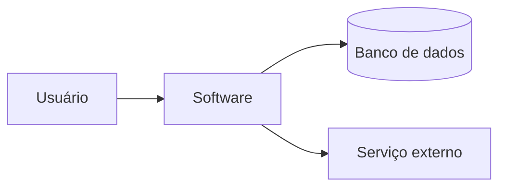

# Software Escolhido

<!-- Critério 3. Nível máximo: diagrama de contexto/arquitetura + implicações do que dá/não dá para medir agora. -->

## 1. Identificação

| Item | Descrição |
| :--- | :--- |
| Nome | [nome] |
| Repositório | [link] |
| Versão avaliada | [tag/commit] |
| Licença | [licença] |
| Tecnologias principais | [linguagens, frameworks, banco de dados] |

## 2. Tipo de produto

**Classificação:** [ex.: aplicação web, aplicativo mobile, biblioteca, API.]

**Justificativa:** [por que essa classificação é a correta.]

## 3. Descrição estruturada

### 3.1 Módulos

| Módulo | Responsabilidade |
| :--- | :--- |
| [módulo 1] | [...] |
| [módulo 2] | [...] |

### 3.2 Interfaces

[Interfaces com usuários, APIs, serviços externos.]

### 3.3 Dependências e restrições

[Bibliotecas, serviços, ambiente de execução, limitações conhecidas.]

### 3.4 Diagrama de contexto

*Figura 1 - Diagrama de contexto do software. Fonte: elaboração da equipe.*

## 4. Implicações para a avaliação

| Dá para medir agora | Não dá para medir agora (e por quê) |
| :--- | :--- |
| [...] | [...] |

---

## Histórico de versão

| Nome do Membro | Contribuição | Data | Commit |
| :--- | :--- | :--- | :--- |
| [Gustavo Fornaciari](https://github.com/GUGOFO) | Criação do molde da página | 15/10 | [hash](URL-do-commit) |

