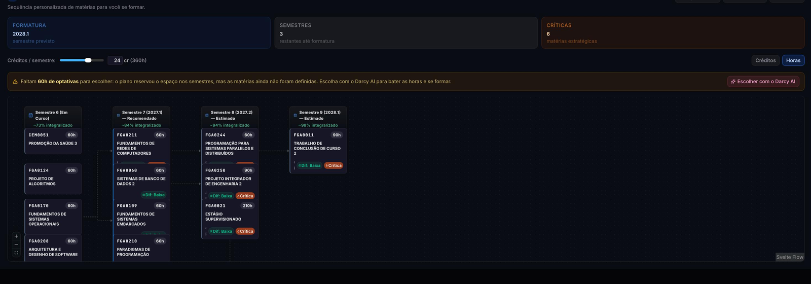
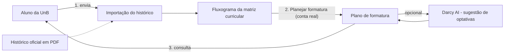
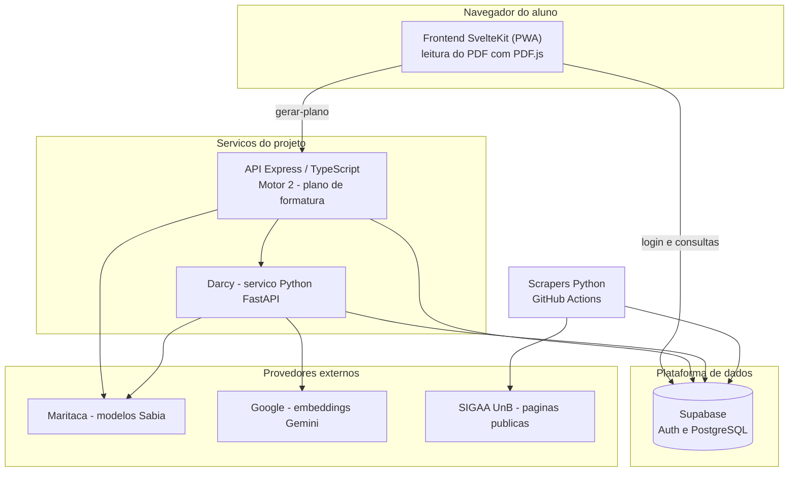

# Software Escolhido: No Fluxo UnB

## 1. Identificação

| Item | Descrição |
| :--- | :--- |
| Nome | No Fluxo UnB (NoFluxo, "by Crianex") |
| Endereço | [no-fluxo.crianex.com](https://no-fluxo.crianex.com) |
| Descrição oficial | "Visualize, monte e personalize fluxogramas de qualquer curso com o poder da IA. Mais agilidade para estudar, entender e avançar." |
| Repositório | [unb-mds/2025-1-NoFluxoUnB](https://github.com/unb-mds/2025-1-NoFluxoUnB) |
| Licença | GPL-3.0 |
| Origem e mantenedora | Nasceu como projeto de estudantes da FGA na disciplina Métodos de Desenvolvimento de Software (2025/1). Hoje é um produto da Crianex, gratuito para o estudante. |
| Versão avaliada | Código de referência: commit `87b5475` (14/10/2026). Acesso ao site em outubro/2026. A versão em produção pode diferir do código, então cada teste registrará data e hora. |
| Tecnologias | Frontend: SvelteKit 2, Svelte 5, TypeScript e Tailwind 4, publicado como site estático com PWA. Backend: Node 20, Express 4 e TypeScript. Dados e autenticação: Supabase (PostgreSQL). IA: serviço Python (FastAPI) com modelos Sabiá (Maritaca) e embeddings Gemini (Google). Operação: Docker, K3s e GitHub Actions. |

Fonte: README, `CONTRIBUTING.md` e base de conhecimento (`docs/kb`) do repositório do software.

## 2. Tipo de produto

**Classificação:** aplicação web de apoio ao planejamento acadêmico, com cliente executado no navegador (PWA), API própria e recurso de inteligência artificial (assistente Darcy).

**Justificativa:** o software é acessado por URL, sem instalação. Ele recebe o histórico acadêmico do aluno e devolve o fluxograma do curso e um plano de formatura. Não é biblioteca nem API pública: o usuário final interage por interface gráfica. O próprio projeto informa que o software complementa a orientação humana e não é ferramenta oficial da UnB.

## 3. Descrição estruturada

### 3.1 Fluxo de uso avaliado

O fluxo escolhido para esta avaliação tem três passos:

1. **Enviar o histórico** (Figura 1): o aluno envia o PDF do histórico oficial da UnB ou preenche os dados manualmente.
2. **Visualizar o fluxograma** (Figura 2): o sistema monta toda a grade da matriz curricular do aluno, com o que já foi cursado e o que falta.
3. **Planejar formatura** (Figura 3): ao clicar no botão "Planejar formatura", o sistema gera a sequência de matérias até a formatura. **Esta tela é o objeto central da avaliação.**

A tela de planejamento (rota `/plano-formatura`) exige **conta real**: o modo anônimo do site não dá acesso a ela. Isso define o ambiente de teste da Fase 3.

*Figura 1 - Tela de importação do histórico. Fonte: captura de tela do No Fluxo UnB, outubro/2026.*

*Figura 2 - Fluxograma da matriz curricular com o status de cada disciplina. Fonte: captura de tela do No Fluxo UnB, outubro/2026.*

*Figura 3 - Tela "Planejar formatura". Fonte: captura de tela do No Fluxo UnB, outubro/2026.*

### 3.2 Módulos

| Módulo | Responsabilidade | Evidência |
| :--- | :--- | :--- |
| Importação de histórico | Extrai os dados do PDF no próprio navegador (PDF.js), casa as disciplinas com o catálogo e persiste o resultado para contas reais. Oferece também o preenchimento manual. | Figura 1; `frontend/src/lib/services/upload.service.ts` |
| Fluxograma da matriz curricular | Exibe as disciplinas por semestre com status (aprovado, matriculado, disponível, reprovado, bloqueado), equivalências, optativas e módulo livre. Permite trocar de matriz, reenviar o histórico e capturar a tela. | Figura 2 |
| Planejamento de formatura (Motor 2) | Gera o plano semestre a semestre até a formatura. Mostra semestre previsto, semestres restantes, matérias críticas, dificuldade estimada e percentual integralizado, em um grafo interativo com dependências. | Figura 3; `backend/src/services/plano_formatura.service.ts` |
| Assistente Darcy (IA) | Painel de chat da tela de planejamento e botão "Escolher com o Darcy AI" para sugerir optativas. Sujeito a login e a cota diária. | Figura 3; `PlannerChatPanel.svelte` |
| Coleta de dados acadêmicos | Scrapers em Python coletam estruturas curriculares, pré e co-requisitos, equivalências, turmas e calendário do SIGAA e alimentam o Supabase. | `DBA/scraping/`; workflows `scrape_*.yml` |

### 3.3 Interfaces

- **Entrada:** PDF do histórico oficial (máx. 10 MB) ou formulário manual. Na tela de planejamento, o aluno informa se trabalha ou estagia, seu objetivo (velocidade ou equilíbrio) e o limite de créditos por semestre (de 8 a 32).
- **Saída:** painéis de resumo (formatura, semestres, críticas), controle de créditos ou horas e grafo com zoom.
- **API interna:** a tela chama `POST /planejamento/gerar-plano` com o currículo, as disciplinas concluídas, o semestre atual e o limite de créditos.
- **Serviços externos:** Supabase (login, banco), Maritaca (modelos Sabiá) e Google (embeddings), usados pelo assistente Darcy.

### 3.4 Dependências e restrições

- O resultado depende do **histórico enviado** e da **matriz curricular** salva nele. O exemplo capturado usa a matriz 6360/1 - 2017.1 de Engenharia de Software, exibida como **INATIVA**; o sistema mantém a matriz do histórico mesmo quando inativa.
- O PDF **não é enviado** ao servidor: a extração ocorre no navegador. Os dados acadêmicos extraídos são enviados ao banco e, para contas reais, ficam armazenados. São dados pessoais.
- A qualidade do plano depende do catálogo (matrizes, pré-requisitos, equivalências, turmas), que vem dos scrapers do SIGAA.
- O backend aplica limite de 120 requisições por minuto por IP e aceita corpo de até 2 MB na geração do plano. O assistente tem cota diária por usuário.
- A equipe do software declara que a leitura do código não comprova o que está implantado em produção.

### 3.5 Diagrama de contexto

*Figura 4 - Diagrama de contexto do fluxo avaliado. Fonte: elaboração da equipe.*

### 3.6 Arquitetura

*Figura 5 - Arquitetura do No Fluxo UnB. Fonte: elaboração da equipe, com base na documentação e no código do repositório (commit `87b5475`).*

### 3.7 Como o plano de formatura é gerado

1. Ao entrar na tela, o aluno responde ao onboarding (trabalha ou estagia, objetivo e limite de créditos).
2. O frontend chama `POST /planejamento/gerar-plano`. O backend valida o login, lê o histórico, a matriz, os pré e co-requisitos, as equivalências e a oferta de turmas do período.
3. O Motor 2 calcula uma prioridade para cada disciplina pendente: obrigatórias, dependentes diretos e transitivos e disciplinas atrasadas pontuam mais. Em seguida, distribui as disciplinas por semestre de forma gulosa, respeitando pré-requisitos, horas e dificuldade, com teto interno de 480 h por semestre. Optativas e complementares entram como espaços (slots) de carga horária.
4. A resposta traz o semestre em curso, os semestres futuros, a formatura estimada e o resumo de integralização. Disciplinas em que o aluno está matriculado são tratadas como aprovadas para planejar os semestres seguintes.

### 3.8 Limitações conhecidas

Pontos observados no código e na documentação do projeto. Cada um é uma **hipótese a ser testada** nas Fases 2 a 4, não um defeito confirmado.

| Observação | Por que importa para a avaliação |
| :--- | :--- |
| O onboarding pergunta se o aluno trabalha e qual é seu objetivo, e envia as respostas ao backend. No serviço do Motor 2, esses campos aparecem apenas como valores padrão e não entram na seleção das disciplinas. | Funcionalidade que pode não ter efeito no plano (adequação funcional). |
| Matrícula em andamento conta como aprovação nos semestres futuros. | O plano pode ficar incorreto se o aluno reprovar; vale checar se isso fica claro na interface. |
| Se a lista de disciplinas não alocadas vier vazia, isso não prova que todas as obrigatórias entraram no plano. | O plano pode omitir disciplinas sem aviso. |
| Em alguns casos, uma disciplina pode ser alocada sem a sua co-requisitada. | Possível violação de regra da matriz. |
| A expansão de equivalências é feita em uma única passada e filtrada por curso, sem considerar a vigência. | Casos de equivalência encadeada ou de matriz antiga podem sair errados. |
| Se a consulta ao período letivo falhar, o período atual é estimado pela data do sistema. | O semestre de partida do plano pode divergir do calendário oficial. |
| A dificuldade ("Dif.") de cada disciplina vem de avaliações e pode usar modelo de linguagem. | O rótulo exibido pode variar e não ser reprodutível. |

Fonte: `docs/kb/subsystems/backend-api-and-motor2.md` e `backend/src/services/plano_formatura.service.ts`, commit `87b5475`.

## 4. Implicações para a avaliação

Quadro preliminar, a ser refinado em [Escopo](escopo.md) e nas Fases 2 e 3.

| Dá para medir agora | Não dá para medir agora (e por quê) |
| :--- | :--- |
| Correção do plano gerado em relação à matriz oficial (pré-requisitos, co-requisitos, horas, formatura estimada), com conta e históricos de teste. | Capacidade e carga em produção: a infraestrutura é de terceiros e há limite de requisições; testes de carga não são autorizados. |
| Desempenho percebido no navegador (tempo de geração e de renderização do plano), com poucas repetições. | Segurança por teste intrusivo: não autorizado. Fica restrita à leitura do código e à observação passiva. |
| Manutenibilidade por análise estática do código público (GPL-3.0), incluindo o Motor 2 e os mais de 140 arquivos de teste do repositório. | Respostas do Darcy de forma reprodutível: dependem de modelo de linguagem, cota diária e custo. |
| Compatibilidade com navegadores e tamanhos de tela, e acessibilidade básica. | Históricos reais de outros alunos: exigem consentimento e proteção de dados pessoais. |
| Confronto entre o que o onboarding promete e o que o plano faz com as respostas. | Garantir que a produção executa exatamente o código do repositório. |

---

## Histórico de versão

| Nome do Membro | Contribuição | Data | Commit |
| :--- | :--- | :--- | :--- |
| [Gustavo Fornaciari](https://github.com/GUGOFO) | Criação do molde da página | 15/10 | [828688f](https://github.com/FCTE-Qualidade-de-Software-1/2026-2_T02_JEAN_SAMMET/commit/828688feb645eebfcd428e11b4b9f87585253b9b) |
| [Gustavo Fornaciari](https://github.com/GUGOFO) | Preenchimento com os dados do No Fluxo UnB | 15/10 | [559e7a9](https://github.com/FCTE-Qualidade-de-Software-1/2026-2_T02_JEAN_SAMMET/commit/559e7a94f159c2caeb4dc9d5996ba9392d0862ac) |
