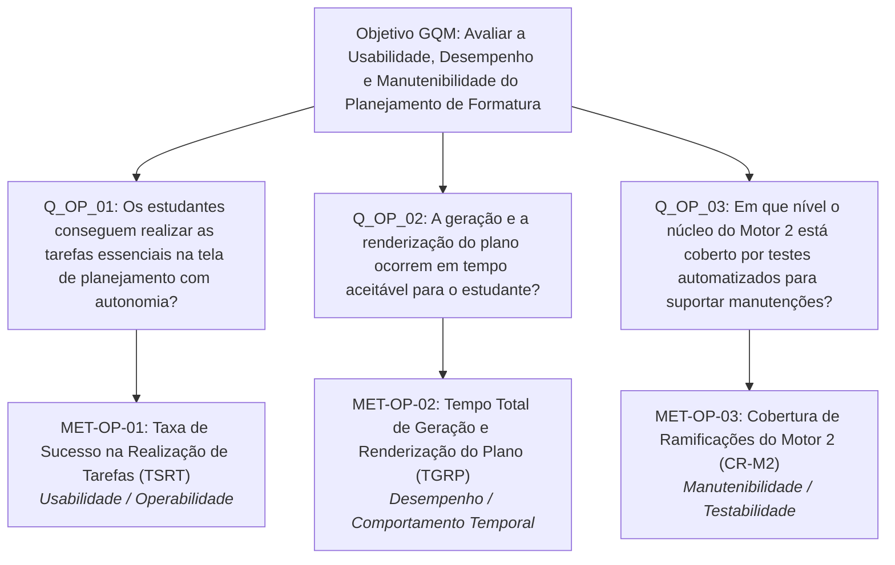

# Especificação da Avaliação — Métricas Operacionais (Pessoa 2)

Documentação das perguntas e métricas operacionais desenvolvidas sob o método **Goal-Question-Metric (GQM)** para as características de **Usabilidade**, **Eficiência de Desempenho** e **Manutenibilidade**, com foco na funcionalidade *Planejar formatura* do No Fluxo UnB.

---

## 1. Contexto e Alinhamento com a Etapa Inicial

A formulação das métricas operacionais decorre da análise conjunta de:

1. **Perfis de Usuários ([Propósito e Stakeholders](../fase1/propositoEStakeholders.md)):**
   - *Aluno concluinte:* necessita identificar rapidamente o semestre de formatura previsto e conferir pendências críticas.
   - *Aluno de meio de curso / com reprovações:* necessita compreender a ordem das disciplinas críticas e simular limites de créditos para equilibrar sua rotina.
   - *Mantenedores do software (Crianex):* necessitam de garantia de que o código do Motor 2 é sustentável, modular e testável para acolher correções e novas regras acadêmicas.
2. **Decisões a Apoiar:**
   - Determinar se o aluno consegue utilizar a tela de forma autônoma, sem necessidade de orientação externa da coordenação para manipular o planejamento.
   - Identificar se o tempo de resposta e renderização do plano viabiliza o uso interativo sem frustração ou desistência.
   - Mapear a cobertura de testes do Motor 2 para subsidiar a escolha e implementação da ação de melhoria da equipe.
3. **Escopo e Limites Operacionais ([Escopo](../fase1/escopo.md)):**
   - Avaliação concentrada na rota `/plano-formatura`, no endpoint `POST /planejamento/gerar-plano` e no arquivo de regras do Motor 2 (`backend/src/services/plano_formatura.service.ts`).
   - Exclusão de testes de carga em produção e utilização restrita de históricos acadêmicos sintéticos.

---

## 2. Estrutura GQM (Goal-Question-Metric)

### 2.1 Objetivo Geral da Avaliação (Nível Conceitual)

De acordo com o template formal do GQM:

| Elemento GQM | Descrição do Objetivo |
| :--- | :--- |
| **Objeto** | A funcionalidade *Planejar formatura* (Motor 2 e interface de planejamento) do software No Fluxo UnB. |
| **Propósito** | **Avaliar** a qualidade em uso e a qualidade interna do produto. |
| **Foco** | As características de **Usabilidade**, **Eficiência de Desempenho** e **Manutenibilidade** (em consonância com a Adequação Funcional avaliada pela Pessoa 1). |
| **Ponto de Vista** | Dos **estudantes de graduação da UnB** (usuários finais) e dos **mantenedores da Crianex / equipe de desenvolvimento**. |
| **Contexto** | Execução em ambiente web desktop moderno, com dados curriculares da Engenharia de Software da FGA/UnB e histórico sintético de disciplinas. |

### 2.2 Desdobramento em Perguntas e Métricas

---

## 3. Fichas Completas das Métricas Operacionais

Cada métrica está especificada conforme os cinco elementos metodológicos exigidos: **Definição**, **Procedimento de cálculo**, **Fonte dos dados**, **Procedimento de coleta** e **Critérios de interpretação**.

---

### Ficha da Métrica MET-OP-01: Taxa de Sucesso na Realização de Tarefas

| Campo | Especificação |
| :--- | :--- |
| **Identificador** | `MET-OP-01` |
| **Nome da Métrica** | Taxa de Sucesso na Realização de Tarefas (TSRT) |
| **Característica ISO/IEC 25010** | Usabilidade — Subcaracterística: Operabilidade (*Operability*) e Apreensibilidade (*Learnability*) |
| **Pergunta GQM Relacionada** | `Q_OP_01`: Os estudantes conseguem realizar as tarefas essenciais na tela de planejamento com autonomia? |
| **1. Definição** | Mede a proporção de participantes que concluem com êxito cada uma das tarefas padronizadas na tela de planejamento de formatura sem receber ajuda externa do avaliador. A unidade de medida é expressa em porcentagem (%). |
| **2. Procedimento de Cálculo** | Para cada tarefa específica $j$ ($j \in \{T_1, T_2, T_3\}$), a taxa de sucesso é dada por:  $$TSRT_j = \left( \frac{N_{\text{sucesso\_sem\_ajuda}, j}}{N_{\text{tentativas\_validas}, j}} \right) \times 100$$ Onde: - $N_{\text{sucesso\_sem\_ajuda}, j}$: quantidade de participantes que concluíram a tarefa $j$ atendendo ao critério de sucesso objetivo sem intervenção do avaliador. - $N_{\text{tentativas\_validas}, j}$: número total de tentativas válidas registradas para a tarefa $j$.  A taxa global de sucesso da sessão é a média aritmética das tarefas avaliadas: $$TSRT_{\text{global}} = \frac{1}{K} \sum_{j=1}^{K} TSRT_j$$ |
| **3. Fonte dos Dados** | Folhas de observação e planilha padronizada de registro das sessões de teste de usabilidade, consolidadas a partir da observação direta e/ou gravação de tela com áudio (com consentimento dos participantes). |
| **4. Procedimento de Coleta** | 1. Recrutar uma amostra de conveniência de no mínimo 5 estudantes de graduação da UnB (abrangendo perfis iniciantes, intermediários e avançados). 2. Fornecer ao participante o acesso ao ambiente de teste com conta autenticada e histórico sintético pré-carregado. 3. Instruir o participante a executar 3 tarefas consecutivas sem interferência prévia: &nbsp;&nbsp;&nbsp;&nbsp;• **Tarefa T1:** Localizar na interface e enunciar qual é o semestre previsto de formatura calculado. &nbsp;&nbsp;&nbsp;&nbsp;• **Tarefa T2:** Identificar quais disciplinas foram sinalizadas como matérias críticas e em qual semestre futuro foram alocadas. &nbsp;&nbsp;&nbsp;&nbsp;• **Tarefa T3:** Ajustar o controle de limite de créditos por semestre para um valor determinado (ex.: 20 créditos) e solicitar a atualização do plano. 4. O avaliador registra silenciosamente se o participante concluiu sozinho (1), precisou de auxílio para destravar (0) ou desistiu/errou a informação (0). 5. Anotar hesitações, comentários espontâneos e dúvidas manifestadas pelo usuário. |
| **5. Critérios de Interpretação** | - **Meta esperada de aceitação:** $TSRT_j \ge 80\%$ para cada tarefa individual e $TSRT_{\text{global}} \ge 85\%$. Esse patamar é amplamente consolidado na literatura de usabilidade (Sauro & Lewis) como indicador de boa operabilidade. - **Alerta / Necessidade de Intervenção ($60\% \le TSRT < 80\%$):** Tarefa com atrito considerável. Requer revisão nos elementos de affordance visual ou legibilidade textual. - **Resultado Inaceitável ($TSRT < 60\%$):** Indica falha grave de usabilidade (ex.: o usuário não encontra o controle deslizante ou confunde matérias críticas com pendentes comuns). Gera subsídio imediato para a proposta de melhoria na Fase 4. |

---

### Ficha da Métrica MET-OP-02: Tempo Total de Geração e Renderização do Plano

| Campo | Especificação |
| :--- | :--- |
| **Identificador** | `MET-OP-02` |
| **Nome da Métrica** | Tempo Total de Geração e Renderização do Plano (TGRP) |
| **Característica ISO/IEC 25010** | Eficiência de Desempenho — Subcaracterística: Comportamento Temporal (*Time Behaviour*) |
| **Pergunta GQM Relacionada** | `Q_OP_02`: A geração e a renderização do plano ocorrem em tempo aceitável para o estudante? |
| **1. Definição** | Mede o intervalo de tempo transcorrido desde o acionamento do comando de geração do plano no frontend até a conclusão da renderização gráfica interativa do grafo de disciplinas no DOM do navegador. A unidade de medida é expressa em segundos (s) ou milissegundos (ms). |
| **2. Procedimento de Cálculo** | O tempo total de uma execução $i$ é composto por:  $$TGRP_i = T_{\text{fim\_renderizacao}, i} - T_{\text{disparo\_requisicao}, i}$$  Sendo decomposto analiticamente em: - $T_{\text{backend}}$: Latência de rede + processamento da rota `POST /planejamento/gerar-plano` (Time to First Byte + Download do payload JSON). - $T_{\text{frontend}}$: Tempo consumido pelo navegador para analisar os dados, construir o grafo e finalizar o repaint do DOM.  Para um conjunto de $N$ repetições ($N \ge 10$) sob o mesmo cenário padronizado de teste, calculam-se: - **Mediana ($\tilde{T}$):** medida principal de tendência central, resiliente a picos isolados de rede. - **Percentil 95 ($P_{95}$) ou Tempo Máximo ($T_{\max}$):** indicador do pior cenário enfrentado pelo usuário. - **Desvio Padrão ($s$):** dispersão temporal das execuções. |
| **3. Fonte dos Dados** | Ferramenta de desenvolvedor do navegador (Google Chrome DevTools — abas *Network* e *Performance*) ou instrumentação com a Navigation/User Timing API (`performance.now()`). |
| **4. Procedimento de Coleta** | 1. Configurar o computador de teste com navegador Google Chrome (versão estável) em janela anônima e sem extensões ativas. 2. Abrir o DevTools, desativar o cache de requisições (*Disable cache*) e manter a conexão de rede sem throttling artificial (ou documentar se for simulado 4G). 3. Carregar o cenário de teste padrão com histórico sintético intermediário (aluno com aproximadamente 50% do curso concluído). 4. Iniciar a medição no momento do clique no botão "Planejar formatura" ou "Gerar plano". 5. Capturar o tempo de requisição de rede (`POST /planejamento/gerar-plano`) e o timestamp em que o componente do grafo finaliza sua renderização visual. 6. Executar o procedimento 10 vezes consecutivas, aguardando um intervalo de 10 segundos entre cada execução para respeitar o limite de 120 req/min da API. 7. Registrar os 10 valores em tabela e calcular a mediana, o desvio e o valor máximo. |
| **5. Critérios de Interpretação** | - **Meta esperada de excelência:** Mediana $\le 2{,}0$ s ($2000\text{ ms}$). De acordo com os padrões de Nielsen e Google Web Vitals, respostas abaixo de 2 segundos mantêm a sensação de resposta instantânea e alta responsividade. - **Limite aceitável (tolerância):** $2{,}0\text{ s} < \text{Mediana} \le 4{,}0\text{ s}$, desde que a interface forneça feedback visual imediato de processamento (indicador de carregamento ou *skeleton screen*). - **Inaceitável / Desempenho Crítico:** Mediana $> 4{,}0\text{ s}$ ou $P_{95} > 6{,}0\text{ s}$. Denota gargalo computacional no algoritmo heurístico do Motor 2 ou lentidão na renderização do grafo de nós no Svelte, justificando investigação e otimização técnica. |

---

### Ficha da Métrica MET-OP-03: Cobertura de Ramificações do Motor 2

| Campo | Especificação |
| :--- | :--- |
| **Identificador** | `MET-OP-03` |
| **Nome da Métrica** | Cobertura de Ramificações do Motor 2 (CR-M2) |
| **Característica ISO/IEC 25010** | Manutenibilidade — Subcaracterística: Testabilidade (*Testability*) e Modularidade |
| **Pergunta GQM Relacionada** | `Q_OP_03`: Em que nível o núcleo do Motor 2 está coberto por testes automatizados para suportar manutenções? |
| **1. Definição** | Percentual de ramificações condicionais de decisão (*branches* — estruturas `if/else`, operadores ternários, `switch/case`) exercitadas pela suíte de testes automatizados do backend especificamente no arquivo do serviço do Motor 2 (`backend/src/services/plano_formatura.service.ts`). Complementada pela medição de Cobertura de Linhas (CL-M2). |
| **2. Procedimento de Cálculo** | O cálculo é realizado pela ferramenta de instrumentação de cobertura de testes (Istanbul / c8 / Vitest Coverage):  $$CR\text{-}M2 = \left( \frac{B_{\text{exercitadas}}}{B_{\text{totais}}} \right) \times 100$$  $$CL\text{-}M2 = \left( \frac{L_{\text{exercitadas}}}{L_{\text{totais}}} \right) \times 100$$ Onde: - $B_{\text{exercitadas}}$: número de ramificações percorridas ao menos uma vez durante a execução dos testes automatizados. - $B_{\text{totais}}$: número total de ramificações identificadas no arquivo alvo. - $L_{\text{exercitadas}}$ e $L_{\text{totais}}$: linhas executadas em relação ao total de linhas instrumentáveis. |
| **3. Fonte dos Dados** | Relatório de cobertura (*Coverage Report*) gerado localmente pelo test runner do backend no commit de referência `87b5475` do repositório oficial. |
| **4. Procedimento de Coleta** | 1. Obter o repositório `unb-mds/2025-1-NoFluxoUnB` no commit `87b5475`. 2. Acessar o subdiretório `backend/` e preparar o ambiente de execução com Node.js versão 20.x e dependências instaladas (`npm install`). 3. Identificar os arquivos de teste unitários/integração relacionados ao Motor 2 (ex.: testes em `backend/src/services/__tests__/` ou `backend/tests/`). 4. Executar o script de teste com flags de cobertura isolada para o serviço de planejamento, por exemplo: &nbsp;&nbsp;&nbsp;&nbsp;`npm run test -- --coverage --collectCoverageFrom="src/services/plano_formatura.service.ts"` 5. Coletar os valores percentuais exibidos na tabela de resumo do console e abrir o relatório HTML detalhado (`coverage/lcov-report/index.html`). 6. Identificar quais blocos condicionais não foram cobertos (ex.: lógica de desempate, tratamento de equivalências ou semestres atípicos). |
| **5. Critérios de Interpretação** | - **Interpretação Exploratória e Meta Técnica da Equipe:** &nbsp;&nbsp;&nbsp;&nbsp;• Meta satisfatória: $CR\text{-}M2 \ge 70\%$ e $CL\text{-}M2 \ge 80\%$. Indica que a maioria dos caminhos lógicos do algoritmo está protegida por testes regressivos, permitindo à equipe realizar correções com segurança. &nbsp;&nbsp;&nbsp;&nbsp;• Alerta de vulnerabilidade de manutenção ($40\% \le CR\text{-}M2 < 70\%$): Existem caminhos de exceção desprotegidos. Qualquer alteração no código para corrigir defeitos (como co-requisitos) exigirá a criação prévia de novos testes de unidade. &nbsp;&nbsp;&nbsp;&nbsp;• Nível crítico de manutenibilidade ($CR\text{-}M2 < 40\%$): O componente central opera quase como uma "caixa preta" sem validação automatizada contínua, elevando o risco de efeitos colaterais indesejados a cada modificação. |

---

## 4. Protocolo de Coleta e Registro das Condições de Teste

Para assegurar a reprodutibilidade dos resultados conforme preconiza o processo SQuaRE (ISO/IEC 25040), a coleta deve obedecer aos seguintes protocolos formais:

### 4.1 Ficha de Registro de Condições de Teste (Ambiente)

Toda sessão de medição deve ser precedida pelo registro do ambiente de execução na tabela abaixo:

| Parâmetro | Valor Registrado na Sessão |
| :--- | :--- |
| **Data e Horário da Coleta** | [Ex.: 16/10/2026 às 14:30 BRT] |
| **Versão / Commit do Software** | Commit `87b5475` (repositório) / Instância `no-fluxo.crianex.com` |
| **Ambiente de Hardware** | Processador (CPU), Memória RAM e Arquitetura do equipamento |
| **Sistema Operacional** | Linux Ubuntu 22.04 LTS / Windows 11 / macOS |
| **Navegador e Versão** | Google Chrome v129.x (64 bits) |
| **Resolução de Tela** | 1920 × 1080 (Full HD) em tela maximizada |
| **Conexão de Rede** | Banda larga fixa (informar velocidade e latência média via ping) |
| **Responsável pela Coleta** | Pessoa 2 (Artur Fernandes Galdino) |

### 4.2 Protocolo para Coleta de Usabilidade (MET-OP-01)

1. **Recrutamento:** Convidar 5 alunos voluntários de cursos de graduação da UnB com diferentes níveis de familiaridade com o No Fluxo UnB.
2. **Termo e Ética:** Esclarecer que o objeto de avaliação é o software e não o participante, garantindo o anonimato das observações.
3. **Template de Registro da Sessão:**

| ID Part. | Perfil Curricular | Tarefa T1 (Previsão) | Tarefa T2 (Críticas) | Tarefa T3 (Ajuste Créditos) | Observações / Dificuldades Observadas |
| :---: | :--- | :---: | :---: | :---: | :--- |
| P01 | Concluinte | [1 = Sucesso / 0 = Falha] | [1 / 0] | [1 / 0] | [Relato livre de hesitações] |
| P02 | Meio de curso | [1 / 0] | [1 / 0] | [1 / 0] | [...] |
| P03 | Reprovações no fluxo | [1 / 0] | [1 / 0] | [1 / 0] | [...] |
| P04 | Calouro / 2º semestre | [1 / 0] | [1 / 0] | [1 / 0] | [...] |
| P05 | Concluinte | [1 / 0] | [1 / 0] | [1 / 0] | [...] |

### 4.3 Protocolo para Coleta de Eficiência de Desempenho (MET-OP-02)

1. **Padronização da Entrada:** Utilizar o histórico sintético padrão de Engenharia de Software (50% concluído, sem pendências anômalas).
2. **Execução:**
   - Abrir a aba *Network* e *Performance* do DevTools.
   - Disparar a requisição de geração do plano.
   - Registrar o tempo de resposta da rota `POST /planejamento/gerar-plano` e o tempo até o fim da renderização visual do grafo.
   - Aguardar 10 segundos antes da próxima repetição.
3. **Template de Registro de Tempos (10 repetições):**

| Repetição | Tempo de Backend / API (ms) | Tempo de Renderização DOM (ms) | Tempo Total TGRP (ms) | Status / Observações |
| :---: | :---: | :---: | :---: | :--- |
| R01 | | | | Normal |
| R02 | | | | Normal |
| ... | | | | |
| R10 | | | | Normal |
| **Mediana** | | | | **Indicador Central** |
| **P95 / Máx** | | | | **Pior caso** |

### 4.4 Protocolo para Coleta de Manutenibilidade (MET-OP-03)

1. Executar os testes automatizados com o utilitário de cobertura do backend.
2. Salvar o log textual completo gerado no terminal.
3. Armazenar a captura de tela ou o snapshot do arquivo HTML de cobertura (`coverage/index.html`).
4. Extrair os valores consolidados para a tabela:

| Componente Avaliado | Linhas Instrumentadas | Linhas Cobertas | % Linhas (CL) | Ramificações Totais | Ramificações Cobertas | % Ramificações (CR) |
| :--- | :---: | :---: | :---: | :---: | :---: | :---: |
| `plano_formatura.service.ts` | | | | | | |
| **Total do Módulo Motor 2** | | | | | | |

---

## 5. Integração com a Pessoa 1 (Qualidade Funcional)

A validade da avaliação da funcionalidade *Planejar formatura* depende do cruzamento contínuo entre as métricas funcionais (Pessoa 1) e operacionais (Pessoa 2):

| Situação de Cruzamento | O que Significa | Ação Decorrente |
| :--- | :--- | :--- |
| **Desempenho Rápido + Alta Violação Funcional** | O algoritmo é rápido porque adota heurísticas simplistas ou ignora restrições obrigatórias (ex.: pula checagem de co-requisitos). | A agilidade não pode mascarar a falta de confiabilidade acadêmica. Priorizar correção do algoritmo. |
| **Alta Usabilidade + Plano Incorreto** | O aluno confia na interface atraente e na facilidade de navegação, mas recebe um plano que atrasará sua formatura. | Risco gravíssimo aos estudantes. Necessidade de alertas explícitos de validação até que o Motor 2 seja corrigido. |
| **Baixa Cobertura de Testes + Regras Complexas** | O Motor 2 tem regras intrincadas de pré-requisitos, mas não possui testes unitários suficientes para validar todos os casos de borda. | Orienta diretamente a equipe na Entrega 2 a criar testes automatizados e refatorar o serviço antes de propor alterações. |

A cadeia completa:
$$\text{Objetivo GQM} \longrightarrow \text{Perguntas} \longrightarrow \text{Métricas} \longrightarrow \text{Dados Coletados} \longrightarrow \text{Interpretação e Decisão}$$
assegura conformidade irrestrita com a norma ISO/IEC 25040 e os critérios acadêmicos do projeto.

---

## Histórico de versão

| Nome do Membro | Contribuição | Data | Commit |
| :--- | :--- | :--- | :--- |
| [Artur Fernandes Galdino](https://github.com/Gotc2607) | Elaboração das perguntas GQM operacionais, fichas completas das métricas e protocolo de teste | 16/10 | [f8219c0](https://github.com/FCTE-Qualidade-de-Software-1/2026-2_T02_JEAN_SAMMET/commit/f8219c0) |
