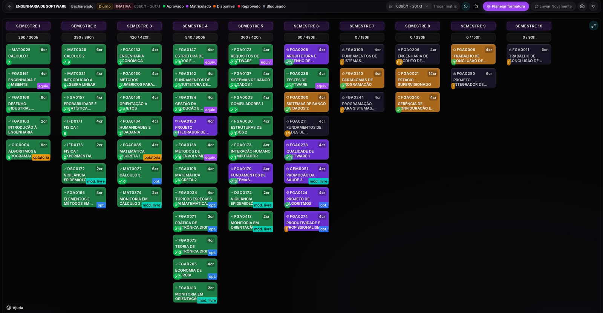

# Escopo da Avaliação

A avaliação se concentrará no fluxo de planejamento de formatura do No Fluxo UnB, composto por três etapas:

1. **Enviar o histórico (Figura 1):** o estudante envia o PDF do histórico oficial da UnB ou preenche os dados manualmente.
2. **Visualizar o fluxograma (Figura 2):** o sistema apresenta a matriz curricular e indica a situação das disciplinas já cursadas e das que faltam.
3. **Planejar formatura (Figura 3):** ao clicar em **“Planejar formatura”**, o sistema gera uma sequência de disciplinas prevista até a formatura. **Esta tela é o objeto central da avaliação.**

*Figura 1 — Tela de importação do histórico. Fonte: captura de tela do No Fluxo UnB, outubro de 2026.*

*Figura 2 — Fluxograma da matriz curricular com a situação das disciplinas. Fonte: captura de tela do No Fluxo UnB, outubro de 2026.*

*Figura 3 — Tela “Planejar formatura”. Fonte: captura de tela do No Fluxo UnB, outubro de 2026.*

## O que será avaliado

| Característica | Objeto e profundidade da avaliação |
|---|---|
| **Adequação Funcional** | Para cenários predefinidos e uma matriz curricular de referência, comparar o plano gerado com os resultados esperados e verificar se as disciplinas e a sequência respeitam as regras consideradas no teste. O envio do histórico e o fluxograma serão usados para preparar e conferir as entradas. |
| **Usabilidade** | Solicitar a participantes que percorram o fluxo, gerem um plano e interpretem a previsão de formatura, os semestres restantes e as matérias críticas. Registrar conclusão das tarefas, erros e necessidade de ajuda. |
| **Segurança** | Fazer verificações não invasivas do acesso ao fluxo e do tratamento observável do histórico. Quando pertinente, consultar o código público. Não serão testados acessos não autorizados nem exploradas vulnerabilidades. |

O foco funcional será um conjunto pequeno de casos controlados para o curso de Engenharia de Software, que aparece nas capturas de tela. A avaliação não pretende cobrir exaustivamente todos os cursos ou históricos possíveis. O ambiente, a versão e os dados usados serão registrados para que os resultados possam ser interpretados.

## O que fica fora — e por quê

| Exclusão | Justificativa |
|---|---|
| **Testes de penetração, exploração de vulnerabilidades ou tentativa de contornar autenticação** | A equipe não dispõe de autorização explícita para realizar ataques. Essas ações podem comprometer dados ou a disponibilidade do serviço; serão feitas apenas observações e inspeções não invasivas. |
| **Testes de carga ou estresse na aplicação em produção** | O ambiente é utilizado por terceiros e a equipe não controla sua infraestrutura. Cargas artificiais podem afetar usuários reais; portanto, esses testes não são necessários para responder às perguntas centrais. |
| **Todos os cursos, matrizes e combinações de histórico** | A quantidade de combinações é ampla para o prazo do trabalho. Uma matriz e cenários sintéticos selecionados permitem uma avaliação repetível, mas limitam a generalização dos resultados. |
| **Todos os navegadores, dispositivos e condições de rede** | Uma avaliação multiplataforma extensa ampliaria o esforço e dificultaria controlar as condições. Os resultados se restringirão ao ambiente registrado durante os testes. |
| **Qualidade das respostas do chatbot e de outras funções de IA** | São funcionalidades auxiliares, dependem de componentes externos e não são necessárias para avaliar o planejamento de formatura escolhido como foco. |
| **Históricos reais de terceiros e dados pessoais sem autorização** | O uso não é necessário para os testes e criaria riscos de privacidade. Serão usados históricos sintéticos ou dados de teste autorizados. |
| **Auditoria formal, certificação ou conclusão de conformidade legal** | O trabalho é uma avaliação acadêmica limitada, não uma auditoria especializada; seus métodos e resultados não sustentam uma certificação. |

## Limites de validade dos resultados

- **Adequação funcional:** os resultados serão válidos para os casos executados e para a matriz curricular de referência; não demonstrarão a correção de todos os cursos ou históricos.
- **Usabilidade:** os achados descreverão os participantes e o ambiente testados. Uma amostra pequena não representa todos os estudantes da UnB.
- **Segurança:** a ausência de problemas observados não prova ausência de vulnerabilidades, pois não haverá testes invasivos nem auditoria completa.
- **Versão do produto:** o site em execução pode diferir do código público. A equipe registrará data, ambiente e, ao analisar o código, o commit examinado.

**Premissas de execução:** serão utilizados históricos sintéticos ou autorizados; as tarefas e os resultados esperados serão definidos antes dos testes; e toda verificação será realizada em ambiente e funcionalidades de acesso autorizado.

---

## Histórico de versão

| Nome do Membro | Contribuição | Data | Commit |
| :--- | :--- | :--- | :--- |
| [Gustavo Fornaciari](https://github.com/GUGOFO) | Criação do molde da página | 15/10 | [828688f](https://github.com/FCTE-Qualidade-de-Software-1/2026-2_T02_JEAN_SAMMET/commit/828688feb645eebfcd428e11b4b9f87585253b9b) |
| [Giovani De Oliveira Teodoro Coelho](https://github.com/Gotc2607) | Detalhamento inicial do escopo operacional, exclusões, limites e premissas | 16/10 | [106ddd5](https://github.com/FCTE-Qualidade-de-Software-1/2026-2_T02_JEAN_SAMMET/commit/106ddd54ca773213a62318d809bc06db010d8232) |
| [Gustavo Fornaciari](https://github.com/GUGOFO) | Atualização da pagina | 16/10 | [a6af5fc](https://github.com/FCTE-Qualidade-de-Software-1/2026-2_T02_JEAN_SAMMET/commit/a6af5fc9dd7113834f334660210ce67b31465d0a) |