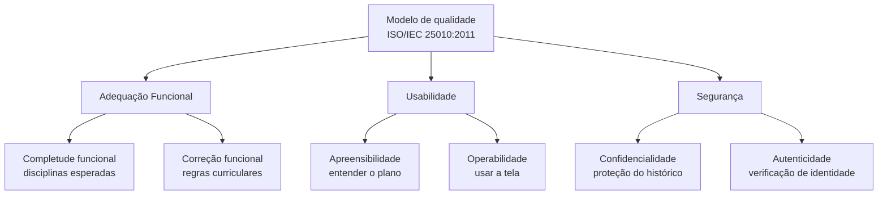

# Modelo de Qualidade

## 1. Modelo adotado

Usaremos como referência o modelo de qualidade de produto da **ISO/IEC 25010:2011 (SQuaRE)**. A avaliação não cobrirá todas as características da norma: ficará restrita a **Adequação Funcional, Usabilidade e Segurança**.

## 2. Aplicação ao No Fluxo UnB

As subcaracterísticas abaixo detalham o que será observado dentro de cada característica escolhida. Elas não são características principais adicionais.

| Característica | Subcaracterísticas em foco | Aplicação ao fluxo “Planejar formatura” |
|---|---|---|
| **Adequação Funcional** | Completude funcional e correção funcional | Verificar se o plano contempla as disciplinas esperadas e se a sequência é consistente com as regras curriculares usadas como referência. Isso atende à necessidade do estudante de planejar sua trajetória acadêmica. |
| **Usabilidade** | Apreensibilidade e operabilidade | Verificar se o estudante consegue entender as informações apresentadas e usar a tela para gerar e interpretar o plano, incluindo semestres previstos e matérias críticas. |
| **Segurança** | Confidencialidade e autenticidade | Observar, de forma não invasiva, o acesso ao fluxo e o tratamento do histórico acadêmico enviado. Isso é relevante porque o histórico pode conter informações pessoais; a inspeção não comprovará ausência de vulnerabilidades. |

## 3. Representação gráfica

*Figura 6 — Modelo de qualidade adaptado ao fluxo “Planejar formatura”. Fonte: elaboração da equipe com base na ISO/IEC 25010:2011.*

A seleção e a priorização das três características estão explicadas em [Características de Qualidade](caracteristicasDeQualidade.md). Os limites práticos da avaliação estão descritos em [Escopo](escopo.md).

---

## Histórico de versão

| Nome do Membro | Contribuição | Data | Commit |
| :--- | :--- | :--- | :--- |
| [Gustavo Fornaciari](https://github.com/GUGOFO) | Criação do molde da página | 15/10 | [828688f](https://github.com/FCTE-Qualidade-de-Software-1/2026-2_T02_JEAN_SAMMET/commit/828688feb645eebfcd428e11b4b9f87585253b9b) |
| [Giovani De Oliveira Teodoro Coelho](https://github.com/Gotc2607) | Definição inicial das adaptações do modelo, subcaracterísticas e diagrama | 16/10 | [106ddd5](https://github.com/FCTE-Qualidade-de-Software-1/2026-2_T02_JEAN_SAMMET/commit/106ddd54ca773213a62318d809bc06db010d8232) |
| [Gustavo Fornaciari](https://github.com/GUGOFO) | Atualização da pagina | 16/10 | [a6af5fc](https://github.com/FCTE-Qualidade-de-Software-1/2026-2_T02_JEAN_SAMMET/commit/a6af5fc9dd7113834f334660210ce67b31465d0a) |
