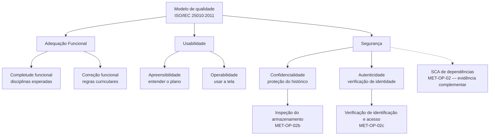

# Modelo de Qualidade

## 1. Modelo adotado

Adotamos como referência o modelo de qualidade de produto da **ISO/IEC 25010:2011 (SQuaRE)**. A avaliação não cobrirá todas as características da norma: ficará restrita a **Adequação Funcional, Usabilidade e Segurança**.

## 2. Aplicação ao No Fluxo UnB

As subcaracterísticas abaixo detalham o que será observado dentro de cada característica escolhida. Elas não são características principais adicionais.

**Tabela 1 — Aplicação ao No Fluxo UnB.**

| Característica | Subcaracterísticas em foco | Aplicação ao fluxo “Planejar formatura” |
| --- | --- | --- |
| **Adequação Funcional** | Completude funcional e correção funcional | Verificar se o plano contempla as disciplinas esperadas e se a sequência é consistente com as regras curriculares usadas como referência. Isso atende à necessidade do estudante de planejar sua trajetória acadêmica. |
| **Usabilidade** | Apreensibilidade e operabilidade | Inspecionar, com heurísticas de usabilidade, possíveis dificuldades para entender as informações e operar a tela de planejamento, incluindo semestres previstos e matérias críticas. |
| **Segurança** | Confidencialidade e autenticidade | Inspecionar o armazenamento do histórico, a identificação e o acesso ao fluxo. Examinar dependências como evidência complementar de riscos aos dados e serviços. |

*Fonte: elaboração da equipe, conforme os registros e referências desta página.*

### 2.1 Verificações associadas ao modelo

**Tabela 2 — Verificações associadas ao modelo.**

| Verificação | Relação com o modelo | Evidência prevista |
| --- | --- | --- |
| Armazenamento no navegador (`MET-OP-02b`) | Confidencialidade dos dados acadêmicos. | Chaves e valores inspecionados em `localStorage`, `sessionStorage` e cookies. |
| Identificação e acesso (`MET-OP-02c`) | Autenticidade e verificação das permissões exigidas pelo serviço. | Respostas da rota e do método validados antes do teste. |
| Dependências (`MET-OP-02`) | Evidência complementar de riscos aos dados e serviços. | Relatório SCA com componentes, versões, ferramenta e cobertura. |

*Fonte: elaboração da equipe, conforme os registros e referências desta página.*

“Integridade da cadeia de dependências” é um recorte da equipe, não uma subcaracterística adicional da norma. A análise se limita aos componentes examinados.

A inspeção heurística identifica possíveis problemas de uso; não mede diretamente a aprendizagem ou o desempenho dos estudantes. Os métodos e critérios estão nas fichas de [Usabilidade](../fase2/operacionais/usabilidade.md) e [Segurança](../fase2/operacionais/seguranca.md).

## 3. Representação gráfica

A Figura 1 apresenta o diagrama desta seção.

*Figura 1 — Modelo adaptado ao fluxo “Planejar formatura”. A ligação tracejada indica evidência complementar. Fonte: equipe, com base na ISO/IEC 25010:2011.*

A seleção e a priorização das três características estão explicadas em [Características de Qualidade](caracteristicasDeQualidade.md). Os limites práticos da avaliação estão descritos em [Escopo](escopo.md).

## 4. Referências

Referências usadas nesta página, conforme [Referências — Fase 1](../../referencias/fase1.md), [Referências — Fase 2](../../referencias/fase2.md) e [Referências — Fase 3](../../referencias/fase3.md).

- INTERNATIONAL ORGANIZATION FOR STANDARDIZATION. **ISO/IEC 25010:2011: Systems and software engineering — Systems and software Quality Requirements and Evaluation (SQuaRE) — System and software quality models**. Genebra: ISO, 2011. Disponível em: [ficha da ISO/IEC 25010:2011](https://www.iso.org/standard/35733.html). Acesso em: 15 nov. 2026.
- NIELSEN, Jakob. **10 Usability Heuristics for User Interface Design**. Nielsen Norman Group, 1994. Disponível em: <https://www.nngroup.com/articles/ten-usability-heuristics/>.
- NIELSEN, Jakob. **Heuristic Evaluation**. In: NIELSEN, Jakob; MACK, Robert L. (Org.). *Usability Inspection Methods*. Nova York: John Wiley & Sons, 1994. p. 25-62.

---

## Histórico de versão

| Nome do Membro | Contribuição | Data | Commit |
| :--- | :--- | :--- | :--- |
| [Gustavo Fornaciari](https://github.com/GUGOFO) | Criação do molde da página | 15/10 | [828688f](https://github.com/FCTE-Qualidade-de-Software-1/2026-2_T02_JEAN_SAMMET/commit/828688feb645eebfcd428e11b4b9f87585253b9b) |
| [Giovani De Oliveira Teodoro Coelho](https://github.com/Gotc2607) | Definição inicial das adaptações do modelo, subcaracterísticas e diagrama | 16/10 | [106ddd5](https://github.com/FCTE-Qualidade-de-Software-1/2026-2_T02_JEAN_SAMMET/commit/106ddd54ca773213a62318d809bc06db010d8232) |
| [Gustavo Fornaciari](https://github.com/GUGOFO) | Atualização da pagina | 16/10 | [a6af5fc](https://github.com/FCTE-Qualidade-de-Software-1/2026-2_T02_JEAN_SAMMET/commit/a6af5fc9dd7113834f334660210ce67b31465d0a) |
| [Gustavo Fornaciari](https://github.com/GUGOFO) | Alinhamento do modelo às verificações e aos limites da avaliação | 15/11 | [9c58043](https://github.com/FCTE-Qualidade-de-Software-1/2026-2_T02_JEAN_SAMMET/commit/9c580430791d8e1652c081bcd5a51ddf6a349110) |
| [Yasmim de Souza Santos](https://github.com/eii-yahs) | Inclusão das referências utilizadas na página | 22/11 | Não commitado |