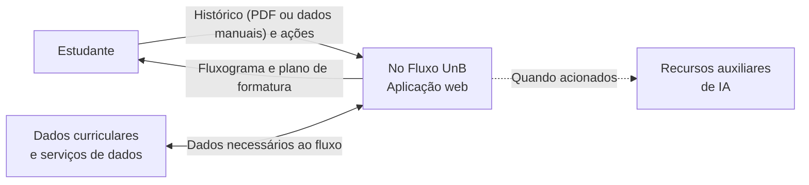
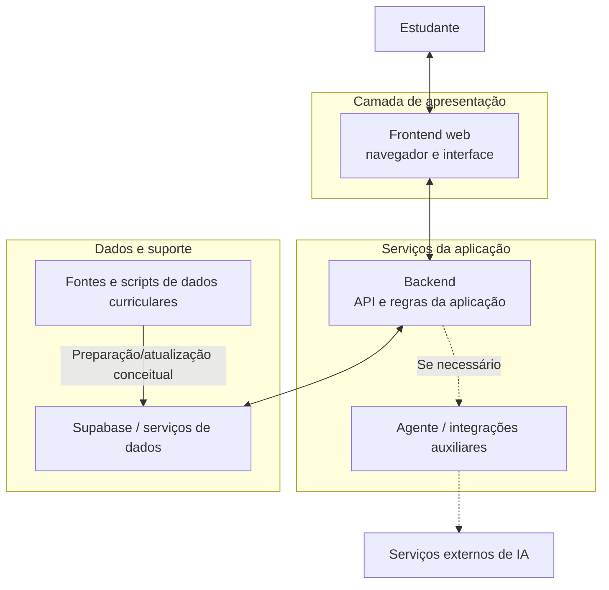

# Software Escolhido: No Fluxo UnB

## 1. Identificação

| Item | Descrição |
|---|---|
| **Nome** | No Fluxo UnB / NoFluxoUNB |
| **Tipo de produto** | Aplicação web de apoio ao planejamento acadêmico |
| **Site** | [no-fluxo.crianex.com](https://no-fluxo.crianex.com) |
| **Repositório analisado** | [unb-mds/2025-1-NoFluxoUNB](https://github.com/unb-mds/2025-1-NoFluxoUNB) |
| **Finalidade** | Apresentar a matriz curricular em um fluxograma interativo e apoiar o estudante na visualização das disciplinas cursadas e no planejamento até a formatura. |

O No Fluxo UnB é acessado pelo navegador. O estudante seleciona o curso, informa seu histórico acadêmico por PDF ou manualmente, visualiza o fluxograma e pode solicitar um plano de formatura. Esta avaliação se concentra nesse fluxo, principalmente no resultado da opção **“Planejar formatura”**. A descrição funcional geral é compatível com o README público do projeto; a organização do repositório também apresenta diretórios para frontend, backend, agente, scripts e migrações do Supabase ([repositório oficial](https://github.com/unb-mds/2025-1-NoFluxoUNB)).

## 2. Recorte do produto

Embora o No Fluxo UnB ofereça outras funcionalidades, esta avaliação examina o fluxo que leva da entrada do histórico ao planejamento de formatura. A tela **“Planejar formatura”** é o objeto central; as etapas anteriores serão consideradas para preparar a entrada e interpretar a saída. As telas estão documentadas em [Escopo](escopo.md).

## 3. Descrição estruturada do produto

### 3.1 Fluxo de uso avaliado

1. **Enviar o histórico:** o estudante envia um PDF ou informa os dados manualmente.
2. **Visualizar o fluxograma:** o sistema apresenta a matriz do curso e a situação das disciplinas.
3. **Planejar formatura:** o sistema gera uma previsão de disciplinas por semestre até a formatura.

O estudante interage pela interface web. O frontend apresenta o fluxograma e os resultados; os serviços da aplicação processam solicitações e dependem dos dados curriculares e dos serviços de suporte utilizados pelo produto. Recursos auxiliares, como funções de IA, não são o foco principal deste estudo.

### 3.2 Módulos

| Módulo identificado no repositório | Responsabilidade geral | Relação com a avaliação |
|---|---|---|
| **Frontend web** ([`frontend/`](https://github.com/unb-mds/2025-1-NoFluxoUNB/tree/main/frontend)) | Interface no navegador para seleção de curso, entrada do histórico, visualização do fluxograma e planejamento. | Principal ponto de observação nos testes de usabilidade e nas verificações funcionais. |
| **Backend** ([`backend/`](https://github.com/unb-mds/2025-1-NoFluxoUNB/tree/main/backend)) | Serviços e regras utilizados pela interface para processar solicitações. A documentação da equipe o identifica como backend TypeScript/Node.js. | Pode auxiliar na investigação de divergências do plano, quando o código relevante estiver disponível. |
| **Dados e autenticação** ([`supabase/`](https://github.com/unb-mds/2025-1-NoFluxoUNB/tree/main/supabase)) | Migrações e estrutura relacionada aos serviços de dados do Supabase. | Pertinente à inspeção não invasiva de controles de acesso e tratamento de dados; não será feita exploração de segurança. |
| **Agente/integrações auxiliares** ([`mcp_agent/`](https://github.com/unb-mds/2025-1-NoFluxoUNB/tree/main/mcp_agent)) | Componentes auxiliares associados a recursos de agente/IA. | Fora do foco central, exceto quando uma dependência for necessária para compreender um comportamento observado. |
| **Scripts** ([`scripts/`](https://github.com/unb-mds/2025-1-NoFluxoUNB/tree/main/scripts)) | Rotinas de apoio, incluindo processamento ou atualização de dados conforme a implementação pública. | Os dados curriculares usados nos testes precisam ter origem e referência conhecidas. |

A tabela descreve os diretórios e as responsabilidades gerais visíveis no repositório; não afirma que todos os módulos participam de cada execução do planejamento.

### 3.3 Interfaces e dependências

| Interface ou dependência | Interação | Limite relevante |
|---|---|---|
| **Navegador ↔ frontend** | O estudante envia ou informa o histórico, navega pelo fluxograma e solicita o plano. | É a interface principal para observar as tarefas e os resultados. |
| **Frontend ↔ serviços de aplicação** | A interface envia solicitações e apresenta as respostas recebidas. | A avaliação externa consegue observar entradas e saídas, mas não inferir todos os estados internos apenas pela interface. |
| **Serviços ↔ dados curriculares e persistência** | O planejamento depende de informações curriculares e, em funções pertinentes, de serviços de dados/autenticação. | Os resultados serão comparados apenas com dados de referência definidos pela equipe. |
| **Recursos de IA e serviços externos** | Podem oferecer funcionalidades auxiliares do produto. | A avaliação da qualidade das respostas de IA e de serviços externos não faz parte do escopo. |

## 4. Diagrama de contexto

O diagrama mostra o produto como uma caixa única e suas principais interações externas. As conexões representam o contexto funcional da avaliação, não um mapa completo de tráfego ou implantação.

*Figura 4 — Diagrama de contexto do No Fluxo UnB. Fonte: elaboração da equipe com base no fluxo observado e na documentação pública do projeto.*

## 5. Diagrama de arquitetura lógica

A arquitetura abaixo organiza os componentes documentados por responsabilidade. As setas indicam relações conceituais; não devem ser interpretadas como confirmação da topologia de produção ou de todas as chamadas realizadas pelo sistema.

*Figura 5 — Visão lógica simplificada dos componentes. Fonte: elaboração da equipe a partir da estrutura pública do repositório; relações internas devem ser confirmadas para a versão efetivamente executada.*

## 6. Implicações para a avaliação

| Característica | O que é possível observar | O que não será possível concluir com este recorte |
|---|---|---|
| **Adequação Funcional** | Comparar planos gerados para cenários controlados com uma matriz curricular e resultados esperados definidos previamente. | Que todos os planos, cursos, históricos ou combinações possíveis estão corretos. |
| **Usabilidade** | Observar se participantes conseguem completar tarefas no fluxo e interpretar as informações da tela de planejamento. | Que os resultados representam todos os estudantes da UnB ou todos os dispositivos. |
| **Segurança** | Fazer inspeção não invasiva do fluxo e dos controles observáveis, usando dados sintéticos e código público quando pertinente. | Que o sistema está livre de vulnerabilidades ou que passou por uma auditoria de segurança. |

## 7. Restrições de execução

- A equipe usará dados sintéticos ou dados de teste autorizados, sem expor históricos de terceiros.
- Não serão realizados testes de invasão, tentativas de contornar autenticação ou testes de carga na aplicação em produção.
- A versão do site e o código público podem divergir; quando houver inspeção do código, a equipe registrará o commit e a data analisados.

## 8. Limitações conhecidas

1. **Representatividade:** os testes cobrirão cenários escolhidos pela equipe, não todas as matrizes curriculares da UnB.
2. **Dependências externas:** falhas ou mudanças em serviços de terceiros podem influenciar o comportamento observado e não serão atribuídas automaticamente ao código do produto.
3. **Visibilidade interna:** a observação pela interface não revela todos os cálculos e estados internos; conclusões sobre o algoritmo exigem evidência adicional no código ou em testes controlados.
4. **Segurança:** uma inspeção limitada identifica apenas aspectos observáveis e não substitui teste de penetração ou auditoria especializada.

---

## Histórico de versão

| Nome do Membro | Contribuição | Data | Commit |
|---|---|---|---|
| [Gustavo Fornaciari](https://github.com/GUGOFO) | Criação do molde da página | 15/10 | [828688f](https://github.com/FCTE-Qualidade-de-Software-1/2026-2_T02_JEAN_SAMMET/commit/828688feb645eebfcd428e11b4b9f87585253b9b) |
| [Gustavo Fornaciari](https://github.com/GUGOFO) | Preenchimento com os dados do No Fluxo UnB | 15/10 | [559e7a9](https://github.com/FCTE-Qualidade-de-Software-1/2026-2_T02_JEAN_SAMMET/commit/559e7a94f159c2caeb4dc9d5996ba9392d0862ac) |
| [Gustavo Fornaciari](https://github.com/GUGOFO) | Atualização da pagina | 16/10 | [a6af5fc](https://github.com/FCTE-Qualidade-de-Software-1/2026-2_T02_JEAN_SAMMET/commit/a6af5fc9dd7113834f334660210ce67b31465d0a) |