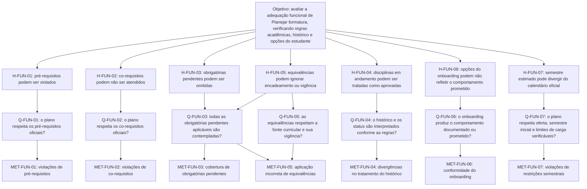

# Métricas funcionais — GQM

## 1. Objetivo da avaliação

| Elemento | Especificação |
|---|---|
| **Objeto** | Funcionalidade *Planejar formatura* do No Fluxo UnB, com foco no Motor 2 e na interface de planejamento. |
| **Propósito** | Avaliar a adequação funcional dos planos gerados. |
| **Foco** | Correção e completude funcional. |
| **Ponto de vista** | Estudantes e equipe responsável pelo produto. |
| **Contexto** | Aplicação web, matriz de Engenharia de Software da FGA/UnB e históricos sintéticos, com regras curriculares oficiais como referência. |

| Elemento GQM       | Descrição do Objetivo                                                                                                                       |
| :----------------- | :------------------------------------------------------------------------------------------------------------------------------------------ |
| **Objeto**         | A funcionalidade _Planejar formatura_ do software No Fluxo UnB.                                       |
| **Propósito**      | **Avaliar** a produto.                                                                            |
| **Foco**           |  **Adequação Funcional**              |
| **Ponto de Vista** | Dos **estudantes de graduação da UnB** e da **equipe de desenvolvimento**.                     |
| **Contexto**       | Execução em ambiente web desktop moderno, com dados curriculares da Engenharia de Software da FGA/UnB e histórico sintético de disciplinas. |

## 2. Diagrama GQM

O diagrama explicita a relação entre o objetivo, as hipóteses que orientam a avaliação, as perguntas e as métricas usadas para respondê-las.

As hipóteses são riscos a verificar, não defeitos confirmados. Os resultados devem ser julgados com base em regras curriculares identificáveis e no comportamento esperado documentado. `H-FUN-05` relaciona-se a `Q-FUN-03` e `Q-FUN-05`, pois uma equivalência inválida ou incompleta pode afetar tanto a lista de pendências quanto a aplicação da regra.

## 3. Hipóteses, perguntas e métricas

| Pergunta | Hipótese associada | Métrica(s) |
|---|---|---|
| `Q-FUN-01` — O plano respeita os pré-requisitos oficiais? | `H-FUN-01`: o plano pode posicionar uma disciplina antes de o pré-requisito ser satisfeito segundo a fonte oficial. | `MET-FUN-01` |
| `Q-FUN-02` — O plano respeita os co-requisitos oficiais? | `H-FUN-02`: disciplinas co-requisitadas podem ser distribuídas sem atender à regra de satisfação simultânea ou prévia aplicável. | `MET-FUN-02` |
| `Q-FUN-03` — Todas as disciplinas obrigatórias pendentes aplicáveis são contempladas? | `H-FUN-03`: o plano pode omitir obrigatórias pendentes mesmo quando a lista de disciplinas não alocadas está vazia. `H-FUN-05` também se aplica, pois equivalências afetam as pendências. | `MET-FUN-03`, `MET-FUN-05` |
| `Q-FUN-04` — O histórico e os status são interpretados conforme as regras documentadas? | `H-FUN-04`: o motor pode tratar disciplinas em andamento como aprovadas no planejamento futuro; é necessário verificar se essa interpretação corresponde à regra definida para o cenário. | `MET-FUN-04` |
| `Q-FUN-05` — As equivalências respeitam a fonte curricular e sua vigência? | `H-FUN-05`: a expansão das equivalências pode ignorar relações encadeadas ou a vigência aplicável. | `MET-FUN-05` |
| `Q-FUN-06` — O onboarding produz o comportamento documentado ou prometido? | `H-FUN-06`: as opções de trabalho/estágio e objetivo podem não produzir o efeito especificado. A expectativa precisa ser confirmada antes de classificar isso como falha. | `MET-FUN-06` |
| `Q-FUN-07` — O plano respeita oferta, semestre inicial e limites de carga verificáveis? | `H-FUN-07`: se a consulta do período letivo falhar, o semestre estimado pela data do sistema pode divergir do calendário oficial e afetar o plano. | `MET-FUN-07` |

As hipóteses devem ser verificadas pelos cenários `CT-01` a `CT-07`, respectivamente. Para `H-FUN-05`, considerar também as evidências coletadas em `CT-03`. Quando a regra oficial ou o comportamento esperado não estiver documentado, registrar a lacuna de especificação, sem presumir sucesso ou defeito.

## 4. Definição das métricas

### `MET-FUN-01` — Violações de pré-requisitos

- **Definição:** percentual de relações aplicáveis violadas — a disciplina dependente é planejada antes de o pré-requisito ser satisfeito, sem equivalência ou exceção válida.
- **Cálculo:** `TVP = (NVP / NRP) × 100`. `NVP` = relações violadas; `NRP` = relações aplicáveis verificadas. Registrar também `NVP`.
- **Dados e coleta:** matriz oficial versionada, regras, histórico sintético e plano gerado. Comparar a situação do pré-requisito com o semestre da disciplina dependente (`CT-01`).
- **Meta e condições:** `TVP = 0%`. Só avaliar relações respaldadas por fonte identificável; se `NRP = 0`, registrar como não aplicável.

### `MET-FUN-02` — Violações de co-requisitos

- **Definição:** percentual de relações de co-requisito não atendidas conforme a regra curricular, considerando se a satisfação deve ocorrer simultaneamente ou pode ser prévia.
- **Cálculo:** `TVC = (NVC / NRC) × 100`. `NVC` = relações violadas; `NRC` = relações aplicáveis verificadas. Registrar também `NVC`.
- **Dados e coleta:** co-requisitos da matriz oficial, histórico sintético e plano por semestre; testar pares pendentes e, quando aplicável, casos em que uma disciplina já foi concluída (`CT-02`).
- **Meta e condições:** `TVC = 0%`. A regra deve vir de fonte oficial; se `NRC = 0`, registrar como não aplicável. A hipótese de falha documentada ainda precisa ser testada.

### `MET-FUN-03` — Cobertura de disciplinas obrigatórias pendentes

- **Definição:** percentual das disciplinas obrigatórias ainda necessárias que aparecem no plano. Aprovação, equivalência ou exceção só retiram uma disciplina da lista quando forem válidas e documentadas.
- **Cálculo:** `CDO = (DPC / DOP) × 100`. `DPC` = disciplinas pendentes contempladas; `DOP` = total de obrigatórias pendentes aplicáveis.
- **Dados e coleta:** cruzar a lista esperada, derivada da matriz e do histórico, com o plano completo; registrar omissões e justificativas (`CT-03`). A lista de “não alocadas”, isoladamente, não comprova completude.
- **Meta e condições:** `CDO = 100%`. Definir antes da coleta como tratar disciplinas sem oferta; se `DOP = 0`, registrar como não aplicável.

### `MET-FUN-04` — Divergências no tratamento do histórico

- **Definição:** percentual de verificações em que o estado considerado pelo plano diverge do esperado para disciplinas aprovadas, pendentes ou em andamento.
- **Cálculo:** `TDH = (NDH / NVH) × 100`. `NDH` = divergências confirmadas; `NVH` = verificações válidas de status.
- **Dados e coleta:** histórico sintético, regras documentadas e plano/interface; comparar o estado esperado e o observado (`CT-04`).
- **Meta e condições:** `TDH = 0%` de divergências não justificadas. A documentação informa que disciplinas em andamento são consideradas aprovadas no planejamento futuro; registrar esse comportamento sem classificá-lo automaticamente como defeito. Se `NVH = 0`, registrar como não aplicável.

### `MET-FUN-05` — Aplicação incorreta de equivalências

- **Definição:** percentual de verificações em que a disciplina satisfeita, a substituta ou o efeito nas pendências diverge da equivalência oficial válida para a matriz e sua vigência.
- **Cálculo:** `TAE = (NEI / NRE) × 100`. `NEI` = aplicações incorretas; `NRE` = relações aplicáveis verificadas.
- **Dados e coleta:** fonte oficial de equivalências, matriz/vigência, histórico e plano; testar casos diretos e casos encadeados ou entre matrizes apenas quando houver respaldo documental (`CT-05`).
- **Meta e condições:** `TAE = 0%`. Sem fonte oficial versionada, a avaliação fica pendente de especificação; se `NRE = 0`, registrar como não aplicável. A hipótese de expansão em uma única passagem orienta os testes, mas não substitui a regra oficial.

### `MET-FUN-06` — Conformidade das opções do onboarding

- **Definição:** percentual de expectativas verificáveis atendidas para as opções de trabalho/estágio, objetivo do planejamento e limite de créditos (8 a 32), conforme o comportamento documentado.
- **Cálculo:** `COO = (NEC / NEV) × 100`. `NEC` = expectativas atendidas; `NEV` = expectativas previamente especificadas e testadas.
- **Dados e coleta:** requisitos e textos da interface, código da versão avaliada e planos de cenários pareados. Manter o histórico fixo e alterar uma opção por vez (`CT-06`).
- **Meta e condições:** `COO = 100%`. Não presumir que toda opção deva alterar as disciplinas selecionadas; comparar o efeito documentado. Não comparar diretamente créditos com o limite interno de 480 horas por semestre. Campo sem comportamento esperado é lacuna de especificação; se `NEV = 0`, manter a métrica pendente.

### `MET-FUN-07` — Violações de restrições semestrais

- **Definição:** percentual de verificações que violam restrições documentadas, como oferta de disciplinas, semestre inicial e limite de carga.
- **Cálculo:** `TVS = (NVS / NRS) × 100`. `NVS` = violações confirmadas; `NRS` = verificações válidas. Calcular por tipo de restrição quando as unidades ou fontes diferirem.
- **Dados e coleta:** calendário e oferta oficiais, limite informado, histórico e plano; comparar cada alocação com a regra aplicável (`CT-07`). Se a consulta ao período letivo falhar, conferir o semestre estimado contra o calendário oficial.
- **Meta e condições:** `TVS = 0%`. Confirmar a fonte e a forma de aferição da carga. Créditos e horas não são equivalentes sem conversão documentada; se `NRS = 0`, registrar como não aplicável.

## Histórico de versão

| Membro | Contribuição | Data | Commit |
|---|---|---|---|
| [Gabriel Mota](https://github.com/Gabro-MO) | Perguntas GQM, métricas e cenários iniciais. | 16/10/2026 | [9306147](https://github.com/FCTE-Qualidade-de-Software-1/2026-2_T02_JEAN_SAMMET/commit/9306147e05a3017e02f9bedaf2c75a8287ef1c8b) |
| [Giovani De Oliveira Teodoro Coelho](https://github.com/Gotc2607) | Consistência do foco GQM e revisão de referências a papéis da equipe. | 16/10/2026 | [81912ba](https://github.com/FCTE-Qualidade-de-Software-1/2026-2_T02_JEAN_SAMMET/commit/81912bac5e02d7429e2d05446544ec9636891f5e) |
| [Gabriel Mota](https://github.com/Gabro-MO) | Divisão do documento em páginas. | 16/10/2026 | [e60f42c](https://github.com/FCTE-Qualidade-de-Software-1/2026-2_T02_JEAN_SAMMET/commit/e60f42cea76bd6f39f2c6069ecdbce438b4e941a) |
