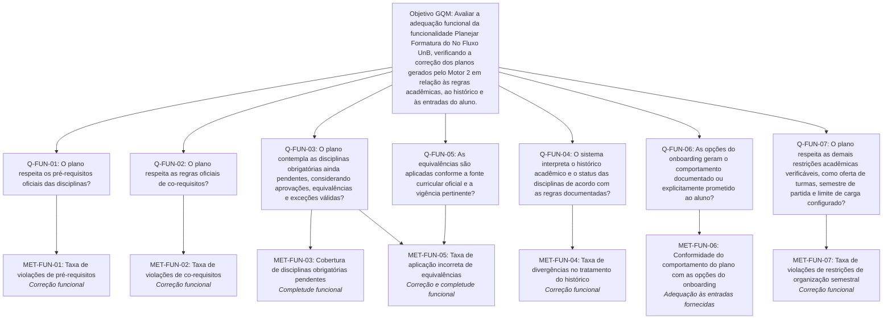

# Especificação da Avaliação — Métricas Funcionais (Pessoa 1)

Este documento especifica as perguntas e métricas de **adequação funcional** para avaliar a funcionalidade _Planejar formatura_ do No Fluxo UnB, com foco no Motor 2. A avaliação procura verificar se os planos gerados são coerentes com o histórico do aluno e com as regras acadêmicas aplicáveis, sem tratar limitações documentadas como defeitos antes da execução dos testes.

A estrutura segue o método **Goal-Question-Metric (GQM)** e complementa as métricas operacionais descritas em [`metricasOperacionais.md`](metricasOperacionais.md).

## 1. Contexto da avaliação

### 1.1 Propósito e decisões apoiadas

O No Fluxo UnB auxilia o estudante a decidir quais disciplinas cursar nos próximos semestres e quando poderá concluir o curso. Na tela _Planejar formatura_, o Motor 2 organiza disciplinas por semestre e apresenta uma previsão de formatura. Um plano com pré-requisitos ignorados, co-requisitos omitidos, disciplinas obrigatórias ausentes ou histórico interpretado incorretamente pode levar a decisões acadêmicas inadequadas e até atrasar a graduação.

A avaliação funcional deve produzir evidências para:

- **Alunos da UnB:** entender em que medida o plano corresponde ao histórico e à matriz curricular e quando precisa ser conferido com a coordenação do curso.
- **Crianex e mantenedores:** localizar comportamentos que merecem correção e priorizar melhorias com base em evidências reproduzíveis.
- **Coordenação e orientação acadêmica:** apoiar a identificação de planos incompatíveis com as regras do curso.
- **Equipe avaliadora e requisitante acadêmica:** fundamentar a avaliação de qualidade do produto e a proposta de melhoria da etapa seguinte.

O plano é uma estimativa produzida por uma heurística e o No Fluxo UnB não é uma ferramenta oficial da UnB. A avaliação não deve apresentar os resultados como garantia institucional de formatura.

### 1.2 Escopo e referência de execução

O objeto funcional principal é o Motor 2, localizado no código de referência como `backend/src/services/plano_formatura.service.ts`, acionado pela rota `POST /planejamento/gerar-plano`.

| Item                      | Referência para a avaliação                                                                                                                                     |
| ------------------------- | --------------------------------------------------------------------------------------------------------------------------------------------------------------- |
| Software                  | No Fluxo UnB, funcionalidade _Planejar formatura_.                                                                                                              |
| Versão do código          | Commit de referência `87b5475`, identificado na documentação da Fase 1.                                                                                         |
| Curso/matriz prioritários | Engenharia de Software da FGA/UnB, matriz identificada na documentação como **6360/1 ou 2017.1**, descrita como inativa no sistema observado.                   |
| Dados de teste            | Históricos sintéticos ou dos membros da equipe e entrevistados que permitirem o uso                                                                             |
| Entradas relevantes       | Histórico e status das disciplinas, matriz curricular, pré-requisitos, co-requisitos, equivalências, oferta de turmas e opções do onboarding.                   |
| Saídas relevantes         | Disciplinas e semestres planejados, matérias pendentes/críticas, semestre previsto de formatura e informações de integralização disponíveis na interface.       |
| Limite de validade        | Os resultados valem para os cenários, a matriz, os dados, a versão e o ambiente registrados. Não provam que a versão em produção é idêntica ao código avaliado. |

### 1.3 Hipóteses funcionais documentadas

Os itens abaixo foram registrados na Fase 1 como **hipóteses que precisam ser testadas**, não como defeitos confirmados.

| Hipótese documentada                                                                                                                                                                        | Risco para a adequação funcional                                                                                                                            | Métrica/cenário relacionado    |
| ------------------------------------------------------------------------------------------------------------------------------------------------------------------------------------------- | ----------------------------------------------------------------------------------------------------------------------------------------------------------- | ------------------------------ |
| As respostas do onboarding sobre trabalho/estágio e objetivo aparecem no fluxo, mas, no serviço analisado, são descritas como valores padrão que não participam da seleção das disciplinas. | A opção apresentada ao aluno pode não produzir o comportamento esperado. É necessário confirmar o comportamento prometido antes de classificá-lo como erro. | `MET-FUN-06`; cenário `CT-06`. |
| Disciplinas com matrícula em andamento são tratadas como aprovadas para planejar semestres futuros.                                                                                         | O plano pode diferir do resultado real caso o aluno seja reprovado; a avaliação deve verificar a regra documentada e a clareza do comportamento.            | `MET-FUN-04`; cenário `CT-04`. |
| Uma lista vazia de disciplinas não alocadas não garante, por si só, que todas as obrigatórias entraram no plano.                                                                            | O plano pode omitir disciplinas pendentes sem que a ausência seja evidente.                                                                                 | `MET-FUN-03`; cenário `CT-03`. |
| Há casos em que uma disciplina pode ser alocada sem sua co-requisitada.                                                                                                                     | O plano pode violar uma relação curricular de co-requisito.                                                                                                 | `MET-FUN-02`; cenário `CT-02`. |
| A expansão de equivalências é descrita como uma única passagem, filtrada por curso e sem considerar a vigência.                                                                             | Equivalências encadeadas ou relacionadas a matrizes antigas podem ser aplicadas incorretamente.                                                             | `MET-FUN-05`; cenário `CT-05`. |
| Se a consulta ao período letivo falhar, o período atual pode ser estimado pela data do sistema.                                                                                             | O plano pode começar em semestre diferente do calendário acadêmico aplicável.                                                                               | `MET-FUN-07`; cenário `CT-07`. |

## 2. Estrutura GQM (Goal-Question-Metric)

### 2.1 Objetivo Geral da Avaliação (Nível Conceitual)

De acordo com o template formal do GQM:

| Elemento GQM       | Descrição do Objetivo                                                                                                                                         |
| :----------------- | :------------------------------------------------------------------------------------------------------------------------------------------------------------ |
| **Objeto**         | A funcionalidade _Planejar formatura_ (Motor 2 e interface de planejamento) do software No Fluxo UnB.                                                         |
| **Propósito**      | **Avaliar** a qualidade em uso e a qualidade interna do produto.                                                                                              |
| **Foco**           | As características de **Usabilidade**, **Eficiência de Desempenho** e **Manutenibilidade** (em consonância com a Adequação Funcional avaliada pela Pessoa 1). |
| **Ponto de Vista** | Dos **estudantes de graduação da UnB** (usuários finais) e dos **mantenedores da Crianex / equipe de desenvolvimento**.                                       |
| **Contexto**       | Execução em ambiente web desktop moderno, com dados curriculares da Engenharia de Software da FGA/UnB e histórico sintético de disciplinas.                   |

### 2.2 Desdobramento em Perguntas e Métricas

## 2. Priorização das características de qualidade

A equipe adotou a matriz **impacto × risco**, com notas de 1 a 5. O impacto considera a consequência para os alunos e mantenedores; o risco considera as limitações conhecidas, a complexidade e as evidências disponíveis.

Prioridade = Impacto \* Risco

| Característica candidata (ISO/IEC 25010) | Impacto | Risco | Prioridade |       Selecionada       | Justificativa resumida                                                                                                                                                                                        |
| ---------------------------------------- | :-----: | :---: | :--------: | :---------------------: | ------------------------------------------------------------------------------------------------------------------------------------------------------------------------------------------------------------- |
| **Adequação funcional**                  |    5    |   4   |   **20**   |           Sim           | Um plano com regras acadêmicas violadas ou disciplinas obrigatórias omitidas pode induzir o estudante a decisões erradas e atrasar a graduação. As hipóteses documentadas do Motor 2 justificam a prioridade. |
| Usabilidade                              |    5    |   3   |     15     |           Sim           | A tela concentra grafo, semestres, previsão de formatura e matérias críticas; o estudante precisa localizar e interpretar as informações. É avaliada pela Pessoa 2.                                           |
| Eficiência de desempenho                 |    4    |   3   |     12     |           Sim           | O plano depende do processamento do backend e da renderização do grafo; tempos altos prejudicam o uso. É avaliada pela Pessoa 2.                                                                              |
| Manutenibilidade                         |    4    |   3   |     12     |           Sim           | O projeto é de código aberto e precisa permitir investigação, testes e correções do Motor 2. É avaliada pela Pessoa 2.                                                                                        |
| Confiabilidade                           |    4    |   2   |     8      | Não, fora da prioridade | As falhas lógicas mais relevantes são avaliadas diretamente como não conformidades funcionais; a equipe restringiu o escopo prioritário.                                                                      |
| Segurança                                |    4    |   2   |     8      | Não, fora da prioridade | Testes invasivos não estão autorizados; o escopo prioriza dados sintéticos e observação não intrusiva.                                                                                                        |
| Compatibilidade                          |    3    |   2   |     6      | Não, fora da prioridade | Testes multiplataforma extensos foram excluídos por prazo e prioridade.                                                                                                                                       |
| Portabilidade                            |    2    |   2   |     4      | Não, fora da prioridade | A avaliação prioriza a adequação do plano e o uso em desktop.                                                                                                                                                 |

A tabela consolida a priorização já registrada em [`Caracteristicas De Qualidade`](../fase1/caracteristicasDeQualidade.md). A característica funcional será medida principalmente pelas subcaracterísticas **Correção funcional** e **Completude funcional**, conforme o [`Modelo De Qualidade`](../fase1/modeloDeQualidade.md).

## 3. Objetivo GQM e perguntas funcionais

### 3.1 Objetivo GQM

**Analisar** a funcionalidade _Planejar formatura_ do No Fluxo UnB, **com o propósito de avaliar** sua adequação funcional, **do ponto de vista** dos alunos da UnB e dos mantenedores, **no contexto** da geração de planos para a matriz curricular de Engenharia de Software da FGA/UnB, usando históricos sintéticos e regras curriculares oficiais identificadas, para detectar violações, omissões e divergências entre as entradas do aluno e o plano gerado.

### 3.2 Perguntas e métricas relacionadas

| Identificador | Pergunta GQM                                                                                                                             | Aspecto de adequação funcional   | Métricas principais         |
| ------------- | ---------------------------------------------------------------------------------------------------------------------------------------- | -------------------------------- | --------------------------- |
| `Q-FUN-01`    | O plano respeita os pré-requisitos oficiais das disciplinas?                                                                             | Correção funcional               | `MET-FUN-01`                |
| `Q-FUN-02`    | O plano respeita as regras oficiais de co-requisitos?                                                                                    | Correção funcional               | `MET-FUN-02`                |
| `Q-FUN-03`    | O plano contempla as disciplinas obrigatórias ainda pendentes, considerando aprovações, equivalências e exceções válidas?                | Completude funcional             | `MET-FUN-03` e `MET-FUN-05` |
| `Q-FUN-04`    | O sistema interpreta o histórico acadêmico e o status das disciplinas de acordo com as regras documentadas?                              | Correção funcional               | `MET-FUN-04`                |
| `Q-FUN-05`    | As equivalências são aplicadas conforme a fonte curricular oficial e a vigência pertinente?                                              | Correção e completude funcional  | `MET-FUN-05`                |
| `Q-FUN-06`    | As opções do onboarding geram o comportamento que está documentado ou explicitamente prometido ao aluno?                                 | Adequação às entradas fornecidas | `MET-FUN-06`                |
| `Q-FUN-07`    | O plano respeita as demais restrições acadêmicas verificáveis, como oferta de turmas, semestre de partida e limite de carga configurado? | Correção funcional               | `MET-FUN-07`                |

## 4. Fichas completas das métricas funcionais

### Ficha `MET-FUN-01` — Taxa de violações de pré-requisitos

| Campo                        | Especificação                                                                                                                                                                                                                                                                                                                                                                                 |
| ---------------------------- | --------------------------------------------------------------------------------------------------------------------------------------------------------------------------------------------------------------------------------------------------------------------------------------------------------------------------------------------------------------------------------------------- |
| **Pergunta GQM relacionada** | `Q-FUN-01`: O plano respeita os pré-requisitos oficiais das disciplinas?                                                                                                                                                                                                                                                                                                                      |
| **Característica**           | Adequação funcional - Correção funcional.                                                                                                                                                                                                                                                                                                                                                     |
| **Definição**                | Quantifica relações de pré-requisito aplicáveis que foram violadas no plano gerado. Conta-se uma violação quando a disciplina dependente aparece planejada sem que o pré-requisito esteja satisfeito antes do semestre previsto, consideradas apenas equivalências e exceções formalmente válidas.                                                                                            |
| **Unidade**                  | Quantidade de violações (n) e percentual de relações verificadas (%).                                                                                                                                                                                                                                                                                                                         |
| **Cálculo**                  | `TVP = (NVP / NRP) × 100`, em que `NVP` é o número de relações de pré-requisito violadas e `NRP` é o total de relações aplicáveis verificadas nos cenários. Registrar também `NVP` como contagem absoluta.                                                                                                                                                                                    |
| **Fonte dos dados**          | Matriz curricular/fluxo oficial versionado; regras de pré-requisito; histórico sintético; plano gerado; evidência da versão testada do software.                                                                                                                                                                                                                                              |
| **Coleta**                   | (1) Selecionar disciplinas com relações de pré-requisito confirmadas na fonte oficial. (2) Preparar históricos sintéticos nos quais o pré-requisito esteja aprovado, pendente ou satisfeito por equivalência válida. (3) Gerar o plano. (4) comparar o semestre da disciplina dependente com a situação do pré-requisito. (5) registrar cada relação avaliada, eventual violação e evidência. |
| **Critério/meta proposta**   | **Meta: 0 violações** (`TVP = 0%`) nos cenários válidos. Qualquer violação confirmada exige investigação do algoritmo, dos dados curriculares e das premissas do cenário. A meta deve ser aprovada pela equipe antes da coleta.                                                                                                                                                               |
| **Limitações/condições**     | Sem fonte curricular oficial e identificável, a relação não pode ser classificada. Não se deve presumir que disciplinas equivalentes ou exceções não documentadas satisfaçam o requisito. Se `NRP = 0`, registrar a métrica como não aplicável.                                                                                                                                               |

### Ficha `MET-FUN-02` — Taxa de violações de co-requisitos

| Campo                        | Especificação                                                                                                                                                                                                                                                                                                                                                             |
| ---------------------------- | ------------------------------------------------------------------------------------------------------------------------------------------------------------------------------------------------------------------------------------------------------------------------------------------------------------------------------------------------------------------------- |
| **Pergunta GQM relacionada** | `Q-FUN-02`: O plano respeita as regras oficiais de co-requisitos?                                                                                                                                                                                                                                                                                                         |
| **Característica**           | Adequação funcional — Correção funcional.                                                                                                                                                                                                                                                                                                                                 |
| **Definição**                | Quantifica pares ou relações de co-requisito aplicáveis que não foram planejados conforme a regra oficial. Uma relação só é avaliada como pendente quando as regras curriculares indicarem que o par ainda precisa ser atendido; situações em que uma das disciplinas já foi concluída ou dispensada por equivalência válida devem ser tratadas conforme a fonte oficial. |
| **Unidade**                  | Quantidade de violações (n) e percentual de relações verificadas (%).                                                                                                                                                                                                                                                                                                     |
| **Cálculo**                  | `TVC = (NVC / NRC) × 100`, em que `NVC` é o número de relações de co-requisito violadas e `NRC` é o total de relações aplicáveis verificadas. Registrar também `NVC`.                                                                                                                                                                                                     |
| **Fonte dos dados**          | Matriz curricular oficial versionada com co-requisitos; histórico sintético; plano por semestre; documentação da versão testada.                                                                                                                                                                                                                                          |
| **Coleta**                   | (1) Selecionar pares confirmados de co-requisitos. (2) Criar cenários em que ambos estejam pendentes e cenários em que uma das disciplinas já esteja concluída, quando aplicável. (3) Gerar o plano. (4) verificar se a distribuição por semestre respeita a regra da fonte. (5) registrar a relação, o resultado esperado, o resultado observado e a evidência.          |
| **Critério/meta proposta**   | **Meta: 0 violações** (`TVC = 0%`) nos cenários válidos. Toda ocorrência confirmada deve ser investigada; a hipótese de falha com co-requisitos consta da documentação, mas não é considerada defeito antes do teste.                                                                                                                                                     |
| **Limitações/condições**     | A regra exata de realização simultânea ou de satisfação prévia deve vir da fonte oficial. Se não houver relações aplicáveis, registrar como não aplicável.                                                                                                                                                                                                                |

### Ficha `MET-FUN-03` — Cobertura de disciplinas obrigatórias pendentes

| Campo                        | Especificação                                                                                                                                                                                                                                                                                                                                                                    |
| ---------------------------- | -------------------------------------------------------------------------------------------------------------------------------------------------------------------------------------------------------------------------------------------------------------------------------------------------------------------------------------------------------------------------------- |
| **Pergunta GQM relacionada** | `Q-FUN-03`: O plano contempla as disciplinas obrigatórias ainda pendentes?                                                                                                                                                                                                                                                                                                       |
| **Característica**           | Adequação funcional - Completude funcional.                                                                                                                                                                                                                                                                                                                                      |
| **Definição**                | Percentual das disciplinas obrigatórias aplicáveis que ainda faltam ao aluno e que são efetivamente contempladas no plano. A simples ausência de itens em uma lista de disciplinas não alocadas não é evidência suficiente de cobertura completa.                                                                                                                                |
| **Unidade**                  | Percentual (%) e contagens de disciplinas contempladas/pendentes.                                                                                                                                                                                                                                                                                                                |
| **Cálculo**                  | `CDO = (DPC / DOP) × 100`, em que `DPC` é o número de disciplinas obrigatórias pendentes contempladas no plano e `DOP` é o total de disciplinas obrigatórias pendentes aplicáveis, calculado a partir da matriz e do histórico sintético.                                                                                                                                        |
| **Fonte dos dados**          | Matriz curricular oficial versionada; histórico sintético; equivalências válidas; plano completo gerado; evidência da versão do software.                                                                                                                                                                                                                                        |
| **Coleta**                   | (1) Montar um histórico sintético com disciplinas aprovadas e pendentes conhecidas. (2) identificar todas as obrigatórias pendentes, removendo apenas as disciplinas efetivamente satisfeitas por aprovação, equivalência ou exceção oficial. (3) gerar o plano. (4) cruzar as duas listas. (5) registrar disciplinas contempladas, ausentes e eventuais justificativas válidas. |
| **Critério/meta proposta**   | **Meta: 100% de cobertura** das disciplinas obrigatórias aplicáveis ao horizonte do plano. Cada omissão deve ser explicada por regra curricular confirmada ou registrada como não conformidade a investigar. A política para disciplinas sem oferta no período deve ser definida antes da coleta.                                                                                |
| **Limitações/condições**     | Não usar a lista de “não alocadas” como único indicador de completude. A equipe deve documentar antes da coleta como tratar equivalências, exceções e restrições de oferta. Se `DOP = 0`, registrar como não aplicável, e não como 100%.                                                                                                                                         |

### Ficha `MET-FUN-04` — Taxa de divergências no tratamento do histórico

| Campo                        | Especificação                                                                                                                                                                                                                                                                                                                                        |
| ---------------------------- | ---------------------------------------------------------------------------------------------------------------------------------------------------------------------------------------------------------------------------------------------------------------------------------------------------------------------------------------------------- |
| **Pergunta GQM relacionada** | `Q-FUN-04`: O sistema interpreta o histórico acadêmico e o status das disciplinas de acordo com as regras documentadas?                                                                                                                                                                                                                              |
| **Característica**           | Adequação funcional - Correção funcional.                                                                                                                                                                                                                                                                                                            |
| **Definição**                | Percentual de verificações em que o estado acadêmico representado no plano diverge do estado esperado com base no histórico sintético e nas regras do sistema. Devem ser verificadas, separadamente, disciplinas aprovadas, pendentes e em matrícula/cursando.                                                                                       |
| **Unidade**                  | Percentual (%) e número de divergências (n).                                                                                                                                                                                                                                                                                                         |
| **Cálculo**                  | `TDH = (NDH / NVH) × 100`, em que `NDH` é o número de divergências confirmadas e `NVH` é o número total de verificações válidas de status das disciplinas. Registrar o tipo de divergência em cada caso.                                                                                                                                             |
| **Fonte dos dados**          | Histórico sintético de entrada; critérios documentados de status; plano gerado e representação das disciplinas na interface.                                                                                                                                                                                                                         |
| **Coleta**                   | (1) Preparar um histórico sintético com amostras de disciplinas aprovadas, pendentes e em andamento. (2) definir antecipadamente o estado esperado para cada disciplina. (3) gerar o plano e observar como cada item é contabilizado. (4) comparar o resultado com o estado esperado. (5) registrar as divergências e a captura/log que as sustenta. |
| **Critério/meta proposta**   | **Meta: 0 divergências não justificadas** (`TDH = 0%`). Para disciplinas em andamento, a documentação do produto afirma que são tratadas como aprovadas para o planejamento dos semestres seguintes; registrar esse comportamento e confrontá-lo com o comportamento esperado/documentado, sem classificá-lo automaticamente como defeito.           |
| **Limitações/condições**     | É necessário determinar quais estados o sistema efetivamente expõe. Se a interface não distinguir um estado necessário para a verificação, registrar essa limitação. Se `NVH = 0`, registrar como não aplicável.                                                                                                                                     |

### Ficha `MET-FUN-05` — Taxa de aplicação incorreta de equivalências

| Campo                        | Especificação                                                                                                                                                                                                                                                                                                                                                                                                                     |
| ---------------------------- | --------------------------------------------------------------------------------------------------------------------------------------------------------------------------------------------------------------------------------------------------------------------------------------------------------------------------------------------------------------------------------------------------------------------------------- |
| **Pergunta GQM relacionada** | `Q-FUN-03` e `Q-FUN-05`: A cobertura e o tratamento de equivalências correspondem às regras oficiais?                                                                                                                                                                                                                                                                                                                             |
| **Característica**           | Adequação funcional - Correção e Completude funcional.                                                                                                                                                                                                                                                                                                                                                                            |
| **Definição**                | Percentual de verificações de equivalência em que a disciplina substituta, a disciplina satisfeita ou o efeito sobre as pendências difere da regra oficial aplicável à matriz e à vigência do aluno.                                                                                                                                                                                                                              |
| **Unidade**                  | Percentual (%) e número de divergências (n).                                                                                                                                                                                                                                                                                                                                                                                      |
| **Cálculo**                  | `TAE = (NEI / NRE) × 100`, em que `NEI` é o número de aplicações incorretas de equivalência e `NRE` é o total de relações de equivalência aplicáveis e verificadas.                                                                                                                                                                                                                                                               |
| **Fonte dos dados**          | Tabela/listagem oficial de equivalências, matriz e sua vigência; histórico sintético; estado das disciplinas; plano gerado.                                                                                                                                                                                                                                                                                                       |
| **Coleta**                   | (1) Obter relações de equivalência documentadas e válidas para a matriz escolhida. (2) construir cenários de equivalência direta e, se houver suporte documental, encadeada ou entre matrizes de vigências diferentes. (3) gerar o plano. (4) verificar se a disciplina satisfeita deixa de ser tratada indevidamente como pendente e se a disciplina substituta é tratada conforme a regra. (5) registrar os casos e evidências. |
| **Critério/meta proposta**   | **Meta: 0 aplicações incorretas** (`TAE = 0%`) nos casos cobertos por fonte oficial. Cada divergência exige análise da lógica de equivalência e dos dados usados pelo motor.                                                                                                                                                                                                                                                      |
| **Limitações/condições**     | A documentação da Fase 1 levanta a hipótese de que a expansão seja feita em uma única passagem e sem considerar vigência. Essa observação deve orientar os casos de teste, mas não substitui a regra oficial. Sem fonte de equivalências versionada, a métrica fica pendente. Se `NRE = 0`, registrar como não aplicável.                                                                                                         |

### Ficha `MET-FUN-06` — Conformidade do comportamento do plano com as opções do onboarding

| Campo                        | Especificação                                                                                                                                                                                                                                                                                                                                                                                                                                                                                                       |
| ---------------------------- | ------------------------------------------------------------------------------------------------------------------------------------------------------------------------------------------------------------------------------------------------------------------------------------------------------------------------------------------------------------------------------------------------------------------------------------------------------------------------------------------------------------------- |
| **Pergunta GQM relacionada** | `Q-FUN-06`: As opções do onboarding geram o comportamento documentado ou explicitamente prometido ao aluno?                                                                                                                                                                                                                                                                                                                                                                                                         |
| **Característica**           | Adequação funcional às entradas fornecidas.                                                                                                                                                                                                                                                                                                                                                                                                                                                                         |
| **Definição**                | Percentual de expectativas verificáveis do onboarding cujo resultado observado corresponde ao comportamento documentado para aquela opção. As opções identificadas na Fase 1 são: trabalhar/estagiar, objetivo de planejamento (velocidade/equilíbrio) e limite de créditos por semestre (8 a 32).                                                                                                                                                                                                                  |
| **Unidade**                  | Percentual (%) e quantidade de expectativas atendidas/não atendidas (n).                                                                                                                                                                                                                                                                                                                                                                                                                                            |
| **Cálculo**                  | `COO = (NEC / NEV) × 100`, em que `NEC` é o número de expectativas verificáveis atendidas e `NEV` é o total de expectativas verificáveis previamente definidas e testadas. Não incluir no denominador uma opção cujo comportamento esperado ainda não tenha sido especificado.                                                                                                                                                                                                                                      |
| **Fonte dos dados**          | Texto/controles da interface de onboarding; requisitos e explicações visíveis ao aluno; código referente à versão avaliada; requisições/entradas enviadas ao serviço; planos produzidos por cenários pareados.                                                                                                                                                                                                                                                                                                      |
| **Coleta**                   | (1) Inspecionar interface e código para listar os campos existentes e seus efeitos pretendidos. (2) registrar a fonte da expectativa de cada campo. (3) fixar um histórico e alterar apenas uma opção por vez, mantendo as outras entradas constantes. (4) gerar e comparar os planos e as propriedades relevantes (semestres, alocação e carga conforme aplicável). (5) verificar se a diferença, ou a ausência de diferença, corresponde ao comportamento documentado. (6) guardar entradas, saídas e evidências. |
| **Critério/meta proposta**   | **Meta: 100% de conformidade** entre as expectativas previamente documentadas e os resultados observados. A Fase 1 levanta a hipótese de que trabalho/estágio e objetivo não influenciam a seleção de disciplinas; confirmar o contrato funcional antes de classificar isso como falha. Se não existir comportamento esperado documentado para um campo, registrar uma lacuna de especificação, não um sucesso.                                                                                                     |
| **Limitações/condições**     | Não presumir que toda alteração do onboarding deva mudar as disciplinas selecionadas; o efeito pode estar previsto em priorização, carga ou outro aspecto. O limite expresso em créditos não deve ser comparado diretamente ao teto interno descrito em horas (480 h/semestre) sem uma conversão documentada. Se `NEV = 0`, a métrica fica pendente de especificação.                                                                                                                                               |

### Ficha `MET-FUN-07` — Taxa de violações de restrições de organização semestral

| Campo                        | Especificação                                                                                                                                                                                                                                                                                                                                                                                                                               |
| ---------------------------- | ------------------------------------------------------------------------------------------------------------------------------------------------------------------------------------------------------------------------------------------------------------------------------------------------------------------------------------------------------------------------------------------------------------------------------------------- |
| **Pergunta GQM relacionada** | `Q-FUN-07`: O plano respeita as demais restrições acadêmicas verificáveis?                                                                                                                                                                                                                                                                                                                                                                  |
| **Característica**           | Adequação funcional - Correção funcional.                                                                                                                                                                                                                                                                                                                                                                                                   |
| **Definição**                | Percentual de restrições semestrais confirmadas que são violadas no plano. Podem ser incluídas a disponibilidade/oferta de disciplinas, o semestre de partida e o limite de créditos informado pelo aluno, desde que a regra e a forma de aferição estejam documentadas.                                                                                                                                                                    |
| **Unidade**                  | Percentual (%) e quantidade de violações (n), discriminadas por tipo de restrição.                                                                                                                                                                                                                                                                                                                                                          |
| **Cálculo**                  | `TVS = (NVS / NRS) × 100`, em que `NVS` é o número de violações confirmadas e `NRS` é o total de verificações válidas de restrições semestrais. Calcular separadamente por tipo se unidades ou fontes forem diferentes.                                                                                                                                                                                                                     |
| **Fonte dos dados**          | Calendário/período letivo e oferta de turmas oficiais aplicáveis; limite selecionado no onboarding; histórico sintético; plano gerado; documentação e código da versão testada.                                                                                                                                                                                                                                                             |
| **Coleta**                   | (1) Selecionar uma regra semestral cuja fonte esteja confirmada. (2) preparar um cenário em que a restrição possa ser verificada. (3) gerar o plano. (4) comparar cada alocação com a regra e registrar eventuais violações. (5) para uma falha na consulta do período letivo, verificar separadamente se o semestre usado corresponde à referência oficial. (6) preservar dados e evidências.                                              |
| **Critério/meta proposta**   | **Meta: 0 violações** (`TVS = 0%`) das restrições oficiais incluídas no protocolo. Violações confirmadas devem ser investigadas como possíveis erros funcionais ou de dados.                                                                                                                                                                                                                                                                |
| **Limitações/condições**     | A documentação descreve que o motor consulta oferta de turmas e que pode estimar o período atual pela data do sistema se a consulta falhar. A disponibilidade efetiva de turmas e a regra de cálculo da carga devem ser confirmadas. Créditos e horas são unidades distintas; o teto interno informado de 480 h/semestre não equivale automaticamente ao limite de 8–32 créditos do onboarding. Se `NRS = 0`, registrar como não aplicável. |

## 5. Casos de teste para a coleta

Todos os casos devem usar históricos sintéticos. A equipe deve guardar a versão do software, a matriz e fonte curricular utilizadas, as entradas, o resultado esperado definido antes da execução, o plano real gerado e as evidências. O resultado esperado deve ser derivado de uma regra oficial ou de um comportamento documentado, nunca de suposição do avaliador.

| ID      | Cenário/entrada sintética                                                                                                                                                                                 | Resultado esperado                                                                                                                                                                                                      | Regra/métrica verificada                             | Evidência a registrar                                                                                       |
| ------- | --------------------------------------------------------------------------------------------------------------------------------------------------------------------------------------------------------- | ----------------------------------------------------------------------------------------------------------------------------------------------------------------------------------------------------------------------- | ---------------------------------------------------- | ----------------------------------------------------------------------------------------------------------- |
| `CT-01` | Uma disciplina obrigatória pendente possui pré-requisito identificado; preparar variações em que o pré-requisito esteja aprovado e pendente.                                                              | Quando pendente, a disciplina dependente não deve ser planejada antes da satisfação válida do pré-requisito; quando aprovado, deve ser tratada conforme a regra de ordenação.                                           | Pré-requisitos; `MET-FUN-01`.                        | Histórico, relação curricular e vigência, semestre dos componentes no plano, captura/log do resultado.      |
| `CT-02` | Duas disciplinas pendentes possuem co-requisito oficial. Adicionar, quando aplicável, uma variação em que uma delas já esteja satisfeita.                                                                 | O plano deve respeitar a forma de satisfação do co-requisito definida pela fonte oficial.                                                                                                                               | Co-requisitos; `MET-FUN-02`.                         | Fonte da relação, status das duas disciplinas, semestre planejado para cada uma e resultado da verificação. |
| `CT-03` | Histórico sintético deixa um conjunto conhecido de disciplinas obrigatórias pendentes.                                                                                                                    | Todas as obrigatórias aplicáveis devem constar no plano, ou qualquer exclusão precisa ter justificativa oficial documentada e ser tratada conforme a política acordada antes da coleta.                                 | Completude; `MET-FUN-03`.                            | Lista esperada, lista gerada, disciplinas omitidas e cálculo da cobertura.                                  |
| `CT-04` | Histórico contém disciplinas aprovadas, pendentes e em andamento/matriculadas.                                                                                                                            | Disciplinas aprovadas devem ser reconhecidas conforme o estado do histórico; disciplinas em andamento devem seguir a regra explicitamente documentada pelo produto e ter o efeito registrado.                           | Tratamento do histórico; `MET-FUN-04`.               | Status de entrada, estado representado/considerado no plano, divergências e capturas.                       |
| `CT-05` | Histórico inclui uma disciplina que, segundo fonte oficial, pode satisfazer outra por equivalência; incluir variação encadeada ou de matriz antiga apenas se houver fonte aplicável.                      | O tratamento das pendências e da disciplina equivalente deve corresponder à regra e à vigência oficiais.                                                                                                                | Equivalências; `MET-FUN-03` e `MET-FUN-05`.          | Fonte e vigência da equivalência, dados de entrada, pendências antes/depois e plano gerado.                 |
| `CT-06` | Manter o histórico fixo e variar um campo do onboarding por execução: trabalho/estágio, objetivo e limite de créditos.                                                                                    | O resultado deve atender à expectativa documentada para cada campo. A expectativa e a propriedade comparada devem ser definidas antes do teste; não se exige diferença de disciplinas se isso não estiver especificado. | Entradas do onboarding; `MET-FUN-06`.                | Campo e valor enviados, fonte do comportamento esperado, planos comparados e conclusão por campo.           |
| `CT-07` | Usar cenário com período letivo/oferta de turmas conhecidos e limite de créditos documentado. Se viável, executar também caso controlado de falha na consulta de período, sem causar impacto em produção. | O plano deve seguir as restrições curriculares e a unidade de carga efetivamente definida. Se o período for estimado por falha, a divergência em relação ao calendário oficial deve ser registrada.                     | Oferta, semestre de partida e limites; `MET-FUN-07`. | Calendário/oferta de referência, configuração de carga, semestre e alocações geradas, logs disponíveis.     |

### 5.1 Registro padronizado por execução

| Campo                                        | Valor a preencher                                                   |
| -------------------------------------------- | ------------------------------------------------------------------- |
| ID do caso de teste                          | `CT-__`                                                             |
| Data e hora                                  | [preencher]                                                         |
| Responsável pela execução                    | [preencher]                                                         |
| Commit/versão do código                      | [preencher]                                                         |
| Ambiente/navegador                           | [preencher]                                                         |
| Matriz e versão da fonte oficial             | [preencher]                                                         |
| Identificador do histórico sintético         | [preencher; sem dados pessoais reais]                               |
| Regra e fonte documental                     | [preencher]                                                         |
| Resultado esperado (definido antes do teste) | [preencher]                                                         |
| Resultado observado                          | [preencher]                                                         |
| Métrica(s) afetada(s) e cálculo              | [preencher]                                                         |
| Evidência (captura, log, exportação)         | [caminho/link interno]                                              |
| Classificação                                | Conforme / Não conforme / Não aplicável / Pendente de especificação |
| Justificativa e observações                  | [preencher]                                                         |

## Histórico de versão

| Nome do Membro | Contribuição | Data | Commit |
| :--- | :--- | :--- | :--- |
| [Gabriel Mota](https://github.com/Gabro-MO) | Elaboração inicial das perguntas GQM, fichas de métricas funcionais e protocolo de cenários de teste. | 16/10/2026 |  |
