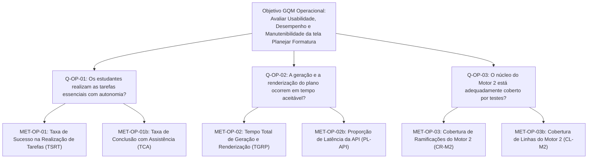

# Especificação da Avaliação — Métricas Operacionais

Este documento centraliza e introduz as perguntas e métricas operacionais desenvolvidas sob o método **Goal-Question-Metric (GQM)** para avaliar a funcionalidade _Planejar formatura_ do No Fluxo UnB, abrangendo os aspectos de experiência do usuário, desempenho computacional e sustentabilidade técnica do software.

Para garantir legibilidade, profundidade técnica e facilidade de consulta, a documentação foi modularizada em seções especializadas:

---

## 📑 Navegação pelas Páginas da Fase 2 (Operacionais)

| Seção / Página | Foco e Conteúdo Principal | Métricas Relacionadas |
| :--- | :--- | :---: |
| **[1. Visão Geral e Estrutura GQM](operacionais/visaoGeral.md)** | Contexto da Fase 1, stakeholders, formulação formal do Objetivo GQM, hipóteses operacionais e árvore hierárquica completa em diagrama Mermaid. | Todas |
| **[2. Métricas de Usabilidade](operacionais/usabilidade.md)** | Avaliação da facilidade de compreensão e uso por estudantes da UnB, definição das tarefas $T_1$, $T_2$ e $T_3$, fichas metodológicas e critérios baseados em normas ergonômicas. | `MET-OP-01` `MET-OP-01b` |
| **[3. Métricas de Eficiência de Desempenho](operacionais/desempenho.md)** | Comportamento temporal do sistema, decomposição do tempo de backend (`POST /planejamento/gerar-plano`) vs. frontend (Svelte/DOM), fichas de tempo e critérios baseados em Nielsen e Web Vitals. | `MET-OP-02` `MET-OP-02b` |
| **[4. Métricas de Manutenibilidade](operacionais/manutenibilidade.md)** | Testabilidade e modularidade do Motor 2 (`plano_formatura.service.ts`), medição automatizada de cobertura de ramificações (*branches*) e linhas com Jest/Vitest, e análise de risco de regressão. | `MET-OP-03` `MET-OP-03b` |
| **[5. Protocolo de Coleta e Condições de Teste](operacionais/protocolo.md)** | Ficha padronizada de ambiente de hardware e software, roteiro detalhado para condução dos testes com alunos, procedimento de 10 repetições de desempenho e comandos de execução no backend. | Todas |

---

## 🎯 Resumo da Estrutura GQM Operacional

---

## 🔗 Integração com as Métricas Funcionais

As métricas operacionais complementam diretamente as métricas de adequação funcional ([Métricas Funcionais](metricasFuncionais.md)). A correlação entre a velocidade de processamento, a clareza da interface e a conformidade do plano com as regras acadêmicas da UnB assegura a validade global da avaliação segundo o processo **ISO/IEC 25040**.

---

## Histórico de versão

| Nome do Membro | Contribuição | Data | Commit |
| :--- | :--- | :--- | :--- |
| [Giovani De Oliveira Teodoro Coelho](https://github.com/Gotc2607) | Modularização das páginas operacionais em subdocumentos especializados e estruturação do índice geral | 16/10 | [f8219c0](https://github.com/FCTE-Qualidade-de-Software-1/2026-2_T02_JEAN_SAMMET/commit/f8219c0) |
| [Giovani De Oliveira Teodoro Coelho](https://github.com/Gotc2607) | Remoção de referências a divisões internas de pessoas e padronização documental | 16/10 | [81912ba](https://github.com/FCTE-Qualidade-de-Software-1/2026-2_T02_JEAN_SAMMET/commit/81912bac5e02d7429e2d05446544ec9636891f5e) |
