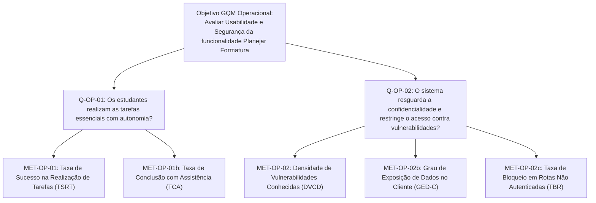

# Especificação da Avaliação — Métricas Operacionais

Este documento centraliza e introduz as perguntas e métricas operacionais desenvolvidas sob o método **Goal-Question-Metric (GQM)** para avaliar a funcionalidade _Planejar formatura_ do No Fluxo UnB, abrangendo os aspectos de experiência do usuário e segurança da informação do produto de software.

Para garantir legibilidade, profundidade técnica e facilidade de consulta, a documentação foi modularizada em seções especializadas:

---

## Navegação pelas Páginas da Fase 2 (Operacionais)

| Seção / Página | Foco e Conteúdo Principal | Métricas Relacionadas |
| :--- | :--- | :---: |
| **[1. Visão Geral e Estrutura GQM](operacionais/visaoGeral.md)** | Contexto da Fase 1, stakeholders, formulação formal do Objetivo GQM, hipóteses operacionais e árvore hierárquica completa em diagrama Mermaid. | Todas |
| **[2. Métricas de Usabilidade](operacionais/usabilidade.md)** | Avaliação da facilidade de compreensão e uso por estudantes da UnB, definição das tarefas $T_1$, $T_2$ e $T_3$, fichas metodológicas e critérios ergonômicos da ISO 9241-11. | `MET-OP-01` `MET-OP-01b` |
| **[3. Métricas de Segurança](operacionais/seguranca.md)** | Análise de composição de software (SCA via `npm audit`), inspeção de armazenamento do cliente (`localStorage`), validação de bloqueio em rotas protegidas e conformidade com LGPD/OWASP. | `MET-OP-02` `MET-OP-02b` `MET-OP-02c` |
| **[4. Protocolo de Coleta e Condições de Teste](operacionais/protocolo.md)** | Ficha padronizada de ambiente de hardware e software, roteiro detalhado para condução dos testes com alunos, comandos de auditoria e testes de chamadas não autenticadas. | Todas |
| **[5. Referências](operacionais/referencias.md)** | Referências bibliográficas, normas técnicas (ISO/IEC, ISO 9241), frameworks de segurança (OWASP) e legislação de proteção de dados (LGPD). | Todas |

---

## Resumo da Estrutura GQM Operacional

---

## Integração com as Métricas Funcionais

As métricas operacionais complementam diretamente as métricas de adequação funcional ([Métricas Funcionais](funcionais/visaoGeral.md)). A correlação entre a proteção dos dados dos estudantes, a clareza da interface e a conformidade do plano com as regras acadêmicas da UnB assegura a validade global da avaliação segundo o processo **ISO/IEC 25040**.

---

## Referências Bibliográficas

As referências metodológicas, normativas técnicas (ISO/IEC e ISO 9241), diretrizes de segurança (OWASP) e legislação de proteção de dados (LGPD) que fundamentam a especificação destas métricas encontram-se detalhadas em [Referências das Métricas Operacionais](operacionais/referencias.md) e consolidadas na página geral de [Referências da Fase 2](../../referencias/fase2.md).

---

## Histórico de versão

| Nome do Membro | Contribuição | Data | Commit |
| :--- | :--- | :--- | :--- |
| [Giovani De Oliveira Teodoro Coelho](https://github.com/Gotc2607) | Modularização das páginas operacionais em subdocumentos especializados e estruturação do índice geral | 16/10 | [f8219c0](https://github.com/FCTE-Qualidade-de-Software-1/2026-2_T02_JEAN_SAMMET/commit/f8219c0) |
| [Giovani De Oliveira Teodoro Coelho](https://github.com/Gotc2607) | Remoção de referências a divisões internas de pessoas e padronização documental | 16/10 | [81912ba](https://github.com/FCTE-Qualidade-de-Software-1/2026-2_T02_JEAN_SAMMET/commit/81912bac5e02d7429e2d05446544ec9636891f5e) |
| [Giovani De Oliveira Teodoro Coelho](https://github.com/Gotc2607) | Ajuste do sumário de métricas operacionais para Usabilidade e Segurança | 16/10 | [3584382](https://github.com/FCTE-Qualidade-de-Software-1/2026-2_T02_JEAN_SAMMET/commit/3584382ccfb17e27db841b011ce415fa1503cbbc) |
| [Giovani De Oliveira Teodoro Coelho](https://github.com/Gotc2607) | Remoção de emojis nos títulos, correção de links relativos e inclusão das referências operacionais | 18/10 | [acadb8d](https://github.com/FCTE-Qualidade-de-Software-1/2026-2_T02_JEAN_SAMMET/commit/acadb8d) |
