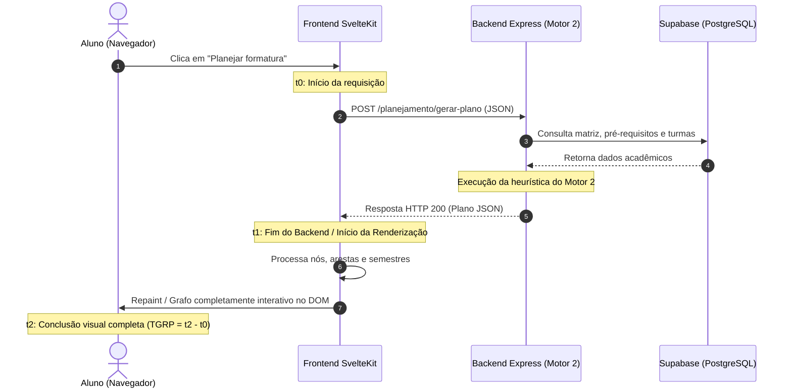

# Métricas de Eficiência de Desempenho

Este documento detalha a especificação das perguntas, hipóteses e métricas de **Eficiência de Desempenho** para a funcionalidade _Planejar formatura_ do No Fluxo UnB, focando no comportamento temporal da aplicação web e do algoritmo do Motor 2.

---

## 1. Característica e Subcaracterística Avaliadas

De acordo com o [Modelo de Qualidade](../../fase1/modeloDeQualidade.md) fundamentado na norma **ISO/IEC 25010:2011**, a Eficiência de Desempenho é analisada sob a seguinte subcaracterística:

* **Comportamento Temporal (_Time Behaviour_):** grau em que os tempos de resposta, processamento e transferência de dados do sistema atendem aos requisitos operacionais e às expectativas dos estudantes ao solicitar a geração do plano.

---

## 2. Questão GQM e Hipótese Associada

### Questão GQM: `Q-OP-02`
> **"A geração do plano pelo Motor 2 e sua renderização no navegador ocorrem em tempo aceitável para o estudante, mantendo a sensação de resposta fluida?"**

### Hipótese Operacional: `H-OP-02`
> **Hipótese:** Devido à complexidade computacional da heurística gulosa do Motor 2 (que avalia dependências diretas, indiretas e regras de pré-requisitos no backend) combinada com a renderização de um grafo visual complexo em Svelte no navegador, o tempo total percebido pelo aluno tende a ultrapassar o limiar de 2,0 segundos sob históricos com mais de 50% de pendências curriculares.

---

## 3. Arquitetura Temporal e Decomposição do Fluxo

A geração do plano de formatura compreende dois momentos técnicos distintos:

O tempo total percebido pelo usuário é decomposto formalmente em:
$$TGRP = T_{\text{backend}} + T_{\text{frontend}}$$
* **$T_{\text{backend}}$:** Latência de ida e volta da rede (RTT) somada ao tempo de processamento da API e consultas ao banco (mensurável via TTFB e tempo total do endpoint).
* **$T_{\text{frontend}}$:** Tempo consumido pelo motor de JavaScript do navegador para processar o payload e finalizar a renderização visual dos componentes gráficos no DOM.

---

## 4. Fichas Completas das Métricas de Desempenho

### Ficha da Métrica Principal: `MET-OP-02` — Tempo Total de Geração e Renderização do Plano (TGRP)

| Campo | Especificação Metodológica |
| :--- | :--- |
| **Identificador** | `MET-OP-02` |
| **Nome da Métrica** | Tempo Total de Geração e Renderização do Plano (TGRP) |
| **Característica / Subcaracterística** | Eficiência de Desempenho — Comportamento Temporal (*Time Behaviour*) |
| **Pergunta GQM Relacionada** | `Q-OP-02`: A geração do plano pelo Motor 2 e sua renderização no navegador ocorrem em tempo aceitável para o estudante? |
| **1. Definição** | Duração temporal compreendida entre o instante do clique do usuário para solicitar o plano até o instante em que todos os nós do grafo de disciplinas e painéis de resumo estão completamente visíveis e interativos no navegador. Unidade: milissegundos (ms) ou segundos (s). |
| **2. Procedimento de Cálculo** | Para cada execução $i$, mede-se:  $$TGRP_i = t_{\text{fim\_renderizacao}, i} - t_{\text{clique\_requisicao}, i}$$  Para uma série padronizada de $N$ repetições ($N = 10$) sob condições controladas, calculam-se: - **Mediana ($\tilde{T}$):** indicador central representativo da experiência típica do aluno: $$\tilde{T} = \text{Mediana}(TGRP_1, TGRP_2, \dots, TGRP_{10})$$ - **Tempo Máximo ($T_{\max}$):** indicador do pior cenário enfrentado pelo usuário. - **Desvio Padrão ($s$):** dispersão temporal e estabilidade do serviço. |
| **3. Fonte dos Dados** | Ferramenta de desenvolvedor do navegador (Google Chrome DevTools — abas *Network* e *Performance*) e/ou chamadas à Performance API do navegador (`performance.now()`). |
| **4. Procedimento de Coleta** | 1. Configurar o navegador Google Chrome em janela anônima e desativar o cache de rede (*Disable cache*). 2. Manter a conexão em banda larga fixa sem limitação artificial (ou registrar se for aplicado throttling 4G). 3. Carregar o cenário padrão com histórico sintético intermediário (50% do curso concluído). 4. Iniciar a gravação de desempenho na aba Performance do DevTools. 5. Clicar no botão de geração do plano. 6. Identificar os timestamps $t_0$ (clique), $t_1$ (conclusão da resposta de rede) e $t_2$ (evento de pintura final do grafo de disciplinas). 7. Repetir 10 vezes consecutivas, respeitando o intervalo de 10 segundos entre requisições para não acionar o rate limit da API (120 req/min). 8. Registrar os valores brutos na tabela de medições. |
| **5. Critérios de Interpretação e Níveis de Julgamento** | - **Nível Excelente:** Mediana $\le 2{,}0$ s ($2000\text{ ms}$). O sistema responde de maneira fluida e instantânea segundo as diretrizes de Jakob Nielsen e Google Web Vitals, mantendo a atenção ininterrupta do estudante. - **Nível Aceitável / Tolerável:** $2{,}0\text{ s} < \text{Mediana} \le 4{,}0\text{ s}$. Resposta aceitável desde que a interface forneça feedback visual imediato de processamento (animação de carregamento ou *skeleton screen*). - **Nível Crítico / Inaceitável:** Mediana $> 4{,}0\text{ s}$ ou $T_{\max} > 6{,}0\text{ s}$. Denota ineficiência no algoritmo heurístico do Motor 2 ou lentidão severa na renderização de nós do Svelte, caracterizando gargalo de desempenho a ser corrigido. |

---

### Ficha da Métrica Complementar: `MET-OP-02b` — Proporção de Latência da API (PL-API)

| Campo | Especificação Metodológica |
| :--- | :--- |
| **Identificador** | `MET-OP-02b` |
| **Nome da Métrica** | Proporção de Latência da API (PL-API) |
| **Característica / Subcaracterística** | Eficiência de Desempenho — Decomposição de Gargalos |
| **Pergunta GQM Relacionada** | `Q-OP-02`: A geração do plano pelo Motor 2 e sua renderização no navegador ocorrem em tempo aceitável para o estudante? |
| **1. Definição** | Percentual do tempo total de geração do plano consumido exclusivamente pelo backend (rede + consultas + algoritmo Motor 2), permitindo isolar se eventuais lentidões decorrem do servidor ou da renderização do cliente. Unidade: percentual (%). |
| **2. Procedimento de Cálculo** | $$PL\text{-}API = \left( \frac{\tilde{T}_{\text{backend}}}{\tilde{T}_{\text{total}}} \right) \times 100$$ |
| **3. Fonte dos Dados** | Coluna *Time* da requisição `POST /planejamento/gerar-plano` na aba *Network* do DevTools comparada com o tempo total da métrica `MET-OP-02`. |
| **4. Procedimento de Coleta** | Coletada simultaneamente durante as 10 repetições da métrica principal. |
| **5. Critérios de Interpretação e Níveis de Julgamento** | - **$PL\text{-}API > 70\%$:** O gargalo preponderante reside no processamento do backend / consultas ao Supabase. Ações de melhoria devem priorizar o algoritmo do Motor 2 (cache, indexação ou otimização da heurística). - **$PL\text{-}API \le 70\%$:** A renderização visual no frontend representa parcela significativa do tempo total. Ações de melhoria devem priorizar a virtualização de nós do grafo ou renderização assíncrona no SvelteKit. |

---

## 5. Fundamentação Teórica dos Limiares de Desempenho

Os critérios adotados para a métrica `MET-OP-02` baseiam-se em referências consolidadas da engenharia de usabilidade e desempenho web:

* **0,1 segundo:** Limite para que o usuário sinta que o sistema está reagindo instantaneamente.
* **1,0 segundo:** Limite para que o fluxo de pensamento do usuário permaneça ininterrupto, mesmo notando um breve atraso.
* **2,0 a 3,0 segundos:** Padrão ouro moderno de resposta para aplicações web interativas (diretrizes do Google Core Web Vitals).
* **10 segundos:** Limite absoluto para manter a atenção do usuário na tela; respostas acima deste limiar causam abandono imediato da tarefa.

---

## Histórico de versão

| Nome do Membro | Contribuição | Data | Commit |
| :--- | :--- | :--- | :--- |
| [Giovani De Oliveira Teodoro Coelho](https://github.com/Gotc2607) | Elaboração da especificação de desempenho, decomposição backend/frontend, fichas MET-OP-02 e MET-OP-02b | 16/10 | [d581fa7](https://github.com/FCTE-Qualidade-de-Software-1/2026-2_T02_JEAN_SAMMET/commit/d581fa7) |
| [Giovani De Oliveira Teodoro Coelho](https://github.com/Gotc2607) | Remoção de referências a divisões internas de pessoas e padronização documental | 16/10 | [81912ba](https://github.com/FCTE-Qualidade-de-Software-1/2026-2_T02_JEAN_SAMMET/commit/81912bac5e02d7429e2d05446544ec9636891f5e) |
