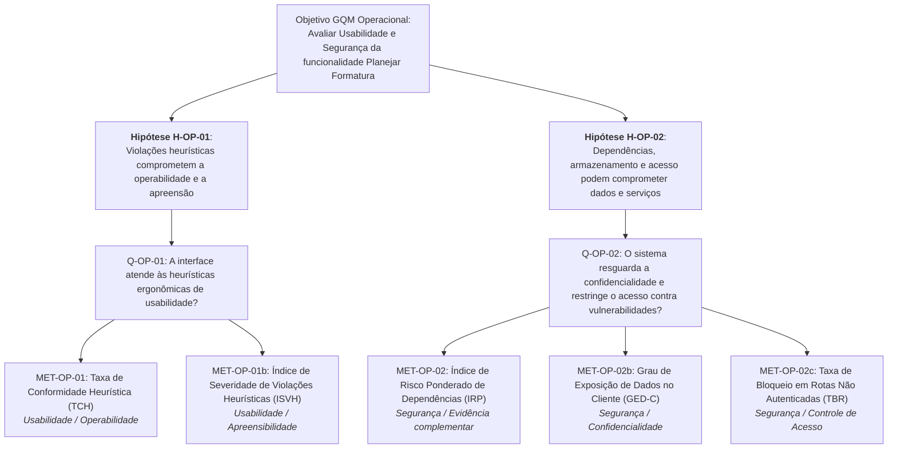
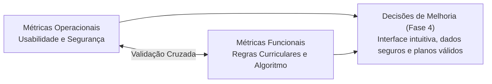

# Visão Geral e Estrutura GQM — Métricas Operacionais

Documento introdutório da avaliação de **Métricas Operacionais** da funcionalidade _Planejar formatura_ do No Fluxo UnB, cobrindo **Usabilidade** e **Segurança**.

---

## 1. Contexto e Rastreabilidade com a Fase 1

As métricas operacionais derivam das definições da Fase 1:

- **Partes Interessadas ([Propósito e Stakeholders](../../fase1/propositoEStakeholders.md)):**
  - *Estudantes:* precisam de interface clara para entender a formatura estimada e autonomia para ajustar créditos, com proteção aos seus dados pessoais.
  - *Mantenedores (Crianex):* necessitam de indicadores sobre facilidade de uso e segurança contra vulnerabilidades em dependências ou rotas desprotegidas.
  - *Equipe avaliadora:* requer evidências reprodutíveis para embasar melhorias na Fase 4.
- **Priorização ([Características de Qualidade](../../fase1/caracteristicasDeQualidade.md)):**
  - *Adequação Funcional:* Prioridade 1 (20 pts) — avaliada em [Métricas Funcionais](../funcionais/visaoGeral.md).
  - *Segurança:* Prioridade 2 (15 pts) — Confidencialidade e autenticidade, com inspeção complementar de dependências.
  - *Usabilidade:* Prioridade 3 (12 pts) — Operabilidade e Apreensibilidade.
- **Escopo e Limites ([Escopo](../../fase1/escopo.md)):**
  - Foco na interface SvelteKit (`/plano-formatura`), armazenamento no cliente (`localStorage`), endpoint `POST /planejamento/gerar-plano` e dependências via Retire.js no cliente e, quando disponíveis, manifestos públicos via `npm audit`.
  - Exclui testes invasivos/destrutivos; uso exclusivo de dados sintéticos.

---

## 2. Hipóteses Operacionais e Matriz de Validação

Formuladas a partir das limitações levantadas na Fase 1 ([Software Escolhido](../../fase1/softwareEscolhido.md#8-limitacoes-conhecidas)):

| ID | Característica | Hipótese Documentada | Questão GQM | Métricas de Teste | Critério de Validação da Hipótese |
| :---: | :--- | :--- | :---: | :--- | :--- |
| **H-OP-01** | Usabilidade | A interface apresenta violações heurísticas relevantes nas tarefas avaliadas. | `Q-OP-01` | TCH e ISVH | Confirmada no recorte se `TCH < 85%` ou houver violação maior/catastrófica; caso contrário, não corroborada, com coleta completa. |
| **H-OP-02** | Segurança | Dependências vulneráveis, retenção de dados em claro ou falhas de controle de acesso podem comprometer os dados e serviços examinados. | `Q-OP-02` | IRP, GED-C e TBR | Julgar os componentes separadamente e aplicar a regra conjunta abaixo. |

### 2.1 Qualidade dos dados

Dados ausentes, erros de coleta e testes que não alcançam o serviço esperado são inconclusivos. Itens sem requisito aplicável recebem Não aplicável, com justificativa. Nenhum desses estados equivale a aprovação.

### 2.2 Regra de julgamento conjunto

| Questão | Regra de resposta |
|---|---|
| **Q-OP-01** | Classificar TCH e ISVH pelas fichas e adotar o pior nível. Usar Inconclusivo se a coleta não cumprir o protocolo. H-OP-01 pode ser confirmada mesmo no nível Aceitável, pois seu limiar é mais exigente. |
| **Q-OP-02** | Há ressalva de segurança se algum componente estiver fora da meta; indicar qual. Só responder favoravelmente quando todos os componentes aplicáveis tiverem dados válidos e atenderem às metas: IRP Excelente, GED-C Conforme e TBR Conforme. Se houver componentes inconclusivos, a resposta global permanece parcial. |

H-OP-02 é confirmada no componente com IRP válido acima de 5 ou classificado Crítico, GED-C não conforme ou acesso indevido comprovado. Os demais componentes continuam com seus próprios estados. Sem esses achados e com cobertura completa, registrar **não corroborada no escopo avaliado**; com lacunas, registrar **inconclusiva**. Não usar uma medida favorável para refutar toda a hipótese.

---

## 3. Estrutura GQM (Goal-Question-Metric)

### 3.1 Objetivo Geral de Medição (Nível Conceitual)

| Elemento GQM | Especificação Formal |
| :--- | :--- |
| **Objeto** | A funcionalidade _Planejar formatura_ (interface web, armazenamento cliente e dependências) do No Fluxo UnB. |
| **Propósito** | **Avaliar** |
| **Foco de Qualidade** | **Usabilidade** e **Segurança** (ISO/IEC 25010). |
| **Ponto de Vista** | **equipe de desenvolvedores**. |
| **Contexto** | Ambiente web desktop controlado, currículo de Engenharia de Software da FGA/UnB, históricos sintéticos e inspeção dos componentes disponíveis. |

### 3.2 Questões de Medição (Nível Operacional)

- **`Q-OP-01` (Usabilidade):** A interface da tela de planejamento atende às heurísticas ergonômicas de usabilidade essenciais para operação e apreensão autônoma?
- **`Q-OP-02` (Segurança):** O sistema protege os dados acadêmicos e os serviços examinados contra exposição no cliente, vulnerabilidades conhecidas e acesso não autorizado?

### 3.3 Árvore GQM com Hipóteses Operacionais

---

## 4. Organização das Páginas Operacionais

| Seção / Página | Foco e Conteúdo Principal | Hipótese | Métricas |
| :--- | :--- | :---: | :---: |
| **[1. Métricas de Usabilidade](usabilidade.md)** | Checklist heurístico (Nielsen), tarefas de referência ($T_1, T_2, T_3$), operabilidade e apreensibilidade. | `H-OP-01` | `MET-OP-01` `MET-OP-01b` |
| **[2. Métricas de Segurança](seguranca.md)** | Auditoria SCA, persistência no cliente, controle de acesso e referências OWASP e proteção de dados. | `H-OP-02` | `MET-OP-02` `MET-OP-02b` `MET-OP-02c` |
| **[3. Protocolo de Coleta e Teste](protocolo.md)** | Roteiro de inspeção heurística da equipe, fichas de ambiente, storage e SCA. | `H-OP-01` `H-OP-02` | Todas |
| **[4. Referências](referencias.md)** | Referências metodológicas, normas técnicas (ISO/IEC e ISO 9241), OWASP e LGPD. | — | Todas |

---

## 5. Integração com as Métricas Funcionais

A avaliação adota abordagem holística, cruzando dados operacionais e funcionais ([Métricas Funcionais](../funcionais/visaoGeral.md)):

- **Usabilidade × Adequação Funcional:** Interface intuitiva não compensa planos curriculares incorretos; da mesma forma, um plano correto não tem utilidade se a interface for incompreensível.
- **Segurança × Confiabilidade:** Relacionar achados de dependências e acesso aos riscos do fluxo, sem inferir confiabilidade ou conformidade legal apenas dessas medidas.

---

## Histórico de versão

| Nome do Membro | Contribuição | Data | Commit |
| :--- | :--- | :--- | :--- |
| [Giovani De Oliveira Teodoro Coelho](https://github.com/Gotc2607) | Elaboração da visão geral, modelo GQM operacional, hipóteses e matriz de rastreabilidade | 16/10 | [b4e71a0](https://github.com/FCTE-Qualidade-de-Software-1/2026-2_T02_JEAN_SAMMET/commit/b4e71a0) |
| [Giovani De Oliveira Teodoro Coelho](https://github.com/Gotc2607) | Remoção de referências a divisões internas de pessoas e padronização documental | 16/10 | [81912ba](https://github.com/FCTE-Qualidade-de-Software-1/2026-2_T02_JEAN_SAMMET/commit/81912bac5e02d7429e2d05446544ec9636891f5e) |
| [Giovani De Oliveira Teodoro Coelho](https://github.com/Gotc2607) | Ajuste da estrutura GQM operacional para Usabilidade e Segurança | 16/10 | [3584382](https://github.com/FCTE-Qualidade-de-Software-1/2026-2_T02_JEAN_SAMMET/commit/3584382ccfb17e27db841b011ce415fa1503cbbc) |
| [Giovani De Oliveira Teodoro Coelho](https://github.com/Gotc2607) | Simplificação textual e concisão mantendo coerência com GQM e ISO 25010 | 24/10 | [b31d87e](https://github.com/FCTE-Qualidade-de-Software-1/2026-2_T02_JEAN_SAMMET/commit/b31d87e) |
| [Giovani De Oliveira Teodoro Coelho](https://github.com/Gotc2607) | Atualização de Usabilidade para Avaliação Heurística de Nielsen (TCH e ISVH) e inclusão na árvore GQM | 25/10 | [8330fa6](https://github.com/FCTE-Qualidade-de-Software-1/2026-2_T02_JEAN_SAMMET/commit/8330fa6ce8a670d083d8718eada13606616f064c) |
| [Gustavo Fornaciari](https://github.com/GUGOFO) | Alinhamento das hipóteses e das regras de julgamento conjunto | 15/11 | [8d625c1](https://github.com/FCTE-Qualidade-de-Software-1/2026-2_T02_JEAN_SAMMET/commit/8d625c1a87436bf186efb0abffb6682e1916a3d5) |
