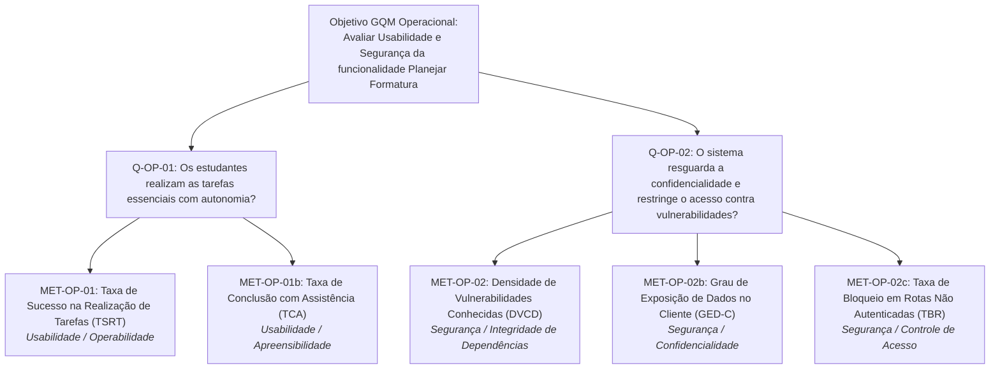
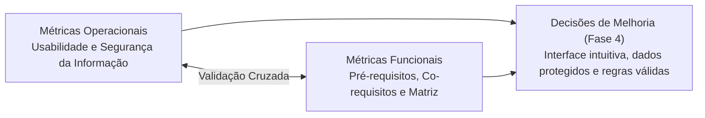

# Visão Geral e Estrutura GQM — Métricas Operacionais

Documento introdutório da avaliação de **Métricas Operacionais** da funcionalidade _Planejar formatura_ do No Fluxo UnB, abrangendo as características de **Usabilidade** e **Segurança**.

---

## 1. Contexto e Rastreabilidade com a Fase 1

A definição das métricas operacionais decorre diretamente dos artefatos consolidados na Fase 1 do projeto:

1. **Perfis de Usuários e Partes Interessadas ([Propósito e Stakeholders](../../fase1/propositoEStakeholders.md)):**
   - **Alunos de Graduação da UnB:** necessitam de uma interface inteligível para compreender a estimativa de formatura e ajustar sua carga semestral com autonomia, além da garantia de que seus dados acadêmicos sensíveis (histórico, notas, matrícula) não sejam expostos indevidamente.
   - **Mantenedores do Software (Crianex):** necessitam de evidências objetivas sobre a facilidade de uso da interface e a resiliência de segurança contra vulnerabilidades em dependências e requisições desprotegidas.
   - **Equipe Avaliadora:** necessita de indicadores reprodutíveis para fundamentar a escolha e implementação da ação de melhoria na Entrega 2.
2. **Priorização de Características ([Características de Qualidade](../../fase1/caracteristicasDeQualidade.md)):**
   - *Adequação Funcional:* Prioridade 1 (Pontuação: 20) — avaliada em [Métricas Funcionais](../metricasFuncionais.md).
   - *Usabilidade:* Prioridade 2 (Pontuação: 16) — foco em Operabilidade e Apreensibilidade.
   - *Segurança:* Prioridade 3 (Pontuação: 12) — foco em Confidencialidade, Integridade de Dependências e Controle de Acesso.
3. **Escopo e Limites Operacionais ([Escopo](../../fase1/escopo.md)):**
   - Objetos delimitados na interface SvelteKit (`/plano-formatura`), no armazenamento do cliente (`localStorage`), nos endpoints protegidos (`POST /planejamento/gerar-plano`) e nas dependências de software via SCA (`npm audit`).
   - Exclusão de testes de invasão destrutivos e uso exclusivo de históricos acadêmicos sintéticos.

---

## 2. Hipóteses Operacionais Documentadas

Com base nas limitações técnicas conhecidas levantadas na Fase 1 ([Software Escolhido](../../fase1/softwareEscolhido.md#38-limitacoes-conhecidas)), formularam-se as seguintes hipóteses a serem testadas:

| ID | Característica | Hipótese Documentada | Risco Associado | Métrica Relacionada |
| :---: | :--- | :--- | :--- | :---: |
| **H-OP-01** | Usabilidade | A interface concentra alta densidade de nós e painéis simultâneos, fazendo com que estudantes tenham hesitação ou necessitem de auxílio externo para identificar a previsão de formatura e as matérias críticas. | O aluno pode interpretar incorretamente seu planejamento ou desistir de utilizar a ferramenta. | `MET-OP-01` `MET-OP-01b` |
| **H-OP-02** | Segurança | O software processa históricos acadêmicos com dados sensíveis no navegador e se comunica com o backend e serviços de autenticação; a retenção não volátil de dados no armazenamento cliente e a presença de dependências desatualizadas podem expor o sistema a vulnerabilidades conhecidas e vazamento de dados. | Violação de princípios da LGPD e exposição do sistema a exploits conhecidos em dependências externas. | `MET-OP-02` `MET-OP-02b` `MET-OP-02c` |

---

## 3. Estrutura GQM (Goal-Question-Metric)

### 3.1 Objetivo Geral de Medição (Nível Conceitual)

Formulado rigorosamente no template estruturado do GQM:

| Elemento GQM | Especificação Formal |
| :--- | :--- |
| **Objeto** | A funcionalidade _Planejar formatura_ (interface web, armazenamento cliente e dependências) do No Fluxo UnB. |
| **Propósito** | **Avaliar** a qualidade em uso e a segurança da informação do produto de software. |
| **Foco de Qualidade** | As características de **Usabilidade** e **Segurança** (norma ISO/IEC 25010). |
| **Ponto de Vista** | Dos **estudantes de graduação da UnB** (usuários finais) e da **equipe técnica / mantenedores**. |
| **Contexto** | Execução em ambiente web desktop controlado, utilizando o currículo de Engenharia de Software da FGA/UnB, históricos sintéticos e auditoria estática de código. |

### 3.2 Questões de Medição (Nível Operacional)

- **`Q-OP-01` (Usabilidade):** Os estudantes conseguem realizar as tarefas essenciais na tela de planejamento com autonomia, sem necessidade de assistência externa?
- **`Q-OP-02` (Segurança):** A funcionalidade de planejamento de formatura resguarda adequadamente a confidencialidade dos dados acadêmicos e restringe o acesso aos seus serviços contra vulnerabilidades conhecidas e chamadas não autenticadas?

### 3.3 Árvore GQM Operacional

---

## 4. Divisão e Organização das Páginas da Fase 2

Para assegurar clareza, profundidade técnica e facilidade de leitura, a especificação das métricas operacionais foi subdividida nos seguintes documentos especializados:

1. **[Métricas de Usabilidade](usabilidade.md):** detalhamento das tarefas-chave de usuário ($T_1$, $T_2$, $T_3$), métricas `MET-OP-01` e `MET-OP-01b`, análise de barreiras de affordance e critérios ergonômicos da ISO 9241-11.
2. **[Métricas de Segurança](seguranca.md):** auditoria de dependências via SCA (`MET-OP-02`), inspeção de persistência no navegador (`MET-OP-02b`), testes de controle de acesso a endpoints (`MET-OP-02c`) e alinhamento com OWASP Top 10 e LGPD.
3. **[Protocolo de Coleta e Teste](protocolo.md):** fichas padronizadas de registro de ambiente, roteiro experimental para sessões de usabilidade, procedimentos de inspeção de storage e execução do `npm audit`.

---

## 5. Integração com as Métricas Funcionais

A avaliação do No Fluxo UnB adota uma abordagem holística, cruzando os achados operacionais com os funcionais ([Métricas Funcionais](../metricasFuncionais.md)):

- **Relação Usabilidade × Adequação Funcional:** Uma interface perfeitamente inteligível não traz benefício real se o algoritmo gerar planos curriculares com violações de regras; inversamente, um plano matematicamente correto cuja interface seja incompreensível causará confusão ou abandono pelo estudante.
- **Relação Segurança × Confiabilidade:** Proteger os dados acadêmicos contra exposição indevida no navegador e garantir que as dependências não contenham vulnerabilidades críticas assegura a conformidade ética e jurídica (LGPD) indispensável para a adoção institucional da ferramenta.

---

## Histórico de versão

| Nome do Membro | Contribuição | Data | Commit |
| :--- | :--- | :--- | :--- |
| [Giovani De Oliveira Teodoro Coelho](https://github.com/Gotc2607) | Elaboração da visão geral, modelo GQM operacional, hipóteses e matriz de rastreabilidade | 16/10 | [b4e71a0](https://github.com/FCTE-Qualidade-de-Software-1/2026-2_T02_JEAN_SAMMET/commit/b4e71a0) |
| [Giovani De Oliveira Teodoro Coelho](https://github.com/Gotc2607) | Remoção de referências a divisões internas de pessoas e padronização documental | 16/10 | [81912ba](https://github.com/FCTE-Qualidade-de-Software-1/2026-2_T02_JEAN_SAMMET/commit/81912bac5e02d7429e2d05446544ec9636891f5e) |
| [Giovani De Oliveira Teodoro Coelho](https://github.com/Gotc2607) | Ajuste da estrutura GQM operacional para Usabilidade e Segurança | 16/10 | [91b3fa1](https://github.com/FCTE-Qualidade-de-Software-1/2026-2_T02_JEAN_SAMMET/commit/91b3fa1) |
