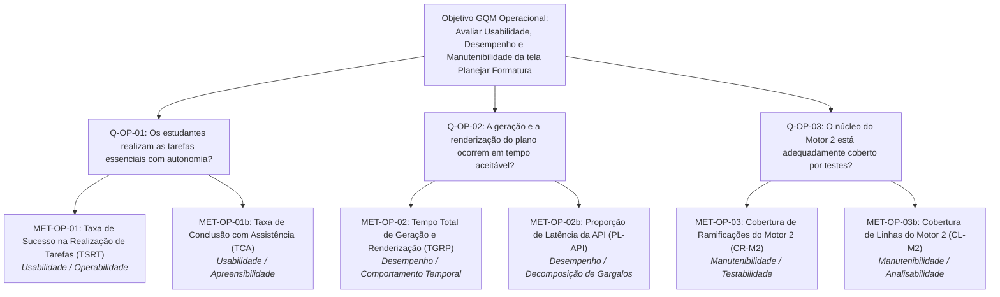

# Visão Geral e Estrutura GQM — Métricas Operacionais

Documento introdutório da avaliação de **Métricas Operacionais** da funcionalidade _Planejar formatura_ do No Fluxo UnB, abrangendo as características de **Usabilidade**, **Eficiência de Desempenho** e **Manutenibilidade**.

---

## 1. Contexto e Rastreabilidade com a Fase 1

A definição das métricas operacionais decorre diretamente dos artefatos consolidados na Fase 1 do projeto:

1. **Perfis de Usuários e Partes Interessadas ([Propósito e Stakeholders](../../fase1/propositoEStakeholders.md)):**
   - **Alunos de Graduação da UnB:** necessitam de uma interface inteligível e responsiva para compreender a estimativa de formatura, identificar disciplinas críticas e ajustar sua carga semestral com autonomia.
   - **Mantenedores do Software (Crianex):** necessitam de evidências objetivas sobre o desempenho computacional do serviço e a testabilidade do Motor 2, viabilizando correções estruturadas sem risco de regressão.
   - **Equipe Avaliadora:** necessita de indicadores reprodutíveis para fundamentar a escolha e implementação da ação de melhoria na Entrega 2.
2. **Priorização de Características ([Características de Qualidade](../../fase1/caracteristicasDeQualidade.md)):**
   - *Usabilidade:* Prioridade 2 (Pontuação: 15) — foco em Operabilidade e Apreensibilidade.
   - *Eficiência de Desempenho:* Prioridade 3 (Pontuação: 12) — foco em Comportamento Temporal.
   - *Manutenibilidade:* Prioridade 4 (Pontuação: 12) — foco em Testabilidade e Modularidade.
3. **Escopo e Limites Operacionais ([Escopo](../../fase1/escopo.md)):**
   - Objetos delimitados na interface SvelteKit (`/plano-formatura`), na API `POST /planejamento/gerar-plano` e no algoritmo do Motor 2 (`backend/src/services/plano_formatura.service.ts`).
   - Exclusão de testes de carga volumosos em produção e uso de dados sintéticos controlados.

---

## 2. Hipóteses Operacionais Documentadas

Com base nas limitações técnicas conhecidas levantadas na Fase 1 ([Software Escolhido](../../fase1/softwareEscolhido.md#38-limitacoes-conhecidas)), formularam-se as seguintes hipóteses a serem testadas:

| ID | Característica | Hipótese Documentada | Risco Associado | Métrica Relacionada |
| :---: | :--- | :--- | :--- | :---: |
| **H-OP-01** | Usabilidade | A interface concentra alta densidade de nós e painéis simultâneos, fazendo com que estudantes tenham hesitação ou necessitem de auxílio externo para identificar a previsão de formatura e as matérias críticas. | O aluno pode interpretar incorretamente seu planejamento ou desistir de utilizar a ferramenta. | `MET-OP-01` |
| **H-OP-02** | Eficiência de Desempenho | O processamento heurístico combinatório no backend somado à renderização interativa do grafo no frontend em Svelte pode ultrapassar 2,0 segundos sob fluxos intermediários. | Perda de fluidez na interação e suposição de travamento da aplicação pelo usuário. | `MET-OP-02` |
| **H-OP-03** | Manutenibilidade | O serviço `plano_formatura.service.ts` concentra a totalidade da heurística do Motor 2 com múltiplos desvios condicionais desprovidos de testes automatizados unitários suficientes. | Dificuldade técnica extrema para que a equipe e mantenedores corrijam defeitos (como co-requisitos) sem introduzir novos bugs. | `MET-OP-03` |

---

## 3. Estrutura GQM (Goal-Question-Metric)

### 3.1 Objetivo Geral de Medição (Nível Conceitual)

Formulado rigorosamente no template estruturado do GQM:

| Elemento GQM | Especificação Formal |
| :--- | :--- |
| **Objeto** | A funcionalidade _Planejar formatura_ (interface web e algoritmo do Motor 2) do No Fluxo UnB. |
| **Propósito** | **Avaliar** a qualidade em uso e a qualidade interna do produto de software. |
| **Foco de Qualidade** | As características de **Usabilidade**, **Eficiência de Desempenho** e **Manutenibilidade** (norma ISO/IEC 25010). |
| **Ponto de Vista** | Dos **estudantes de graduação da UnB** (usuários finais) e dos **mantenedores da Crianex / desenvolvedores**. |
| **Contexto** | Execução em ambiente web desktop controlado, utilizando o currículo de Engenharia de Software da FGA/UnB e históricos sintéticos. |

### 3.2 Questões de Medição (Nível Operacional)

- **`Q-OP-01` (Usabilidade):** Os estudantes conseguem realizar as tarefas essenciais na tela de planejamento com autonomia, sem necessidade de assistência externa?
- **`Q-OP-02` (Desempenho):** A geração do plano pelo Motor 2 e sua renderização no navegador ocorrem em tempo aceitável para o estudante, mantendo a sensação de resposta fluida?
- **`Q-OP-03` (Manutenibilidade):** Em que nível o componente central do Motor 2 está coberto por testes automatizados para suportar refatorações e correções de defeitos com segurança?

### 3.3 Árvore GQM Operacional

---

## 4. Divisão e Organização das Páginas da Fase 2

Para assegurar clareza, profundidade técnica e facilidade de leitura, a especificação das métricas operacionais foi subdividida nos seguintes documentos especializados:

1. **[Métricas de Usabilidade](usabilidade.md):** detalhamento das tarefas-chave de usuário, métricas `MET-OP-01` e `MET-OP-01b`, análise de barreiras de affordance e critérios baseados em normas de ergonomia de software.
2. **[Métricas de Eficiência de Desempenho](desempenho.md):** decomposição temporal (API vs. renderização DOM), métricas `MET-OP-02` e `MET-OP-02b`, medições com Chrome DevTools e critérios de resposta fundamentados em Nielsen e Google Web Vitals.
3. **[Métricas de Manutenibilidade](manutenibilidade.md):** isolamento do arquivo `plano_formatura.service.ts`, instrumentação de cobertura de código (`MET-OP-03` e `MET-OP-03b`) e avaliação do risco de regressão em manutenções.
4. **[Protocolo de Coleta e Teste](protocolo.md):** fichas padronizadas de registro de ambiente, roteiro experimental para sessões de usabilidade, protocolo de repetições de desempenho e comandos de execução dos testes de cobertura.

---

## 5. Integração com as Métricas Funcionais

A avaliação do No Fluxo UnB adota uma abordagem holística, cruzando os achados operacionais com os funcionais ([Métricas Funcionais](../metricasFuncionais.md)):

- **Relação Desempenho × Correção:** Um plano gerado de forma extremamente rápida não tem valor se violar regras curriculares fundamentais; da mesma forma, um algoritmo correto que cause travamento na interface será rejeitado pelos alunos.
- **Relação Usabilidade × Confiabilidade:** Uma interface clara evita que o estudante tome decisões curriculares equivocadas caso o plano precise de validação adicional com a coordenação.
- **Relação Manutenibilidade × Evolução:** Uma alta cobertura de testes no Motor 2 é o pré-requisito técnico mandatório para que a equipe implemente as correções de co-requisitos e onboarding planejadas para a Fase 4.

---

## Histórico de versão

| Nome do Membro | Contribuição | Data | Commit |
| :--- | :--- | :--- | :--- |
| [Giovani De Oliveira Teodoro Coelho](https://github.com/Gotc2607) | Elaboração da visão geral, modelo GQM operacional, hipóteses e matriz de rastreabilidade | 16/10 | [b4e71a0](https://github.com/FCTE-Qualidade-de-Software-1/2026-2_T02_JEAN_SAMMET/commit/b4e71a0) |
| [Giovani De Oliveira Teodoro Coelho](https://github.com/Gotc2607) | Remoção de referências a divisões internas de pessoas e padronização documental | 16/10 | [c19a4e8](https://github.com/FCTE-Qualidade-de-Software-1/2026-2_T02_JEAN_SAMMET/commit/c19a4e8) |
