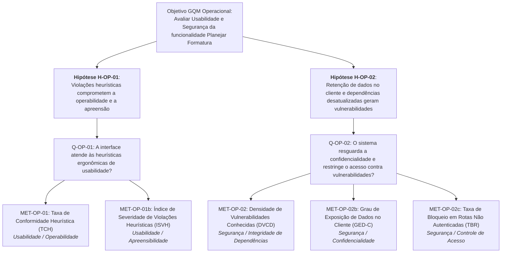
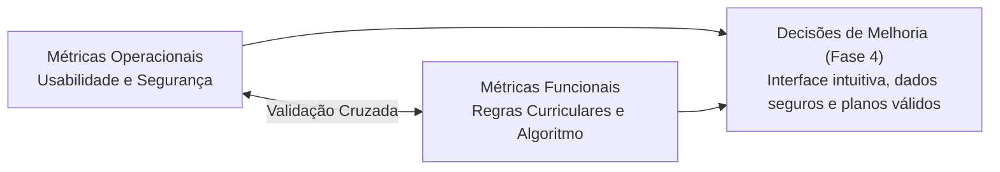

# Visão Geral e Estrutura GQM — Métricas Operacionais

Documento introdutório da avaliação de **Métricas Operacionais** da funcionalidade _Planejar formatura_ do No Fluxo UnB, cobrindo **Usabilidade** e **Segurança**.

---

## 1. Contexto e Rastreabilidade com a Fase 1

As métricas operacionais derivam das definições da Fase 1:

- **Partes Interessadas ([Propósito e Stakeholders](../../fase1/propositoEStakeholders.md)):**
  - *Estudantes:* precisam de interface clara para entender a formatura estimada e autonomia para ajustar créditos, com proteção aos seus dados pessoais.
  - *Mantenedores (Crianex):* necessitam de indicadores sobre facilidade de uso e segurança contra vulnerabilidades em dependências ou rotas desprotegidas.
  - *Equipe avaliadora:* requer evidências reprodutíveis para embasar melhorias na Fase 4.
- **Priorização ([Características de Qualidade](../../fase1/caracteristicasDeQualidade.md)):**
  - *Adequação Funcional:* Prioridade 1 (20 pts) — avaliada em [Métricas Funcionais](../funcionais/visaoGeral.md).
  - *Segurança:* Prioridade 2 (15 pts) — Confidencialidade, Integridade de Dependências e Controle de Acesso.
  - *Usabilidade:* Prioridade 3 (12 pts) — Operabilidade e Apreensibilidade.
- **Escopo e Limites ([Escopo](../../fase1/escopo.md)):**
  - Foco na interface SvelteKit (`/plano-formatura`), armazenamento no cliente (`localStorage`), endpoint `POST /planejamento/gerar-plano` e dependências via SCA (`npm audit`).
  - Exclui testes invasivos/destrutivos; uso exclusivo de dados sintéticos.

---

## 2. Hipóteses Operacionais e Matriz de Validação

Formuladas a partir das limitações levantadas na Fase 1 ([Software Escolhido](../../fase1/softwareEscolhido.md#8-limitacoes-conhecidas)):

| ID | Característica | Hipótese Documentada | Questão GQM | Métricas de Teste | Critério de Validação da Hipótese |
| :---: | :--- | :--- | :---: | :--- | :--- |
| **H-OP-01** | Usabilidade | A tela `/plano-formatura` concentra violações heurísticas (densidade excessiva de nós, feedback insuficiente de recálculo e terminologia ambígua), comprometendo a facilidade de uso e a apreensão das saídas. | `Q-OP-01` | `MET-OP-01` (TCH) `MET-OP-01b` (ISVH) | **Confirmada** se $TCH < 85\%$ ou se for identificada qualquer violação heurística de severidade maior ou catastrófica ($N_{\text{maior}} \ge 1$ ou $N_{\text{catastrófico}} \ge 1$). |
| **H-OP-02** | Segurança | O processamento no navegador com retenção em `localStorage` e dependências desatualizadas pode expor dados sensíveis e vulnerabilidades conhecidas. | `Q-OP-02` | `MET-OP-02` (DVCD) `MET-OP-02b` (GED-C) `MET-OP-02c` (TBR) | **Confirmada** se $IRP > 5$, $GED\text{-}C \ge 1$ chave sensível ou $TBR < 100\%$. |

---

## 3. Estrutura GQM (Goal-Question-Metric)

### 3.1 Objetivo Geral de Medição (Nível Conceitual)

| Elemento GQM | Especificação Formal |
| :--- | :--- |
| **Objeto** | A funcionalidade _Planejar formatura_ (interface web, armazenamento cliente e dependências) do No Fluxo UnB. |
| **Propósito** | **Avaliar** |
| **Foco de Qualidade** | **Usabilidade** e **Segurança** (ISO/IEC 25010). |
| **Ponto de Vista** | **Estudantes de graduação da UnB** (usuários) e **equipe técnica / mantenedores**. |
| **Contexto** | Ambiente web desktop controlado, currículo de Engenharia de Software da FGA/UnB, históricos sintéticos e auditoria estática de código. |

### 3.2 Questões de Medição (Nível Operacional)

- **`Q-OP-01` (Usabilidade):** A interface da tela de planejamento atende às heurísticas ergonômicas de usabilidade essenciais para operação e apreensão autônoma?
- **`Q-OP-02` (Segurança):** O sistema resguarda a confidencialidade dos dados acadêmicos e restringe o acesso aos serviços contra vulnerabilidades conhecidas e chamadas não autenticadas?

### 3.3 Árvore GQM com Hipóteses Operacionais

---

## 4. Organização das Páginas Operacionais

| Seção / Página | Foco e Conteúdo Principal | Hipótese | Métricas |
| :--- | :--- | :---: | :---: |
| **[1. Métricas de Usabilidade](usabilidade.md)** | Checklist heurístico (Nielsen), tarefas de referência ($T_1, T_2, T_3$), operabilidade e apreensibilidade. | `H-OP-01` | `MET-OP-01` `MET-OP-01b` |
| **[2. Métricas de Segurança](seguranca.md)** | Auditoria SCA, persistência no cliente, controle de acesso e conformidade OWASP/LGPD. | `H-OP-02` | `MET-OP-02` `MET-OP-02b` `MET-OP-02c` |
| **[3. Protocolo de Coleta e Teste](protocolo.md)** | Roteiro de inspeção heurística da equipe, fichas de ambiente, storage e `npm audit`. | `H-OP-01` `H-OP-02` | Todas |
| **[4. Referências](referencias.md)** | Referências metodológicas, normas técnicas (ISO/IEC e ISO 9241), OWASP e LGPD. | — | Todas |

---

## 5. Integração com as Métricas Funcionais

A avaliação adota abordagem holística, cruzando dados operacionais e funcionais ([Métricas Funcionais](../funcionais/visaoGeral.md)):

- **Usabilidade × Adequação Funcional:** Interface intuitiva não compensa planos curriculares incorretos; da mesma forma, um plano correto não tem utilidade se a interface for incompreensível.
- **Segurança × Confiabilidade:** Proteger dados contra exposição indevida e eliminar vulnerabilidades em dependências garante a conformidade ética e jurídica (LGPD) essencial para a ferramenta.

---

## Histórico de versão

| Nome do Membro | Contribuição | Data | Commit |
| :--- | :--- | :--- | :--- |
| [Giovani De Oliveira Teodoro Coelho](https://github.com/Gotc2607) | Elaboração da visão geral, modelo GQM operacional, hipóteses e matriz de rastreabilidade | 16/10 | [b4e71a0](https://github.com/FCTE-Qualidade-de-Software-1/2026-2_T02_JEAN_SAMMET/commit/b4e71a0) |
| [Giovani De Oliveira Teodoro Coelho](https://github.com/Gotc2607) | Remoção de referências a divisões internas de pessoas e padronização documental | 16/10 | [81912ba](https://github.com/FCTE-Qualidade-de-Software-1/2026-2_T02_JEAN_SAMMET/commit/81912bac5e02d7429e2d05446544ec9636891f5e) |
| [Giovani De Oliveira Teodoro Coelho](https://github.com/Gotc2607) | Ajuste da estrutura GQM operacional para Usabilidade e Segurança | 16/10 | [3584382](https://github.com/FCTE-Qualidade-de-Software-1/2026-2_T02_JEAN_SAMMET/commit/3584382ccfb17e27db841b011ce415fa1503cbbc) |
| [Giovani De Oliveira Teodoro Coelho](https://github.com/Gotc2607) | Simplificação textual e concisão mantendo coerência com GQM e ISO 25010 | 24/10 | [b31d87e](https://github.com/FCTE-Qualidade-de-Software-1/2026-2_T02_JEAN_SAMMET/commit/b31d87e) |
| [Giovani De Oliveira Teodoro Coelho](https://github.com/Gotc2607) | Atualização de Usabilidade para Avaliação Heurística de Nielsen (TCH e ISVH) e inclusão na árvore GQM | 25/10 | [8330fa6](https://github.com/FCTE-Qualidade-de-Software-1/2026-2_T02_JEAN_SAMMET/commit/8330fa6ce8a670d083d8718eada13606616f064c) |

