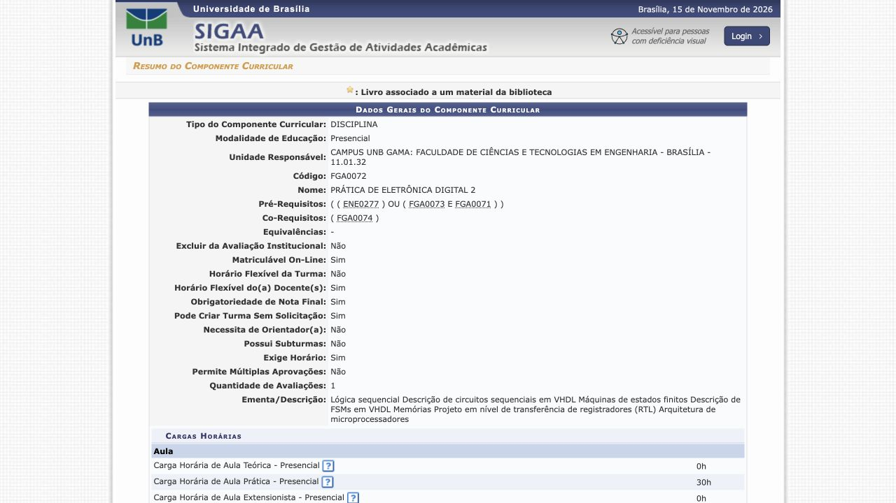

# Referências para os testes funcionais

## 1. Matriz de referência

Foi conferida a estrutura **6360/1 — 2017.1**, no [SIGAA público](https://sigaa.unb.br/sigaa/public/curso/curriculo.jsf?id=414924&lc=pt_BR), em 15/11. Na lista, escolher 6360/1 e **Visualizar Estrutura Curricular**. A matriz estar inativa para novos ingressos não invalida seu uso como recorte da avaliação.

| Regra | Valor conferido |
|---|---|
| Carga total mínima | 3.480h |
| Obrigatórias | 2.580h, distribuídas em 39 componentes |
| Optativas mínimas | 900h |
| Limites por período | Mínimo de 240h e máximo de 480h |
| Componentes eletivos | Máximo de 360h |

A relação foi conferida com o relatório oficial fornecido pelo usuário, emitido em 15/11. A transcrição estruturada e o hash desse relatório ficam em `testes/referencias/estrutura_6360_1.json`. A lista de obrigatórias não inclui as exigências de cadeias de seletividade nem substitui as horas optativas: a CDO será julgada apenas no recorte declarado.

## 2. Regras consultadas no SIGAA

Nos detalhes da matriz, abrir o nível e selecionar **Visualizar Detalhes do Componente**. O endereço do resumo depende da sessão; usar o código abaixo para repetir a consulta.

| Componente | Regra observada | Uso no teste |
|---|---|---|
| FGA0211 — Redes | Exige FGA0170; pré-requisito ativo desde 01/08/2019. | CT-01 e comparação de status em CT-04 |
| MAT0026 — Cálculo 2 | Exige MAT0025 ou MAT0024; expressão ativa desde 07/11/2021. | CT-01, cobrindo uma relação alternativa |
| MAT0026 — Cálculo 2 | MAT0138 consta como equivalência ativa desde 07/11/2021. | CT-05: cadastro, carga e vigência conferidos no complemento abaixo |
| IFD0173 — Física 1 Experimental | Sem pré/co-requisito exibido; há equivalências cadastradas. | Não presumir que Física 1 seja seu co-requisito |

Essas consultas verificam exemplos, não todos os pré/co-requisitos do curso. Preservar captura ou transcrição dos campos e da vigência de cada regra usada na coleta formal. A posição da disciplina no fluxograma não substitui a regra oficial.

## 3. Lacunas

- **Co-requisitos:** par FGA0072/FGA0074 confirmado no complemento abaixo. Falta validar a seleção explícita dessas optativas no planejador.
- **Equivalências:** MAT0138/MAT0026 conferidas no complemento abaixo. Falta validar o reconhecimento do código na entrada; não presumir equivalência transitiva.
- **Oferta e calendário:** registrar o período real da coleta e a oferta oficial. Sem isso, a parte correspondente de CT-07 fica pendente.
- **Onboarding:** a interface mostra carga sugerida e objetivo; o efeito algorítmico exato de trabalho e objetivo ainda precisa de requisito identificável.
- **Optativas:** conferir apenas as selecionadas para o cenário. As demais ficam fora da cobertura declarada.

O repositório de referência e o commit `87b5475` não puderam ser recuperados por consulta pública nesta preparação. Isso não comprova remoção definitiva; as conclusões atuais não dependem de suposta inspeção desse código.

---

## Fontes complementares confirmadas em 15/11

| Caso | Regra conferida no SIGAA | Uso |
|---|---|---|
| CT-02 | FGA0072 (30h) exige FGA0074 (60h) como co-requisito e vice-versa; ambas optativas da matriz 6360/1. Regras ativas desde 01/08/2019. | Selecionar explicitamente o par e satisfazer `ENE0277 OU (FGA0073 E FGA0071)` antes de gerar o plano. |
| CT-05 | MAT0138 — Cálculo 2 Semipresencial, 90h. Equivalência para MAT0026 ativa desde 01/08/2019; no cadastro de MAT0026, a expressão que lista MAT0138 está ativa desde 07/11/2021. | Comparar os dois históricos mantendo MAT0025 aprovada. A consulta de MAT0026 não exibiu exceção específica à equivalência geral. |

A busca do cadastro é reproduzível em **SIGAA público → Graduação → Componentes Curriculares → código MAT0138**, selecionando nível Graduação. [Abrir consulta](https://sigaa.unb.br/sigaa/public/componentes/busca_componentes.jsf?nivel=G&aba=p-graduacao). Os detalhes da matriz são consultados pela página inicial das estruturas; URLs de detalhe dependem de sessão.

*Figura 1 — Identificação, cargas e limites da matriz. Fonte: SIGAA/UnB, captura de 15/11.*

*Figura 2 — FGA0072 exige FGA0074. Fonte: SIGAA/UnB, captura de 15/11. A relação recíproca foi conferida nos detalhes de FGA0074.*

*Figura 3 — Código, nome e carga da equivalente. Fonte: SIGAA/UnB, captura de 15/11.*

## Histórico de versão

| Nome do Membro | Contribuição | Data | Commit |
| :--- | :--- | :--- | :--- |
| [Gustavo Fornaciari](https://github.com/GUGOFO) | Registro das fontes curriculares e das pendências por regra | 15/11 | [aa0c61f](https://github.com/FCTE-Qualidade-de-Software-1/2026-2_T02_JEAN_SAMMET/commit/aa0c61fac5e9d2db19adec76fd052a2bb6b04b90) |
| [Gustavo Fornaciari](https://github.com/GUGOFO) | Confirmação de co-requisitos e equivalência com capturas oficiais | 15/11 | [0e38da3](https://github.com/FCTE-Qualidade-de-Software-1/2026-2_T02_JEAN_SAMMET/commit/0e38da3eac882c62bf7c6f9e1bda97a8b744ef2e) |
