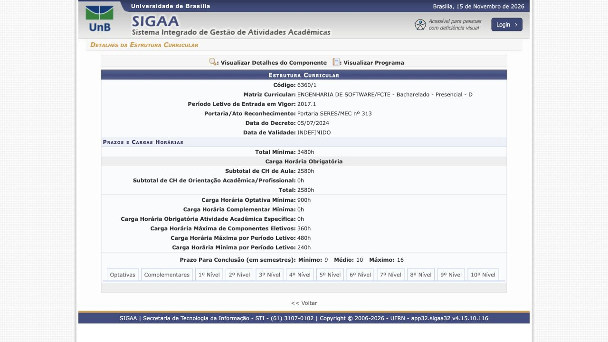
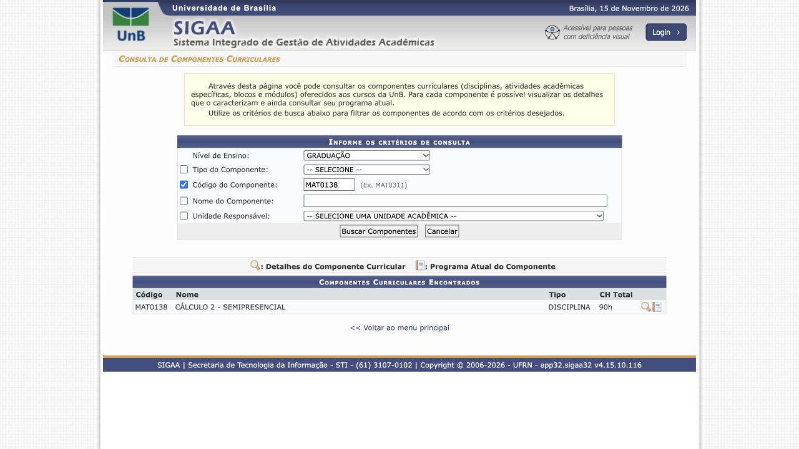

# Referências para os testes funcionais

*[Voltar para a Matriz Geral de Rastreabilidade](../../../rastreabilidade.md)*

## 1. Matriz de referência

Foi conferida a estrutura **6360/1 — 2017.1**, no [SIGAA público](https://sigaa.unb.br/sigaa/public/curso/curriculo.jsf?id=414924&lc=pt_BR), em 15/11. Na lista, escolher 6360/1 e **Visualizar Estrutura Curricular**. A matriz estar inativa para novos ingressos não invalida seu uso como recorte da avaliação.

**Tabela 1 — Matriz de referência.**

| Regra | Valor conferido |
| --- | --- |
| Carga total mínima | 3.480h |
| Obrigatórias | 2.580h, distribuídas em 39 componentes |
| Optativas mínimas | 900h |
| Limites por período | Máximo avaliado: 480h por período |
| Componentes eletivos | Máximo de 360h |

*Fonte: elaboração da equipe, conforme os registros e referências desta página.*

A relação foi conferida com o relatório oficial fornecido pelo usuário, emitido em 15/11. A transcrição estruturada e o hash desse relatório ficam em `testes/referencias/estrutura_6360_1.json`. A lista de obrigatórias não inclui as exigências de cadeias de seletividade nem substitui as horas optativas: a CDO será julgada apenas no recorte declarado.

## 2. Regras consultadas no SIGAA

Nos detalhes da matriz, abrir o nível e selecionar **Visualizar Detalhes do Componente**. O endereço do resumo depende da sessão; usar o código abaixo para repetir a consulta.

**Tabela 2 — Regras consultadas no SIGAA.**

| Componente | Regra observada | Uso no teste |
| --- | --- | --- |
| FGA0211 — Redes | Exige FGA0170; pré-requisito ativo desde 01/08/2019. | CT-01 e comparação de status em CT-04 |
| MAT0026 — Cálculo 2 | Exige MAT0025 ou MAT0024; expressão ativa desde 07/11/2021. | Referência complementar; não amplia o denominador de CT-01 em H0 |
| MAT0026 — Cálculo 2 | MAT0138 consta como equivalência ativa desde 07/11/2021. | Referência complementar fora das oito relações de H0 |
| IFD0173 — Física 1 Experimental | Sem pré/co-requisito exibido; há equivalências cadastradas. | Não presumir que Física 1 seja seu co-requisito |

*Fonte: elaboração da equipe, conforme os registros e referências desta página.*

Essas consultas verificam exemplos, não todos os pré/co-requisitos do curso. Preservar captura ou transcrição dos campos e da vigência de cada regra usada na coleta formal. A posição da disciplina no fluxograma não substitui a regra oficial.

## 3. Delimitação das referências

- **Co-requisitos:** par FGA0072/FGA0074 confirmado no complemento abaixo. A seleção/alocação desse par foi reportada na coleta funcional; consultar as evidências da Fase 4, sem tratá-la como repetição do piloto operacional.
- **Equivalências:** as oito relações de H0 definem CT-05. MAT0138/MAT0026 é referência complementar e não constitui outra entrada de teste.
- **Oferta e calendário:** EC-01 usa os quadros de controle OC-01 e CAL-01 da seção 7; os resultados permanecem limitados a essas referências.
- **Onboarding:** distinguir a representação de carga dos contratos de aceitação de C3/C4 definidos na seção 7. Não inferir uma regra curricular a partir dessas preferências.
- **Optativas:** conferir apenas as selecionadas para o cenário. As demais ficam fora da cobertura declarada.

O repositório de referência e o commit `87b5475` não puderam ser recuperados por consulta pública nesta preparação. Isso não comprova remoção definitiva; as conclusões atuais não dependem de suposta inspeção desse código.

---

## Fontes complementares confirmadas em 15/11

**Tabela 3 — Fontes complementares confirmadas em 15/11.**

| Caso | Regra conferida no SIGAA | Uso |
| --- | --- | --- |
| CT-02 | FGA0072 (30h) exige FGA0074 (60h) como co-requisito e vice-versa; ambas optativas da matriz 6360/1. Regras ativas desde 01/08/2019. | Selecionar explicitamente o par e satisfazer `ENE0277 OU (FGA0073 E FGA0071)` antes de gerar o plano. |
| CT-05 | MAT0138 — Cálculo 2 Semipresencial, 90h. Equivalência para MAT0026 ativa desde 01/08/2019; no cadastro de MAT0026, a expressão que lista MAT0138 está ativa desde 07/11/2021. | Consulta complementar de cadastro e vigência; fora do universo de H0. Não há comparação entre históricos. |

*Fonte: elaboração da equipe, conforme os registros e referências desta página.*

A busca do cadastro é reproduzível em **SIGAA público → Graduação → Componentes Curriculares → código MAT0138**, selecionando nível Graduação. [Abrir consulta](https://sigaa.unb.br/sigaa/public/componentes/busca_componentes.jsf?nivel=G&aba=p-graduacao). Os detalhes da matriz são consultados pela página inicial das estruturas; URLs de detalhe dependem de sessão.

O registro é apresentado na Figura 1.

*Figura 1 — Identificação, cargas e limites da matriz. Fonte: SIGAA/UnB, captura de 15/11.*

O registro é apresentado na Figura 2.

*Figura 2 — FGA0072 exige FGA0074. Fonte: SIGAA/UnB, captura de 15/11. A relação recíproca foi conferida nos detalhes de FGA0074.*

O registro é apresentado na Figura 3.

*Figura 3 — Código, nome e carga da equivalente. Fonte: SIGAA/UnB, captura de 15/11.*

## 6. Entrada acadêmica H0

H0 é o histórico oficial SIGAA/UnB autorizado, emitido em 15/11/2026. O documento original fica fora do repositório; os dados mínimos estão em `testes/referencias/h0_sanitizado.json` e nos CSVs `h0_*.csv`.

H0 contém **44 registros acadêmicos: 37 aprovados e 7 matriculados**, correspondentes a 42 códigos distintos. DSC0172 e FGA0413 aparecem em dois períodos diferentes e são preservadas como ocorrências separadas. Não há registro atual com status Trancado na tabela de componentes cursados/cursando.

São **seis equivalências concluídas** (FGA0302→FGA0161, FGA0146→FGA0147, FGA0307→FGA0184, FGA0312→FGA0138, FGA0313→FGA0172 e FGA0314→FGA0238) e **duas em andamento** (FGA0303→FGA0150 e FGA0315→FGA0278).

O quadro do SIGAA contém **15 disciplinas obrigatórias pendentes, totalizando 1.110h**. Duas cadeias de seletividade de 60h e ENADE concluinte são exigências separadas, fora do denominador da CDO. Das 39 obrigatórias, 24 estão satisfeitas por aprovação ou equivalência concluída.

FGA0170 está matriculada em 2026.2; FGA0211 e FGA0060 estão pendentes. A anotação administrativa de trancamento de FGA0161 nas observações não representa um status atual de FGA0060.

A carga declarada é de 2.130h integralizadas e 1.350h pendentes: 1.470h/1.110h de obrigatórias e 660h/240h de optativas. Ocorrências repetidas não devem ser somadas como novas obrigações.

As declarações do SIGAA definem o resultado acadêmico esperado. Elas não demonstram o reconhecimento pelo No Fluxo: essa comparação será registrada na Fase 4.

## 7. Contratos de aceitação de EC-01

Os contratos abaixo pertencem ao cenário avaliado e complementam as consultas curriculares. Não são citações do SIGAA nem atribuições de requisitos aos mantenedores.

**Tabela 4 — Contratos de aceitação de EC-01.**

| Identificador | Critério do cenário | Aplicação |
| --- | --- | --- |
| CA-C3 | Ao ativar trabalho/estágio em C0, sugerir 20 créditos em lugar de 24 | CT-06: comparar a sugestão |
| CA-C4 | Em velocidade, produzir horizonte de dois semestres futuros em lugar dos três de C0 | CT-06: comparar a saída |
| OC-01 | As dez alocações de referência têm oferta no semestre listado, exceto FGA0244, disponível apenas em 2027.1 | CT-07: uma verificação por disciplina |
| CAL-01 | O início futuro esperado é 2027.1 na consulta normal, tardia e na falha com fallback | CT-07: três condições |

*Fonte: elaboração da equipe; contratos de aceitação do cenário.*

O [registro funcional](../../fase4/funcionais/dadosBrutos.md#ct-07-restricoes-semestrais) contém as dez linhas de OC-01 e os três casos de CAL-01. As hipóteses e as metas da Fase 2 foram preservadas; contratos explícitos impedem julgar uma preferência sem definir o esperado.

## 8. Referências

Referências usadas nesta página, conforme [Referências — Fase 1](../../../referencias/fase1.md) e [Referências — Fase 3](../../../referencias/fase3.md).

- NO FLUXO UNB. **2025-1-NoFluxoUNB: código-fonte do No Fluxo UnB**. GitHub, [s. d.]. Disponível em: [repositório do No Fluxo UnB](https://github.com/unb-mds/2025-1-NoFluxoUNB). Acesso em: 15 out. 2026. Commit de referência: `87b5475`; não comprova a versão implantada no site.
- UNIVERSIDADE DE BRASÍLIA. **Relatório da estrutura curricular 6360/1**. Emitido em 15/11/2026, fornecido pelo usuário. Transcrição dos dados usados e hash do documento em `testes/referencias/estrutura_6360_1.json`; não inclui o histórico pessoal.
- UNIVERSIDADE DE BRASÍLIA. **SIGAA — Estruturas curriculares de Engenharia de Software**, matriz 6360/1 — 2017.1. [Consulta pública](https://sigaa.unb.br/sigaa/public/curso/curriculo.jsf?id=414924&lc=pt_BR). Acesso em: 15 nov. 2026. Nos detalhes, consultar os componentes FGA0211, MAT0026 e IFD0173 e seus históricos de vigência.

---

## Histórico de versão

| Membro | Contribuição | Data | Commit |
|---|---|---|---|
| [Gustavo Fornaciari](https://github.com/GUGOFO) | Registro das fontes curriculares e das pendências por regra | 15/11 | [aa0c61f](https://github.com/FCTE-Qualidade-de-Software-1/2026-2_T02_JEAN_SAMMET/commit/aa0c61fac5e9d2db19adec76fd052a2bb6b04b90) |
| [Gustavo Fornaciari](https://github.com/GUGOFO) | Confirmação de co-requisitos e equivalência com capturas oficiais | 15/11 | [0e38da3](https://github.com/FCTE-Qualidade-de-Software-1/2026-2_T02_JEAN_SAMMET/commit/0e38da3eac882c62bf7c6f9e1bda97a8b744ef2e) |
| [Gabriel Mota](https://github.com/Gabro-MO) | Vinculação das regras às equivalências e pendências observadas em H0 | 15/11 | [c972eab](https://github.com/FCTE-Qualidade-de-Software-1/2026-2_T02_JEAN_SAMMET/commit/c972eabf8458093451576237d0f79a5c80875cf2) |
| [Gustavo Fornaciari](https://github.com/GUGOFO) | Padronização da avaliação pelo histórico oficial H0 | 15/11 | [f454d2c](https://github.com/FCTE-Qualidade-de-Software-1/2026-2_T02_JEAN_SAMMET/commit/f454d2c099e16a6dd593b92420b541a18262b086) |
| [Gabriel Mota](https://github.com/Gabro-MO) | Recuperação das observações e capturas funcionais | 15/11 | [289a2a0](https://github.com/FCTE-Qualidade-de-Software-1/2026-2_T02_JEAN_SAMMET/commit/289a2a02674594fc05aed55ad7c8177ca8154bdd) |
| [Gustavo Fornaciari](https://github.com/GUGOFO) | Alinhamento ao H0 e preservação das evidências anteriores com cobertura identificada | 15/11 | [7a74d9e](https://github.com/FCTE-Qualidade-de-Software-1/2026-2_T02_JEAN_SAMMET/commit/7a74d9e0809e91d60a36a88559b357bfe171f37e) |
| [Yasmim de Souza Santos](https://github.com/eii-yahs) | Inclusão das referências utilizadas na página | 22/11 | Não commitado |
| [Giovani De Oliveira Teodoro Coelho](https://github.com/Gotc2607) | Inclusão de link de retorno para a Matriz Geral de Rastreabilidade | 24/11 | [8f30292](https://github.com/FCTE-Qualidade-de-Software-1/2026-2_T02_JEAN_SAMMET/commit/8f302921912ed18ed6f6a18507c2bbab654f3366) |
