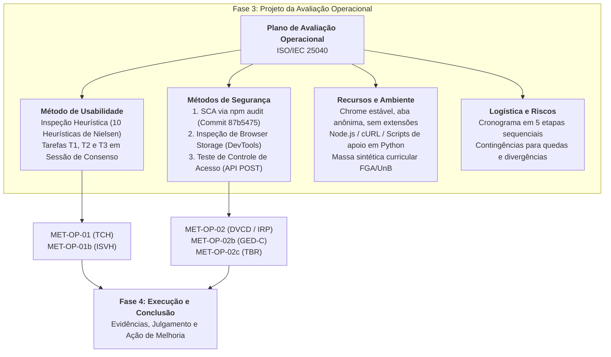

# Projeto da Avaliação — Métricas Operacionais (Fase 3)

Este documento centraliza e introduz o **Plano de Avaliação** das métricas operacionais desenvolvido para a funcionalidade _Planejar formatura_ do No Fluxo UnB, em estrita conformidade com a atividade **"Projetar a avaliação"** da norma **ISO/IEC 25040:2011/2024**.

A Fase 3 estabelece as bases operacionais, os métodos práticos, os recursos tecnológicos, os dados de teste e a logística necessários para que a coleta e a análise de dados na Fase 4 sejam executadas de maneira repetível, reprodutível, auditável e sem vieses.

---

## 1. Navegação pelas Páginas da Fase 3 (Métricas Operacionais)

A documentação do projeto da avaliação operacional está modularizada em páginas temáticas:

| Seção / Página | Conteúdo e Foco Principal | Métricas Relacionadas |
| :--- | :--- | :---: |
| **[1. Visão Geral do Plano](operacionais/visaoGeral.md)** | Objetivos do plano, escopo operacional, premissas de execução e alinhamento com a ISO/IEC 25040. | Todas |
| **[2. Especificação dos Métodos](operacionais/metodos.md)** | Métodos de medição: Inspeção Heurística de Nielsen (Usabilidade), Análise SCA (`npm audit`), Inspeção de *Browser Storage* e Bateria de Testes Negativos de API (Segurança). | `MET-OP-01` `MET-OP-01b` `MET-OP-02` `MET-OP-02b` `MET-OP-02c` |
| **[3. Recursos e Massa de Dados](operacionais/ambienteERecursos.md)** | Especificações de hardware, software, navegadores, ferramentas auxiliares, papéis da equipe e perfis de histórico sintético (conformidade LGPD). | Todas |
| **[4. Roteiro do Avaliador](operacionais/roteiroAvaliador.md)** | Instruções passo a passo para os avaliadores, critérios operacionais de severidade (1–4), protocolos de sessão de consenso e formulários de registro. | Todas |
| **[5. Cronograma e Riscos](operacionais/cronogramaERiscos.md)** | Sequenciamento das atividades, matriz de precedências, alocação de esforço para a Fase 4, análise de riscos e planos de contingência. | Todas |
| **[6. Matriz de Rastreabilidade](operacionais/rastreabilidade.md)** | Mapeamento bidirecional unificando Requisitos (Fase 1) $\leftrightarrow$ Especificação GQM (Fase 2) $\leftrightarrow$ Projeto da Avaliação (Fase 3) $\leftrightarrow$ Execução Prevista (Fase 4). | Todas |

---

## 2. Síntese do Plano de Avaliação Operacional

O diagrama a seguir sintetiza a articulação entre os métodos, os recursos e as métricas operacionais projetadas para a execução na Fase 4:

---

## 3. Integração com a Avaliação Funcional

A execução do plano operacional ocorre de forma sincronizada com as métricas de **Adequação Funcional**. Ambas as frentes compartilham o mesmo commit congelado da aplicação (`87b5475`), a mesma instância de teste e a mesma base curricular de Engenharia de Software da FGA/UnB. Essa integração garante que o plano formatado pelo motor de regras seja avaliado simultaneamente em sua correção funcional, na sua compreensibilidade ergonômica e na segurança da custódia dos dados dos estudantes.

---

## Histórico de versão

| Nome do Membro | Contribuição | Data | Commit |
| :--- | :--- | :--- | :--- |
| [Giovani De Oliveira Teodoro Coelho](https://github.com/Gotc2607) | Estruturação da página principal da Fase 3 para métricas operacionais e modularização do plano | 14/11/2026 | [6594e5c](https://github.com/FCTE-Qualidade-de-Software-1/2026-2_T02_JEAN_SAMMET/commit/6594e5c2349ee5fc4dc632f07b97bc8191357819) |

