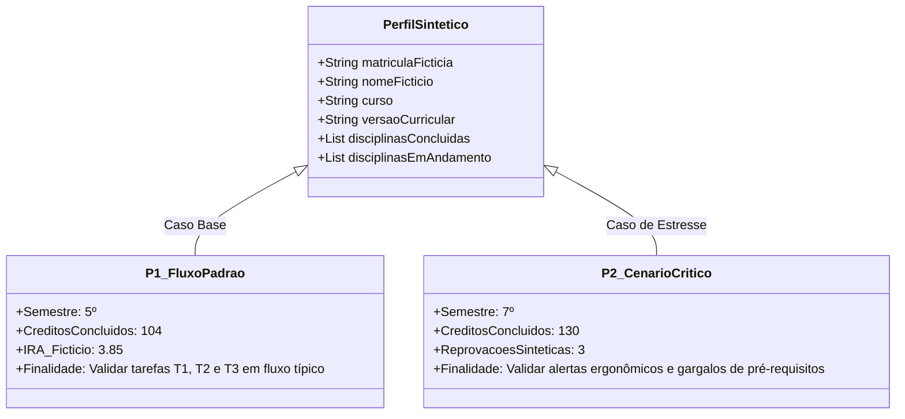

# Recursos de Hardware, Software e Massa de Dados Sintética

Este documento especifica os **recursos de hardware, software, ambiente experimental e massa de dados sintética** necessários para a execução reprodutível das medições operacionais na Fase 4, em cumprimento às diretrizes da norma **ISO/IEC 25040:2011/2024**.

---

## 1. Ambiente Experimental e Configuração Tecnológica

Para eliminar ruídos causados por variações de ambiente, as medições operacionais devem ser conduzidas sob uma configuração de referência estritamente padronizada:

| Elemento | Especificação de Referência | Justificativa Técnica |
| :--- | :--- | :--- |
| **Sistema Operacional** | Linux Ubuntu (versão 22.04 LTS ou superior) / Windows 11 (64-bit) | Sistemas operacionais majoritários dos membros da equipe e desenvolvedores do projeto. |
| **Hardware Mínimo** | Processador Intel Core i5 / AMD Ryzen 5 (4+ núcleos), 8 GB de RAM, SSD com $\ge 10$ GB livres | Assegura que lentidões de renderização na interface ou na auditoria não sejam fruto de escassez de hardware. |
| **Navegador Web** | Google Chrome (versão estável $\ge 120.0$, 64 bits) | Motor Chromium utilizado pela ampla maioria dos discentes e base recomendada pelo No Fluxo UnB. |
| **Resolução de Tela** | 1920 × 1080 pixels (Full HD), viewport maximizado, zoom em 100% | Padroniza a área visual e a densidade dos grafos curriculares, evitando distorções heurísticas causadas por zoom indevido. |
| **Isolamento do Navegador** | Janela Anônima (*Incognito Window*), todas as extensões e bloqueadores de anúncios desativados | Impede interferências de scripts injetados por extensões (ex.: adblockers, tradutores) na renderização e no armazenamento. |
| **Auditoria de Dependências Caixa-Preta** | Extensão Retire.js para Chrome ou DevTools Network/Sources | Varredura de vulnerabilidades conhecidas (CVEs) em bibliotecas cliente servidas pela aplicação pública. |
| **Ferramentas de Suporte** | Python $\ge 3.10$, cURL $\ge 7.80$ e terminal bash | Execução automatizada da bateria de requisições de controle de acesso de API e análise estatística. |

---

## 2. Massa de Dados Sintética (Synthetic Test Data)

### 2.1 Justificativa Ética e Conformidade com a LGPD

A premissa fundamental da avaliação é a **não utilização de dados reais de discentes** da Universidade de Brasília. Em respeito à Lei Geral de Proteção de Dados Pessoais (Lei nº 13.709/2018 - LGPD), o processo adota exclusivamente **históricos acadêmicos sintéticos**.

Esses históricos simulam com precisão a estrutura curricular do curso de **Engenharia de Software (Currículo 6360/1 da FGA/UnB)**, contendo códigos reais de disciplinas, créditos e pré-requisitos, mas associados a matrículas, nomes e identificadores estritamente fictícios.

### 2.2 Perfis Sintéticos de Teste

Para cobrir a diversidade de comportamentos da tela de planejamento e validar os limites de usabilidade e segurança, foram projetados dois perfis de teste complementares:



#### Perfil P1: Estudante em Fluxo Regular (Caso Base)
- **Matrícula Fictícia:** `990000001`
- **Nome Fictício:** *Estudante Sintético Alpha*
- **Situação:** Cursando o 5º semestre de Engenharia de Software.
- **Histórico:** Concluiu 104 créditos obrigatórios (cobrindo o ciclo básico da Engenharia e as disciplinas introdutórias como APC, Orientação a Objetos, Estruturas de Dados e Requisitos de Software).
- **Objetivo da Avaliação:** Validar o percurso padrão das tarefas $T_1$ (localização da previsão de formatura), $T_2$ (compreensão das matérias críticas) e $T_3$ (ajuste rotineiro de créditos de 24 para 20 créditos/semestre).

#### Perfil P2: Estudante com Dependências Críticas (Cenário de Estresse)
- **Matrícula Fictícia:** `990000002`
- **Nome Fictício:** *Estudante Sintético Beta*
- **Situação:** Cursando o 7º semestre com histórico contendo reprovações sintéticas em disciplinas de cadeia longa (ex.: Cálculo 1 e Engenharia de Requisitos).
- **Objetivo da Avaliação:** Testar o comportamento da interface frente a planos estendidos, verificando se o grafo gera poluição visual catastrófica (Heurística #8), se o sistema emite feedback adequado ao recalcular (Heurística #1) e se as advertências curriculares orientam a recuperação do aluno (Heurística #9).

### 2.3 Estrutura do Arquivo de Dados (`testes/massa_dados_sintetica.json`)

A massa de dados foi padronizada em formato JSON para fácil injeção via script ou carregamento manual na interface:

```json
{
  "versao_schema": "1.0",
  "descricao": "Massa de teste sintética para avaliação operacional ISO/IEC 25040",
  "estudante": {
    "matricula": "990000001",
    "nome": "Estudante Sintético Alpha",
    "curso": "Engenharia de Software",
    "codigo_curriculo": "6360/1",
    "ira_simulado": 3.85,
    "semestre_atual": 5,
    "disciplinas_concluidas": [
      { "codigo": "FGA0168", "nome": "ALGORITMOS E PROGRAMAÇÃO DE COMPUTADORES", "mencao": "MS", "creditos": 6 },
      { "codigo": "FGA0169", "nome": "DESENHO INDUSTRIAL ASSISTIDO POR COMPUTADOR", "mencao": "SS", "creditos": 4 },
      { "codigo": "FGA0170", "nome": "ENGENHARIA E AMBIENTE", "mencao": "MS", "creditos": 4 },
      { "codigo": "MAT0025", "nome": "CÁLCULO 1", "mencao": "MM", "creditos": 6 },
      { "codigo": "FGA0157", "nome": "ORIENTAÇÃO A OBJETOS", "mencao": "SS", "creditos": 4 },
      { "codigo": "FGA0158", "nome": "ESTRUTURAS DE DADOS", "mencao": "MS", "creditos": 4 },
      { "codigo": "FGA0173", "nome": "REQUISITOS DE SOFTWARE", "mencao": "SS", "creditos": 4 }
    ],
    "parametros_planejamento_padrao": {
      "limite_creditos_semestre": 24,
      "priorizar_obrigatorias": true,
      "incluir_optativas": false
    }
  }
}
```

---

## 3. Papéis e Responsabilidades da Equipe

A condução dos testes operacionais requer distribuição clara de atribuições entre os membros da equipe avaliadora:

| Papel | Responsabilidades Principais | Membros Designados |
| :--- | :--- | :--- |
| **Avaliador Heurístico 1** | Execução individual e cega da inspeção heurística (tarefas $T_1$, $T_2$, $T_3$), registro de inconformidades e severidades. | Membro da equipe Jean Sammet |
| **Avaliador Heurístico 2** | Execução individual independente da inspeção heurística para validação cruzada interavaliadores. | Membro da equipe Jean Sammet |
| **Consolidador / Mediador de Usabilidade** | Condução da sessão de consenso, facilitação do debate de divergências, registro da ata final e cálculo de $TCH$ e $ISVH$. | [Giovani Coelho](https://github.com/Gotc2607) |
| **Auditor de Segurança (SCA e Storage)** | Execução do `npm audit`, extração de CVEs, inspeção do DevTools (*Storage*), contagem de chaves e cálculo de $IRP$ e $GED\text{-}C$. | [Giovani Coelho](https://github.com/Gotc2607) |
| **Operador de Testes de API (Controle de Acesso)** | Execução do script automatizado das 10 requisições HTTP, captura de logs de resposta e apuração do índice $TBR$. | [Giovani Coelho](https://github.com/Gotc2607) |

---

## Histórico de versão

| Nome do Membro | Contribuição | Data | Commit |
| :--- | :--- | :--- | :--- |
| [Giovani De Oliveira Teodoro Coelho](https://github.com/Gotc2607) | Especificação de hardware, software, isolamento, massa sintética LGPD e matriz de papéis | 14/11/2026 | [6594e5c](https://github.com/FCTE-Qualidade-de-Software-1/2026-2_T02_JEAN_SAMMET/commit/6594e5c2349ee5fc4dc632f07b97bc8191357819) |

