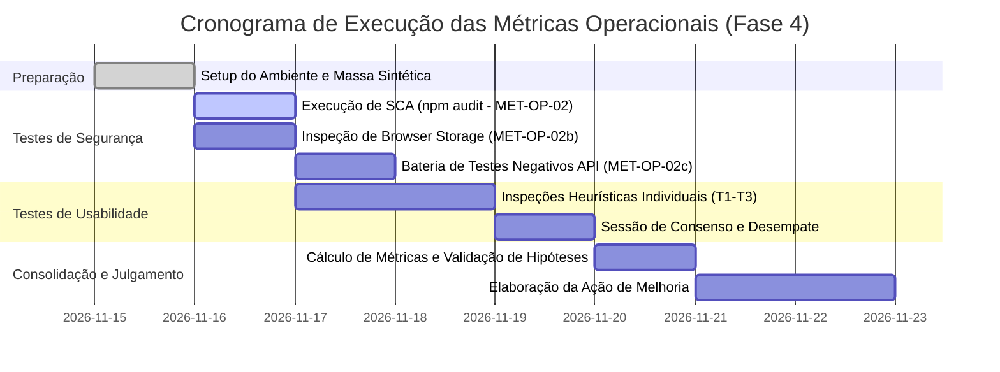

# Cronograma de Execução na Fase 4 e Gestão de Riscos

Este documento formaliza o **cronograma detalhado de execução das medições operacionais na Fase 4**, a estimativa de esforço por atividade, as relações de precedência e a **gestão de riscos e contingências**, em conformidade com as diretrizes do processo **ISO/IEC 25040:2011/2024** e o modelo de gestão **PSM/CID**.

---

## 1. Cronograma e Logística de Execução (Fase 4)

A execução das medições operacionais na Fase 4 está estruturada em cinco etapas sequenciais lógicas, garantindo que os dados brutos sejam gerados, auditados e consolidados antes do julgamento final da qualidade.

### 1.1 Matriz de Atividades, Precedências e Esforço Estimado

| Etapa | ID | Descrição da Atividade Operacional | Responsável Principal | Precedência | Esforço Estimado |
| :---: | :---: | :--- | :--- | :---: | :---: |
| **1** | `ATV-OP-01` | **Setup e Certificação de Ambiente:** Clonagem limpa do commit `87b5475`, validação de versões de Node/NPM, configuração do Chrome anônimo e verificação da massa sintética P1 e P2. | [Giovani Coelho](https://github.com/Gotc2607) | — | 2 h |
| **2** | `ATV-OP-02` | **Auditoria de Dependências (SCA):** Execução do `npm audit --json` em `frontend/` e `backend/`, execução do script `analisador_sca_irp.py` e extração do $IRP$ (`MET-OP-02`). | [Giovani Coelho](https://github.com/Gotc2607) | `ATV-OP-01` | 2 h |
| **2** | `ATV-OP-03` | **Inspeção de Persistência no Navegador:** Carga de massa sintética, verificação de `localStorage`, `sessionStorage` e cookies no DevTools, cálculo de $GED\text{-}C$ (`MET-OP-02b`). | [Giovani Coelho](https://github.com/Gotc2607) | `ATV-OP-01` | 2 h |
| **2** | `ATV-OP-04` | **Bateria de Testes de Controle de Acesso:** Disparo automatizado das 10 requisições negativas contra a API de planejamento e apuração de $TBR$ (`MET-OP-02c`). | [Giovani Coelho](https://github.com/Gotc2607) | `ATV-OP-01` | 2 h |
| **3** | `ATV-OP-05` | **Inspeções Heurísticas Individuais:** Dois avaliadores percorrem de forma independente as tarefas $T_1$, $T_2$ e $T_3$, preenchendo as folhas com notas e evidências. | Avaliadores 1 e 2 | `ATV-OP-01` | 4 h (2h/aval) |
| **3** | `ATV-OP-06` | **Sessão de Consenso e Alinhamento:** Debate técnico das discrepâncias, arbitragem das notas finais, elaboração da ata e consolidação de $TCH$ e $ISVH$ (`MET-OP-01/01b`). | Equipe Avaliadora | `ATV-OP-05` | 2 h |
| **4** | `ATV-OP-07` | **Consolidação dos Dados e Julgamento:** Comparação das 5 métricas contra os critérios de pontuação da Fase 2, confirmação/refutação das hipóteses $H\text{-}OP\text{-}01$ e $H\text{-}OP\text{-}02$. | [Giovani Coelho](https://github.com/Gotc2607) | `ATV-OP-02`, `03`, `04`, `06` | 3 h |
| **5** | `ATV-OP-08` | **Projeto da Ação de Melhoria (Fase 4):** Elaboração e implementação de melhoria concreta sobre as falhas operacionais mais graves identificadas (ex.: correção de storage ou heurística). | Equipe Avaliadora | `ATV-OP-07` | 6 h |
| **Total**| — | **Carga Horária Total Prevista para o Plano Operacional** | — | — | **23 horas** |

---

## 2. Gestão de Riscos e Planos de Contingência

Em conformidade com a ISO/IEC 25040, a equipe identificou proativamente os potenciais riscos operacionais que poderiam comprometer a repetibilidade, a integridade ou o cronograma dos testes, definindo ações de contingência imediatas:

| ID | Risco Identificado | Probabilidade | Impacto | Ação Preventiva | Plano de Contingência Imediato |
| :---: | :--- | :---: | :---: | :--- | :--- |
| **R-01** | **Instabilidade da Instância Externa:** A instância `no-fluxo.crianex.com` apresentar instabilidade, lentidão excessiva de rede ou indisponibilidade temporária. | Média | Alto | Testar a conectividade da URL pública 24 horas antes do início da bateria de medições. | **Execução em Ambiente Local:** Clonar os repositórios oficiais e rodar o backend (`npm run start`) e o frontend (`npm run dev`) localmente na máquina de referência (`localhost:5173`). |
| **R-02** | **Divergência Severa entre Avaliadores Heurísticos:** Avaliadores divergirem criticamente sobre a presença de uma violação ou atribuírem severidades opostas (ex.: cosmético vs catastrófico). | Alta | Médio | Nivelamento conceitual prévio utilizando os critérios objetivos de severidade da Fase 2. | **Sessão de Desempate Mediada:** Reexame conjunto da tela gravada. Em caso de empate persistente, prevalece a classificação mais conservadora (severidade mais alta), justificando formalmente na ata. |
| **R-03** | **Falsos Positivos em `devDependencies` no SCA:** O `npm audit` reportar vulnerabilidades críticas em pacotes de desenvolvimento (ex.: linters, bundlers de teste) que não são empacotados na build de produção. | Alta | Médio | Executar o comando com a flag seletiva para auditar dependências de produção. | **Segregação na Análise:** O script analisador filtra e documenta separadamente `dependencies` (produção) e `devDependencies`, recalculando o $IRP$ de produção conforme especificado na Fase 2. |
| **R-04** | **Alteração Acidental na Linha de Base:** Atualização de dependências ou alteração de código local durante a fase de testes, quebrando a consistência da medição. | Baixa | Alto | Criação de tag de verificação e checagem de hash git (`git status`) antes de qualquer medição. | **Restauração Forçada:** Descartar qualquer alteração com `git reset --hard 87b5475` e reinstalar dependências usando estritamente o lockfile (`npm ci`). |
| **R-05** | **Vazamento Inadvertido de Dados Pessoais:** Inserção acidental de dados de estudantes reais durante testes manuais de importação de histórico. | Baixa | Crítico | Restrição total aos arquivos sintéticos `massa_dados_sintetica.json` padronizados no repositório. | **Purga e Notificação:** Limpeza imediata do storage local (`localStorage.clear()`), deleção de arquivos temporários e refação do teste com a massa homologada. |

---

## Histórico de versão

| Nome do Membro | Contribuição | Data | Commit |
| :--- | :--- | :--- | :--- |
| [Giovani De Oliveira Teodoro Coelho](https://github.com/Gotc2607) | Elaboração do cronograma em 5 etapas, cálculo de esforço, grafo de precedências e matriz de riscos operacionais | 14/11/2026 | [6594e5c](https://github.com/FCTE-Qualidade-de-Software-1/2026-2_T02_JEAN_SAMMET/commit/6594e5c2349ee5fc4dc632f07b97bc8191357819) |

