# Visão Geral do Plano de Avaliação Operacional

Este documento apresenta a **visão geral, governança e critérios operacionais** do Plano de Avaliação elaborado na Fase 3 do processo **ISO/IEC 25040:2011/2024**, cobrindo as características de **Usabilidade** e **Segurança** da funcionalidade _Planejar formatura_ do No Fluxo UnB.

---

## 1. Propósito do Plano de Avaliação

O objetivo central deste plano é transformar as especificações conceituais e matemáticas definidas na Fase 2 ([Métricas Operacionais](../../fase2/metricasOperacionais.md)) em um **conjunto estruturado e reprodutível de procedimentos experimentais**. 

De acordo com a ISO/IEC 25040 (item *Design the evaluation*), o plano deve assegurar que:
1. Qualquer membro da equipe avaliadora ou auditor externo consiga reproduzir rigorosamente os testes e obter medições consistentes.
2. Os métodos sejam objetivos, minimizando vieses subjetivos de interpretação.
3. Os dados brutos gerados sejam auditáveis e armazenados com rastreabilidade total até as hipóteses $H\text{-}OP\text{-}01$ e $H\text{-}OP\text{-}02$.
4. Os limites éticos e jurídicos da Lei Geral de Proteção de Dados Pessoais (LGPD) sejam integralmente preservados pelo uso exclusivo de massa sintética.

---

## 2. Escopo e Limites Operacionais

O escopo operacional detalha as fronteiras técnicas da avaliação:

| Dimensão | No Escopo do Plano | Fora do Escopo do Plano |
| :--- | :--- | :--- |
| **Tipo de Avaliação** | **Avaliação Estritamente Caixa-Preta (*Black-Box Testing*):** Não requer acesso ao código-fonte interno, bancos de dados ou repositórios privados da aplicação. Toda a avaliação opera sobre a interface web pública, o comportamento no navegador e os endpoints expostos. | Auditorias de caixa-branca que exigem inspeção direta de código-fonte de backend ou testes unitários internos. |
| **Ponto de Aplicação de Usabilidade** | Interface gráfica na rota pública `/plano-formatura` de `no-fluxo.crianex.com`, contemplando linha do tempo, nós do fluxo curricular, cards de formatura e controles de créditos. | Telas de autenticação externa, módulo de fórum ou páginas institucionais não ligadas ao planejamento. |
| **Ponto de Aplicação de Segurança** | Análise de composição de software (SCA) via caixa-preta (*fingerprinting* de bibliotecas/Retire.js), auditoria de mecanismos de persistência no cliente (`localStorage`, `sessionStorage`, `cookies`) e testes de controle de acesso a rotas HTTP. | Testes destrutivos de negação de serviço (DoS/DDoS), engenharia social ou ataques contra a infraestrutura de hospedagem externa. |
| **Massa de Dados** | Históricos acadêmicos sintéticos construídos com base no fluxo curricular de Engenharia de Software da FGA/UnB. | Dados reais de estudantes da UnB, matrículas reais, CPFs ou históricos acadêmicos extraídos do SIGAA sem descaracterização total. |
| **Instância Avaliada** | Instância oficial em produção: `https://no-fluxo.crianex.com`. | Builds locais ou alterações arbitrárias não homologadas. |

---

## 3. Critérios de Prontidão (Entry) e Critérios de Conclusão (Exit)

Para assegurar a validade metodológica da avaliação antes de iniciar e antes de encerrar as medições, foram fixados os seguintes critérios:

```mermaid
flowchart LR
    subgraph Entrada [Critérios de Prontidão - Entry Criteria]
        E1["Commit 87b5475 congelado"]
        E2["Ambiente limpo e certificado"]
        E3["Massa sintética validada"]
        E4["Avaliadores treinados no checklist"]
    end

    subgraph Execucao [Execução Controlada - Fase 4]
        EX1["Testes de Usabilidade"]
        EX2["Auditoria de Segurança"]
    end

    subgraph Saida [Critérios de Conclusão - Exit Criteria]
        S1["100% dos testes executados"]
        S2["Sessão de consenso realizada"]
        S3["Logs e dumps versionados"]
        S4["Hipóteses H-OP-01 e H-OP-02 julgadas"]
    end

    Entrada --> Execucao --> Saida
```

### 3.1 Critérios de Entrada (*Entry Criteria*)
A execução da Fase 4 só é autorizada após o cumprimento cumulativo dos seguintes itens:
1. **Congelamento de Código:** Garantia de que a auditoria estática e os testes de interface ocorrem estritamente sobre o commit `87b5475`.
2. **Ambiente Certificado:** Navegador na versão estável especificada, sem extensões ou plugins ativos, executando em aba anônima.
3. **Massa Sintética Pronta:** Arquivo JSON com histórico de teste gerado, revisado e conferido quanto à ausência total de dados pessoais reais.
4. **Nivelamento Técnico:** Avaliadores com pleno domínio das 10 Heurísticas de Nielsen e das definições de severidade de 1 a 4.

### 3.2 Critérios de Saída (*Exit Criteria*)
A fase de medição operacional é considerada formalmente concluída quando:
1. **Integralidade da Coleta:** Todos os 10 itens do checklist heurístico foram preenchidos por todos os avaliadores designados.
2. **Consolidação por Consenso:** Todas as discrepâncias entre avaliadores foram debatidas e formalmente arbitradas com justificativa registrada.
3. **Evidências Registradas:** Execução completa dos comandos `npm audit`, varredura documentada do *browser storage* e envio das 10 requisições de controle de acesso com relatórios anexados.
4. **Cálculo das Métricas:** Apuração final de $TCH$, $ISVH$, $IRP$, $GED\text{-}C$ e $TBR$ confrontados contra os níveis de julgamento da Fase 2.

---

## 4. Governança e Preservação de Evidências

A reprodutibilidade exigida pela norma ISO/IEC 25040 impõe a rastreabilidade estrita de cada artefato gerado. Todas as evidências operacionais coletadas devem obedecer ao seguinte padrão de armazenamento no repositório:

- `testes/evidencias/usabilidade/`: Planilhas individuais de inspeção e ata da sessão de consenso com justificativas de severidade.
- `testes/evidencias/seguranca/sca/`: Arquivos brutos `audit-frontend.json` e `audit-backend.json`.
- `testes/evidencias/seguranca/storage/`: Capturas de tela do painel *Application > Storage* do DevTools e exportação JSON do estado das chaves.
- `testes/evidencias/seguranca/api/`: Logs textuais das respostas HTTP retornadas pelo script automatizado de teste de controle de acesso.

---

## Histórico de versão

| Nome do Membro | Contribuição | Data | Commit |
| :--- | :--- | :--- | :--- |
| [Giovani De Oliveira Teodoro Coelho](https://github.com/Gotc2607) | Criação da visão geral do plano de avaliação operacional, critérios de entrada/saída e governança | 14/11/2026 | [6594e5c](https://github.com/FCTE-Qualidade-de-Software-1/2026-2_T02_JEAN_SAMMET/commit/6594e5c2349ee5fc4dc632f07b97bc8191357819) |

