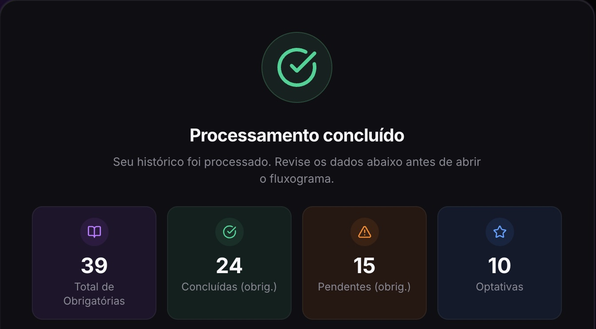
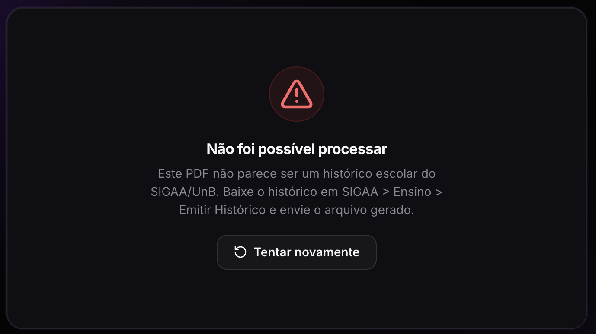

# Piloto e Prontidão

*[Voltar para a Matriz Geral de Rastreabilidade](../../rastreabilidade.md)*

Esta página registra a preparação verificada, antes do encerramento de EC-01. O piloto confirma a viabilidade dos procedimentos; os cálculos e julgamentos consolidados estão na [Fase 4](../fase4/conclusao.md).

## 1. Entrada e fluxo verificados

O histórico oficial **H0** foi enviado manualmente por Gustavo à conta de teste. A tela mostrou **Processamento concluído**, matriz 6360/1 e semestre 2026.2. O resumo apresentou 39 obrigatórias, 24 concluídas, 15 pendentes e 2.130h/3.480h integralizadas, compatíveis com a referência sanitizada. Esses totais não substituem a conferência individual dos 44 registros e das 8 equivalências na Fase 4.

*Figura 1 — Resumo de H0 aceito. Fonte: No Fluxo. Recorte sem identificação, índices acadêmicos ou nome do arquivo.*

O fluxo **Visualizar fluxograma → Planejar formatura → Preferências** foi acessado; o assistente de três etapas e o plano gerado ficaram observáveis. Foram aceitas as configurações **24 créditos/360h**, **20/300h** e **32/480h**, com recálculo. A base foi restaurada para **24/360h**, sem indicador de recálculo pendente. Isso confirma a operação dos controles, sem julgar a correção de todas as alocações.

*Figura 2 — Controle em 20 créditos/300h após o recálculo. Fonte: No Fluxo.*

*Figura 3 — Controle em 32 créditos/480h após o recálculo. Fonte: No Fluxo.*

*Figura 4 — Controle restaurado para 24 créditos/360h. Fonte: No Fluxo.*

## 2. Condições para encerrar o preparo

**Tabela 1 — Condições verificadas e ligação com a avaliação.**

| Frente | Verificação do piloto | Procedimento correspondente na Fase 4 |
|---|---|---|
| Entrada e planejamento | H0 aceito; plano e controles acessíveis; C1/C2 aceitos e base restaurada | Gabriel confere CT-01 a CT-07 por unidade e registra cobertura. |
| Usabilidade | Tarefas e checklist disponíveis; dupla Gustavo/Gabriel definida | Alinhar severidade e realizar duas inspeções independentes antes do consenso. |
| Ambiente | Viewport, zoom, hardware, sessão e estimativas de rede registrados | Cada avaliador registra seu ambiente; a versão do servidor permanece desconhecida. |
| SCA | Retire.js 6.1.1 executado sobre 129 scripts estáticos carregados; pdf.js 5.4.624 reconhecido | Giovani registra cobertura e limitações. O reconhecimento de um componente não cobre todas as dependências nem o backend. |
| Storage | Acesso a localStorage, sessionStorage e cookies confirmado; somente metadados exportados | Giovani coleta os três estados e classifica as chaves sem publicar valores pessoais. |
| API | POST real do planejamento retornou 200; mesma chamada sem Authorization retornou 401 | Controle positivo e bateria negativa, com pré-condições próprias, registrados nos [dados operacionais](../fase4/operacionais/dadosBrutos.md#5-controle-de-acesso-bateria-de-dez-condicoes). |

*Fonte: registros do piloto, organizados pela equipe.*

**Fase 3 concluída no escopo de preparação:** procedimentos, recursos, responsáveis e viabilidade básica verificados. A conclusão não significa aprovação das métricas nem cobertura integral dos casos. Condições ausentes permanecem Sem cobertura/Inconclusivo na Fase 4; não preencher resultados automaticamente.

O prazo é **22/11**. A sequência de atividades está no [cronograma de avaliação](cronograma.md); o esforço realizado permanece nos registros próprios do PSM, sem alteração por este piloto.

## 3. Evidências e limites

Os registros sanitizados do piloto ficam em `testes/evidencias/piloto/fase3-2026-11-15/`: ambiente, créditos, API, metadados de storage, inventário dos scripts, cobertura e relatório do scanner. PDF, tokens, payload acadêmico e valores de armazenamento não foram incluídos nos arquivos versionados.

A chamada observada é `POST https://api-nofluxo.crianex.com/planejamento/gerar-plano`, com token direto em Authorization, sem prefixo Bearer. O corpo possui `curriculo_completo`, `codigos_concluidos`, `semestre_atual` e `limite_creditos`. A verificação sem Authorization preservou método, corpo e User-ID. Não se calculou TBR a partir desse único teste.

O scanner foi validado conforme sua [documentação oficial](https://github.com/RetireJS/retire.js/blob/master/node/README.md). Seu relatório reconheceu pdf.js 5.4.624 sem achados reportados para esse componente. Isso não equivale a IRP global igual a zero: dependências não reconhecidas, outros fluxos e backend não estão cobertos.

C0–C5 mantêm H0 fixo. CT-02 exige seleção explícita do par de optativas, e não apenas uma reserva de horas. A conferência consolidada está no [registro de co-requisitos](../fase4/funcionais/dadosBrutos.md#ct-02-co-requisitos). As regras curriculares e os contratos do cenário estão em [Fontes e regras](funcionais/fontes.md).

As falhas anteriores de controle do Chrome foram superadas pela conexão da extensão. As capturas de Gabriel foram integradas aos [registros funcionais de H0](../fase4/funcionais/dadosBrutos.md), com identificação dos estados exibidos.

## 4. Rejeição do PDF de teste

O PDF sintético enviado no teste relatado por Gustavo foi rejeitado. O importador exige o histórico oficial gerado pelo SIGAA/UnB. Os arquivos sintéticos foram retirados; H0 foi aceito e é a entrada adotada.

*Figura 5 — Captura fornecida por Gustavo. Comprova a rejeição dessa entrada, sem gerar nota para as métricas.*

## 5. Referências

Referências usadas nesta página, conforme [Referências — Fase 1](../../referencias/fase1.md), [Referências — Fase 2](../../referencias/fase2.md) e [Referências — Fase 3](../../referencias/fase3.md).

- NIELSEN, Jakob. **10 Usability Heuristics for User Interface Design**. Nielsen Norman Group, 1994. Disponível em: <https://www.nngroup.com/articles/ten-usability-heuristics/>.
- NIELSEN, Jakob. **Heuristic Evaluation**. In: NIELSEN, Jakob; MACK, Robert L. (Org.). *Usability Inspection Methods*. Nova York: John Wiley & Sons, 1994. p. 25-62.
- NIELSEN, Jakob. **Severity Ratings for Usability Problems**. Nielsen Norman Group, 1995. Disponível em: <https://www.nngroup.com/articles/how-to-rate-the-severity-of-usability-problems/>. Acesso em: 14 nov. 2026.
- NO FLUXO UNB. **No Fluxo UnB**. Crianex, [s. d.]. Disponível em: [aplicação No Fluxo UnB](https://no-fluxo.crianex.com). Acesso em: 15 out. 2026.

---

## Histórico de versão

| Nome do Membro | Contribuição | Data | Commit |
| :--- | :--- | :--- | :--- |
| [Gustavo Fornaciari](https://github.com/GUGOFO) | Registro da exploração do fluxo e das pendências do piloto sintético | 15/11 | [aa0c61f](https://github.com/FCTE-Qualidade-de-Software-1/2026-2_T02_JEAN_SAMMET/commit/aa0c61fac5e9d2db19adec76fd052a2bb6b04b90) |
| [Gustavo Fornaciari](https://github.com/GUGOFO) | Padronização da entrada H0 | 15/11 | [f454d2c](https://github.com/FCTE-Qualidade-de-Software-1/2026-2_T02_JEAN_SAMMET/commit/f454d2c099e16a6dd593b92420b541a18262b086) |
| [Gustavo Fornaciari](https://github.com/GUGOFO) | Registro do piloto com H0, responsáveis e condições restantes de prontidão | 15/11 | [7a74d9e](https://github.com/FCTE-Qualidade-de-Software-1/2026-2_T02_JEAN_SAMMET/commit/7a74d9e0809e91d60a36a88559b357bfe171f37e) |
| [Yasmim de Souza Santos](https://github.com/eii-yahs) | Inclusão das referências utilizadas na página | 22/11 | Não commitado |
| [Giovani De Oliveira Teodoro Coelho](https://github.com/Gotc2607) | Inclusão de link de retorno para a Matriz Geral de Rastreabilidade | 24/11 | [8f30292](https://github.com/FCTE-Qualidade-de-Software-1/2026-2_T02_JEAN_SAMMET/commit/8f302921912ed18ed6f6a18507c2bbab654f3366) |
