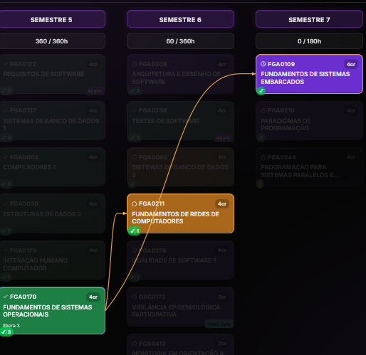
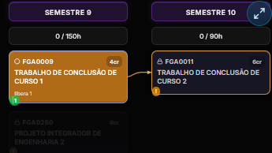
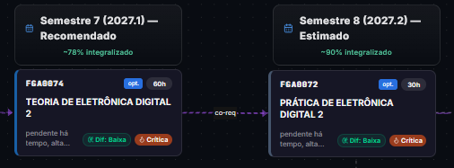
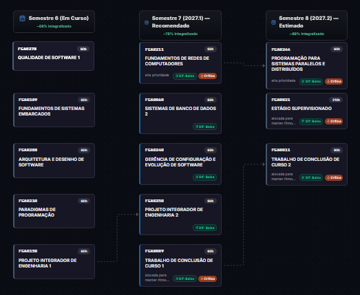
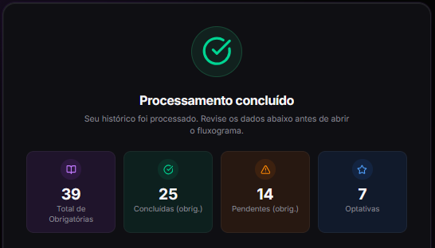
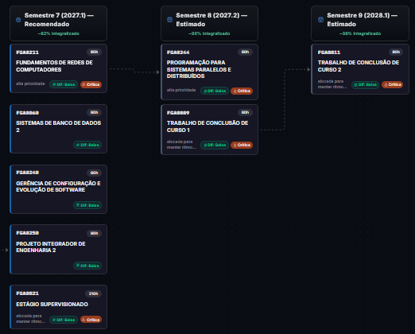
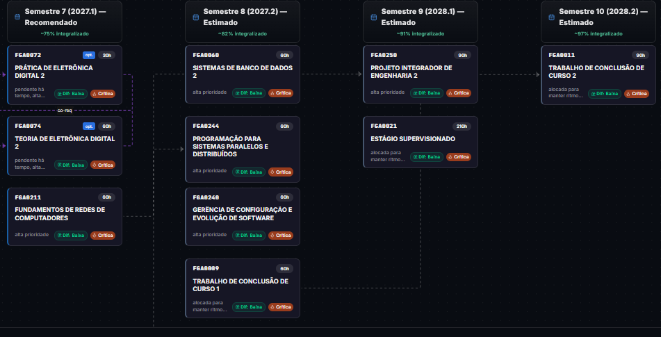
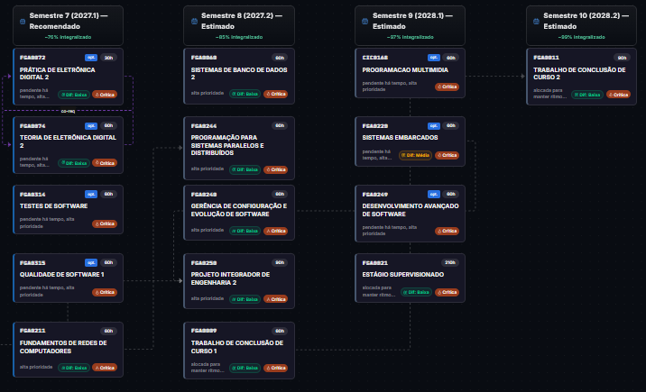

# Análise dos Resultados e Julgamento — Métricas Funcionais (Fase 4)

## 1. Método de processamento

A avaliação segue as fórmulas e metas do [GQM da Fase 2](../../fase2/funcionais/GQM.md) e o [roteiro da Fase 3](../../fase3/funcionais/roteiro.md). Os resultados foram transcritos das análises de execução informadas pelo avaliador e das capturas mantidas em `testes/evidencias/funcionais/execucao-2026-11-15/`.

Para métricas de violação, `conforme=0` representa uma violação; para cobertura/conformidade, `conforme=1` representa atendimento. Só entram no cálculo linhas com classificação, identificação da unidade, regra/fonte e referência de evidência. `INCONCLUSIVO` não entra no denominador. Para os universos fixos de H0 (14 obrigatórias, 41 componentes e 7 equivalências), o processador exige uma linha válida por unidade para emitir percentual final.

A execução foi realizada no ambiente do avaliador. O registro anterior de falha DNS em `tentativa_acesso_aplicacao.log` é uma tentativa de pré-condição de outra execução e não invalida as capturas funcionais posteriormente fornecidas. Horário/fuso, navegador, sistema, viewport, zoom e versão do produto não foram informados; esses campos permanecem em branco/sem identificação no CSV, sem inferência.

## 2. Linha de base H0

| Fato | Valor | Uso |
|---|---:|---|
| Componentes curriculares com status | 46 | Universo de CT-04 |
| Aprovados / matriculados / trancados | 33 / 7 / 1 | Estados esperados na importação |
| Equivalências concluídas | 5 | Parte do universo CT-05 |
| Equivalências em andamento | 2 | Não podem ser tratadas como concluídas |
| Disciplinas obrigatórias pendentes | 14 (1.050h) | Denominador de CT-03 |
| Cadeias de seletividade | 2 | Fora do denominador de CT-03 |
| ENADE concluinte | 1 requisito | Fora do denominador de CT-03 |

As cinco equivalências concluídas são FGA0146→FGA0147, FGA0307→FGA0184, FGA0312→FGA0138, FGA0313→FGA0172 e FGA0314→FGA0238. As duas relações em andamento são FGA0303→FGA0150 e FGA0315→FGA0278. As últimas permanecem pendentes enquanto o status de origem for `MATRICULADO`.

## 3. Resultados consolidados

| Métrica | Cálculo observado | Resultado | Meta | Julgamento |
|---|---:|---:|---:|---|
| `MET-FUN-01` - TVP | 0/2 | **0,00%** | 0% | **Conforme** |
| `MET-FUN-02` - TVC | 2/2 | **100,00%** | 0% | **Não conforme** |
| `MET-FUN-03` - CDO | 13/14 | **92,86%** | 100% | **Não conforme** |
| `MET-FUN-04` - TDH | 0/46 | **0,00%** | 0% | **Conforme** |
| `MET-FUN-05` - TAE | 7/7  | **100,00%** | 0% | **Conforme** |
| `MET-FUN-06` - COO | -/3 | -- | -- | **Inconclusivo** |
| `MET-FUN-07` - TVS | 3/3 | **100,00%** | 0% por tipo | **Não conforme** |

OBS.: A `MET-FUN-06` foi colocada como inconclusiva devido ao ausencia de resposta visivel do sistema ao testa-lá e explicações documentadas

### 3.1 CT-01 — Pré-requisitos

As duas sequências observadas foram consideradas válidas na análise fornecida:

- `FGA0170 → FGA0211`: FGA0170 já estava concluída no H0; o produto alocou FGA0170 no semestre 5 e FGA0211 no semestre 6.
- `FGA0009 → FGA0011`: nenhuma das duas estava concluída na entrada; o produto alocou FGA0009 no semestre 9 e FGA0011 no semestre 10.

Assim, `NVP=0`, `NRP=2` e `TVP=0%`.

### 3.2 CT-02 — Co-requisitos

A captura `CT-02-TED2-PED2.png` mostra FGA0074 no semestre 7 e FGA0072 no semestre 8, apesar de serem co-requisitos recíprocos. As duas direções da relação foram registradas como violadas: `NVC=2`, `NRC=2`, `TVC=100%`. O resultado não atende à meta de 0%.

### 3.3 CT-03 — Cobertura de obrigatórias

Das 14 obrigatórias pendentes de H0, 13 aparecem no plano. FGA0206 foi omitida. Percebe que o pré-requisito alternativo FGA0242 ou FGA0171 não foi apresentado; essa relação não foi adicionada ao denominador de disciplinas obrigatórias, que continua sendo 14. Logo, `DPC=13`, `DOP=14` e `CDO=(13/14)×100=92,86%`, abaixo da meta de 100%.

### 3.4 CT-04 — Tratamento do histórico

A importação foi concluída e verificou-se que os dados reconhecidos correspondem ao esperado em H0. A captura apresenta 39 obrigatórias, 25 concluídas, 14 pendentes e 7 optativas. .

### 3.5 CT-05 — Equivalências

A captura disponível apresenta FGA0147 e FGA0172 reconhecidas com indicação de equivalência/conclusão. A análise fornecida informa que a obrigatória equivalente foi reconhecida, deixou de aparecer como pendente e não houve duplicação. Essas duas relações foram registradas como conformes.

### 3.6 CT-06 — Onboarding

As três variantes de quantidade de matérias foram julgadas não conformes frente ao alvo informado pelo cenário:

| Variante | Alvo | Composição relatada no 9º semestre | Carga observada | Desvio |
|---|---:|---|---:|---:|
| 4 matérias (`C5-4`) | 240h | 210h + 90h | 300h | +60h |
| 6 matérias (`C5-6`) | 360h | 210h + 3×60h | 390h | +30h |
| 8 matérias (`C5-8`) | 480h | 210h + 90h + 4×60h | 540h | +60h |

Para as três expectativas verificáveis, `NEC=0`, `NEV=3` e `COO=0%`. Os efeitos das opções de trabalho/estágio (`C3`) e velocidade/equilíbrio (`C4`) foram classificados como inconclusivos, porque as capturas Antes/Depois não mostram mudança visual identificável e o protocolo não define um efeito algorítmico obrigatório para essas preferências. Esses dois registros não entram no denominador de COO.

### 3.7 CT-07 — Restrições semestrais

As três variantes foram julgadas não conformes frente aos alvos de carga selecionados: 300h para 240h, 390h para 360h e 540h para 480h. Assim, `NVS=3`, `NRS=3` e `TVS=100%` para o tipo **alvo de carga do cenário**.

É importante distinguir o alvo de cada cenário da faixa global da matriz (mínimo 240h e máximo 480h por período). As saídas de 300h e 390h estão dentro da faixa global 240–480h; sua não conformidade decorre da divergência em relação aos alvos de 240h e 360h informados para as variantes. A saída de 540h, além de exceder o alvo de 480h, ultrapassa o máximo curricular em 60h. A especificação deve deixar explícito se a carga selecionada no onboarding é limite rígido, alvo exato ou apenas preferência. A captura do cenário 480h continua pendente.

## 4. Respostas formais às questões GQM

| Questão | Resultado | Resposta baseada na execução |
|---|---|---|
| `Q-FUN-01` — O plano respeita os pré-requisitos oficiais? | **Conforme no escopo observado** | As duas sequências fornecidas foram respeitadas (FGA0170/FGA0211 e FGA0009/FGA0011). A segunda ainda precisa de fonte curricular oficial/vigência anexada. |
| `Q-FUN-02` — O plano respeita os co-requisitos oficiais? | **Não conforme** | FGA0074 e FGA0072 foram distribuídas nos semestres 7 e 8, violando o co-requisito recíproco. |
| `Q-FUN-03` — Todas as obrigatórias pendentes aplicáveis são contempladas? | **Não conforme — resultado parcial** | A cobertura foi 13/14; FGA0206 foi omitida. |
| `Q-FUN-04` — O histórico e os status são interpretados conforme as regras? | **Conforme no escopo conferido** | O avaliador informou correspondência dos dados importados com H0; a captura confirma processamento concluído e totais agregados. |
| `Q-FUN-05` — As equivalências respeitam a fonte curricular e sua vigência? | **Conforme no escopo conferido** | As duas relações visíveis foram reconhecidas corretamente |
| `Q-FUN-06` — O onboarding produz o comportamento documentado ou prometido? | **Inconlusivo** | As variantes 240h, 360h e 480h divergiram dos alvos. Trabalho/estágio e velocidade/equilíbrio permanecem inconclusivos. |
| `Q-FUN-07` — O plano respeita oferta, semestre inicial e limites de carga verificáveis? | **Não conforme no escopo de carga** | Os três planos ultrapassaram os alvos de carga do cenário; o caso 480h também ultrapassa o máximo global. Oferta/calendário não foi avaliada por falta de evidência específica. |

## 5. Julgamento das hipóteses

| Hipótese | Julgamento | Fundamentação |
|---|---|---|
| `H-FUN-01` — possível violação de pré-requisitos | **Não observada nos pares testados** | As duas sequências fornecidas foram respeitadas. A relação FGA0009→FGA0011 ainda carece de fonte curricular oficial no pacote. |
| `H-FUN-02` — possível violação de co-requisitos | **Comprovada no caso testado** | FGA0074 e FGA0072 aparecem em semestres diferentes. |
| `H-FUN-03` — possível omissão de obrigatória pendente | **Comprovada** | FGA0206 foi omitida; cobertura de 13/14. |
| `H-FUN-04` — possível interpretação incorreta de status | **Não observada na execução reportada** | Os dados importados foram considerados compatíveis com H0; TDH=0% no universo conferido. |
| `H-FUN-05` — possível aplicação incorreta de equivalências | **Não observada na execução reportada** | As duas relações visíveis foram tratadas corretamente; cobertura total ainda é 2/7. |
| `H-FUN-06` — possível desconformidade das opções do onboarding | **Comprovada para C5; C3/C4 inconclusivos** | As três variantes de carga ultrapassaram o alvo configurado. Os efeitos das preferências não foram observáveis. |
| `H-FUN-07` — possível violação de restrições semestrais | **Comprovada no escopo de carga** | Os três alvos foram excedidos; 540h também excede o máximo curricular de 480h. Falta a captura do cenário de 480h e a especificação do significado dos alvos. |

## Histórico de versão

| Membro | Contribuição | Data | Commit |
|---|---|---|---|
| Gabriel Mota | Consolidação das observações CT-01 a CT-07, cálculo e respostas GQM | 15/11/2026 | [1bc6aca](https://github.com/FCTE-Qualidade-de-Software-1/2026-2_T02_JEAN_SAMMET/commit/1bc6acac9640bf2f81bd53039c24ab5507f88b92) |
