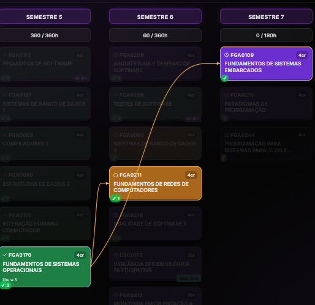
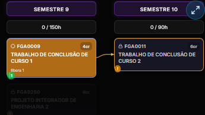
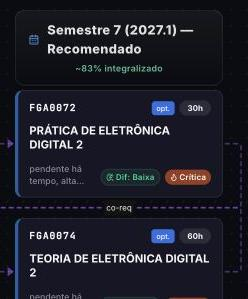
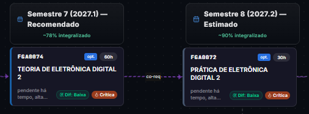
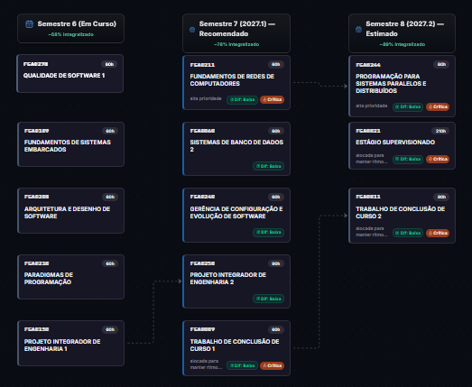
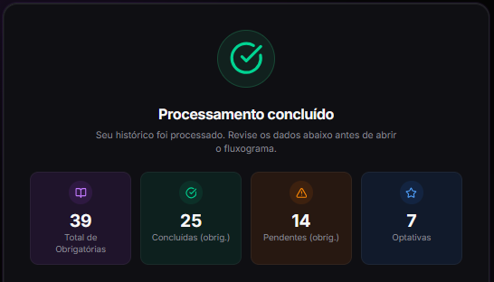
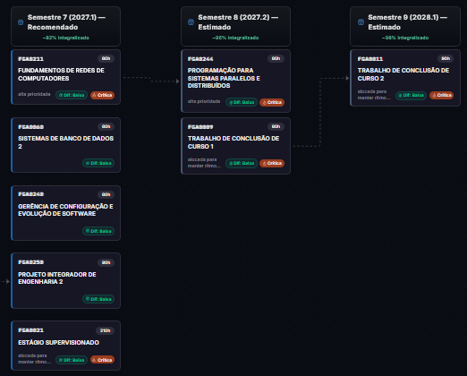
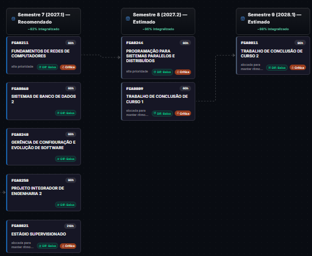
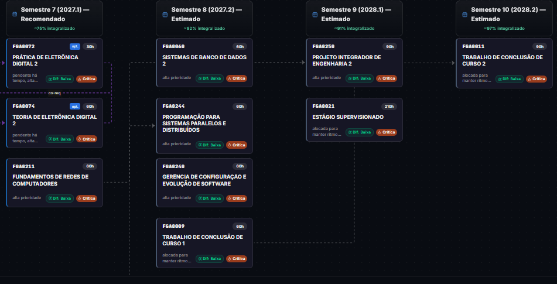
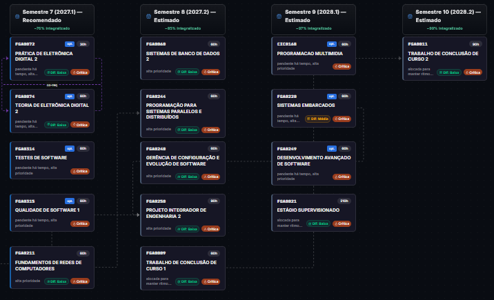

# Dados brutos e evidências — Métricas funcionais

## 1. Entrada e organização

A entrada única é **H0**, matriz 6360/1 — 2017.1: **44 registros (37 APR e sete MATR), 15 obrigatórias pendentes e oito equivalências**. C0–C5 alteram somente a configuração de uso. Os originais acadêmicos e os identificadores pessoais permanecem fora da documentação pública.

A avaliação consolidada é **EC-01**. As capturas de Gabriel estão incorporadas abaixo como **G-01** e identificadas pela equipe como H0. Elas preservam os valores e posições exibidos em cada registro; não substituem a conferência individual nem são usadas para comprovar resultados de outra execução.

Os arquivos em `testes/evidencias/funcionais/execucao-h0-2026-11-15/` e os CSVs existentes preservam a coleta técnica. Suas 102 linhas de verificação e respectivas classificações não foram alteradas neste fechamento. As tabelas desta página registram a complementação e o julgamento consolidado de EC-01: **113 unidades funcionais**, distribuídas em 1 relação de pré-requisito, 2 de co-requisito, 15 obrigatórias, 44 registros, 8 equivalências, 7 expectativas de onboarding e 36 restrições (23 de carga, 10 de oferta e 3 de calendário).

## 2. Arquivos de coleta preservados

**Tabela 1 — Arquivos de coleta preservados.**

| Registro | Uso |
| --- | --- |
| `c0-plano.json` e variantes C1–C5 | Semestres, disciplinas, cargas e reservas observadas |
| `h0-importado.json` e `fluxograma-status.txt` | Conferência por código, período e status |
| `politica-projecao.txt` | Distinção entre matrícula e projeção condicionada à aprovação |
| `ct02-plano-interface.json` e `ct02-grafo.txt` | Posição do par explicitamente selecionado |
| `ambiente-coleta.json` | Ambiente registrado; versão do servidor não identificada |
| `execucoes.csv` e `verificacoes_funcionais.csv` | Contexto e unidades da coleta técnica |

*Fonte: registro da avaliação EC-01, organizado pela equipe.*

## 3. Registros por caso

### CT-01 — Pré-requisitos

**Meta: TVP=0%. Resultado consolidado: 0/1=0%.** FGA0170 permanece MATR em 2026.2 e FGA0211 está prevista em 2027.1. A projeção não transforma a matrícula em aprovação real. TCC 1/2 é uma ilustração adicional, sem inclusão no denominador da relação respaldada pela referência.

O registro é apresentado na Figura 1.

*Figura 1 — Sequência FGA0170/FGA0211 no registro de Gabriel. Fonte: captura de Gabriel, 15/11; registro G-01, entrada identificada pela equipe como H0.*

O registro é apresentado na Figura 2.

*Figura 2 — Sequência TCC 1/2 como registro visual; não integra o denominador oficial conferido. Fonte: captura de Gabriel, 15/11; registro G-01, entrada identificada pela equipe como H0.*

### CT-02 — Co-requisitos

**Meta: TVC=0%. Resultado consolidado: 0/2=0%.** Na seleção explícita do par, FGA0072 e FGA0074 aparecem em 2027.1.

O registro é apresentado na Figura 3.

*Figura 3 — Par FGA0072/FGA0074 alocado em 2027.1. Fonte: No Fluxo, 15/11; registro da seleção explícita do par.*

O registro é apresentado na Figura 4.

*Figura 4 — Distribuição do par no registro G-01, distinta da alocação consolidada. Fonte: captura de Gabriel, 15/11; registro G-01, entrada identificada pela equipe como H0.*

**Tabela 2 — Comparação dos registros de co-requisitos.**

| Registro | Alocação observada | Uso no julgamento |
| --- | --- | --- |
| G-01 | Par em semestres diferentes | Preservação da observação de Gabriel |
| EC-01 — par consolidado | Ambas em 2027.1 | Duas relações dirigidas conformes, denominador de TVC=2 |

*Fonte: registro da avaliação EC-01, organizado pela equipe.*

A divergência entre registros foi mantida visível. Não se presume correção no produto entre execuções nem se atribui uma mudança a versão não identificada.

### CT-03 — Obrigatórias pendentes

**Meta: CDO=100%. Resultado: 14/15=93,33%.** FGA0206 está na referência de pendências e não aparece no plano-base completo nem na lista de não alocadas. O diagnóstico depende do cruzamento das 15 unidades, não apenas de um trecho da imagem.

O registro é apresentado na Figura 5.

*Figura 5 — Trecho do planejamento usado na investigação da ausência de FGA0206. Fonte: captura de Gabriel, 15/11; registro G-01, entrada identificada pela equipe como H0.*

### CT-04 — Tratamento do histórico

**Meta: TDH=0%. Resultado: 0/44=0%.** A conferência usa código e período, preservando as ocorrências repetidas. Equivalências podem ser representadas pelo destino oficial; MATR não é aprovação concluída.

O registro é apresentado na Figura 6.

*Figura 6 — Resumo de importação apresentado ao avaliador. Fonte: captura de Gabriel, 15/11; registro G-01, entrada identificada pela equipe como H0.*

**Leitura do resumo:** a captura G-01 exibe 25 obrigatórias concluídas e 14 pendentes. A referência normalizada adotada no consolidado é 24 satisfeitas e 15 pendentes. Os valores da captura foram preservados; esse resumo agregado não foi usado como prova da comparação individual nem como denominador de CDO/TDH.

### CT-05 — Equivalências

**Meta: TAE=0%. Resultado: 0/8=0%.** Foram conferidas seis relações concluídas e duas em andamento. As oito relações estão na referência de H0; a captura ilustra algumas, sem representar cobertura visual de todas.

O registro é apresentado na Figura 7.

*Figura 7 — Indicação visual de equivalências em disciplinas do fluxograma. Fonte: captura de Gabriel, 15/11; registro G-01, entrada identificada pela equipe como H0.*

### CT-06 — Onboarding

**Meta: COO=100%. Resultado: 5/7=71,43%.** Os contratos abaixo definem o esperado antes do julgamento de EC-01.

**Tabela 3 — Expectativas e resultados do onboarding.**

| Cenário | Contrato de aceitação | Resultado observado | Atendido? |
| --- | --- | --- | --- |
| C1 | Selecionar 20 créditos deve representar 300h | 20 créditos/300h | **Sim** |
| C2 | Selecionar 32 créditos deve representar 480h | 32 créditos/480h | **Sim** |
| C5-4 | Quatro matérias devem sugerir 240h | 240h | **Sim** |
| C5-6 | Seis matérias devem sugerir 360h | 360h | **Sim** |
| C5-8 | Oito matérias devem sugerir 480h | 480h | **Sim** |
| C3 | Ao ativar trabalho/estágio, sugerir 20 créditos em lugar de 24 | Permanência em 24 créditos | **Não** |
| C4 | Objetivo velocidade deve produzir horizonte de dois semestres futuros no cenário | Permanência em três semestres | **Não** |

*Fonte: registro da avaliação EC-01, organizado pela equipe.*

A sugestão de carga do onboarding e o teto obrigatório de 480h têm funções diferentes. Os contratos de C3/C4 pertencem à aceitação do cenário, não às regras curriculares oficiais. As capturas Antes/Depois registram os estados da interface; os sete resultados são apurados pela tabela.

O registro é apresentado na Figura 8.

*Figura 8 — Configuração antes da alteração de preferências. Fonte: captura de Gabriel, 15/11; registro G-01, entrada identificada pela equipe como H0.*

O registro é apresentado na Figura 9.

*Figura 9 — Configuração após a alteração de preferências. Fonte: captura de Gabriel, 15/11; registro G-01, entrada identificada pela equipe como H0.*

### CT-07 — Restrições semestrais

**Meta: TVS=0% por tipo.** O máximo obrigatório verificado é 480h. Oferta e calendário usam os quadros de controle OC-01 e CAL-01 definidos nas [fontes do cenário](../../fase3/funcionais/fontes.md#7-contratos-de-aceitacao-de-ec-01).

**Tabela 4 — TVS por tipo de restrição.**

| Tipo | Universo | Violações | Resultado | Julgamento |
| --- | ---: | ---: | --- | --- |
| Máximo de 480h | 23 semestres futuros | 0 | **0,00%** | **Conforme** |
| Oferta OC-01 | Dez alocações de disciplinas | 1 | **10,00%** | **Não conforme** |
| Calendário CAL-01 | Três condições de consulta | 1 | **33,33%** | **Não conforme** |

*Fonte: registro da avaliação EC-01, organizado pela equipe.*

**Tabela 5 — Quadro de oferta OC-01.**

| Disciplina — OC-01 | Semestre previsto | Oferta de referência | Conforme? |
| --- | --- | --- | --- |
| FGA0211 | 2027.1 | 2027.1 | Sim |
| FGA0060 | 2027.1 | 2027.1 | Sim |
| FGA0109 | 2027.1 | 2027.1 | Sim |
| FGA0210 | 2027.1 | 2027.1 | Sim |
| FGA0240 | 2027.1 | 2027.1 | Sim |
| FGA0009 | 2027.1 | 2027.1 | Sim |
| FGA0244 | 2027.2 | Apenas 2027.1 no quadro de controle | **Não** |
| FGA0250 | 2027.2 | 2027.2 | Sim |
| FGA0021 | 2027.2 | 2027.2 | Sim |
| FGA0011 | 2028.1 | 2028.1 | Sim |

*Fonte: registro da avaliação EC-01, organizado pela equipe.*

**Tabela 6 — Quadro de calendário CAL-01.**

| Condição — CAL-01 | Início esperado | Início observado | Conforme? |
| --- | --- | --- | --- |
| Consulta normal | 2027.1 | 2027.1 | Sim |
| Consulta com resposta tardia | 2027.1 | 2027.1 | Sim |
| Falha de consulta com fallback | 2027.1 | 2027.2 | **Não** |

*Fonte: registro da avaliação EC-01, organizado pela equipe.*

O registro é apresentado na Figura 10.

*Figura 10 — Distribuição apresentada no registro de carga de 240h. Fonte: captura de Gabriel, 15/11; registro G-01, entrada identificada pela equipe como H0.*

O registro é apresentado na Figura 11.

*Figura 11 — Distribuição apresentada no registro de carga de 360h. Fonte: captura de Gabriel, 15/11; registro G-01, entrada identificada pela equipe como H0.*

Os recortes de carga de Gabriel mostram distribuições próprias de G-01. Não são usados para atribuir 540h à execução consolidada nem para converter a sugestão de carga em obrigação. O julgamento final é o indicado nas tabelas por tipo.

## 4. Encerramento da execução

A configuração-base de 24 créditos foi restaurada, conforme confirmação de Gustavo. As referências de H0 e os registros técnicos foram preservados. A [análise](analiseResultados.md) responde às sete questões e julga as hipóteses; os resultados têm alcance limitado ao conjunto de cenários definido.

O processador `python3 scripts/metricas_funcionais.py` continua reprocessando os CSVs da coleta técnica. A consolidação EC-01 inclui os contratos e quadros de avaliação desta página; seu resultado não deve ser confundido com a saída daquele recorte de coleta.

## 5. Referências

Referências usadas nesta página, conforme [Referências — Fase 3](../../../referencias/fase3.md).

- UNIVERSIDADE DE BRASÍLIA. **SIGAA — Estruturas curriculares de Engenharia de Software**, matriz 6360/1 — 2017.1. [Consulta pública](https://sigaa.unb.br/sigaa/public/curso/curriculo.jsf?id=414924&lc=pt_BR). Acesso em: 15 nov. 2026. Nos detalhes, consultar os componentes FGA0211, MAT0026 e IFD0173 e seus históricos de vigência.

---

## Histórico de versão

| Membro | Contribuição | Data | Commit |
|---|---|---|---|
| Gabriel Mota | Consolidação dos dados brutos e evidências da avaliação funcional | 15/11 | [dcfdb1a](https://github.com/FCTE-Qualidade-de-Software-1/2026-2_T02_JEAN_SAMMET/commit/dcfdb1a07e1511a2ac831844012889753ad837d4)  |
| [Gustavo Fornaciari](https://github.com/GUGOFO) | Padronização da avaliação pelo histórico oficial H0 | 15/11 | [f454d2c](https://github.com/FCTE-Qualidade-de-Software-1/2026-2_T02_JEAN_SAMMET/commit/f454d2c099e16a6dd593b92420b541a18262b086) |
| [Gabriel Mota](https://github.com/Gabro-MO) | Recuperação das observações e capturas funcionais | 15/11 | [289a2a0](https://github.com/FCTE-Qualidade-de-Software-1/2026-2_T02_JEAN_SAMMET/commit/289a2a02674594fc05aed55ad7c8177ca8154bdd) |
| [Gustavo Fornaciari](https://github.com/GUGOFO) | Alinhamento ao H0 e preservação das evidências anteriores com cobertura identificada | 15/11 | [7a74d9e](https://github.com/FCTE-Qualidade-de-Software-1/2026-2_T02_JEAN_SAMMET/commit/7a74d9e0809e91d60a36a88559b357bfe171f37e) |
| [Gustavo Fornaciari](https://github.com/GUGOFO) | Coleta assistida com H0, apuração e julgamento com cobertura identificada | 15/11 | [f5e77d5](https://github.com/FCTE-Qualidade-de-Software-1/2026-2_T02_JEAN_SAMMET/commit/f5e77d5) |
| [Gustavo Fornaciari](https://github.com/GUGOFO) | Ampliação da análise, respostas GQM e síntese dos julgamentos | 15/11 | [f5e77d5](https://github.com/FCTE-Qualidade-de-Software-1/2026-2_T02_JEAN_SAMMET/commit/f5e77d5) |
| [Gustavo Fornaciari](https://github.com/GUGOFO) | Explicitação das metas nas tabelas de resultados e avaliação | 15/11 | [f5e77d5](https://github.com/FCTE-Qualidade-de-Software-1/2026-2_T02_JEAN_SAMMET/commit/f5e77d5) |
| [Yasmim de Souza Santos](https://github.com/eii-yahs) | Inclusão das referências utilizadas na página | 22/11 | Não commitado |