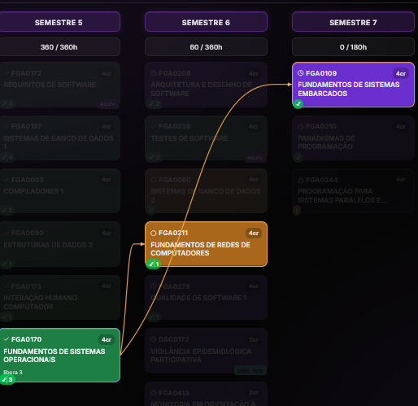
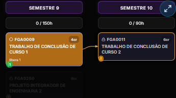
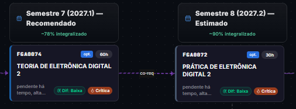
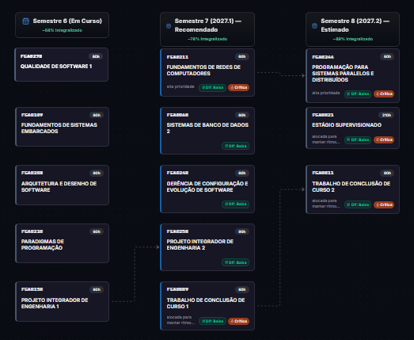
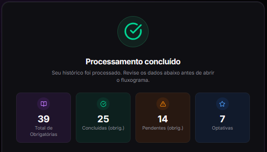
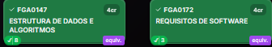
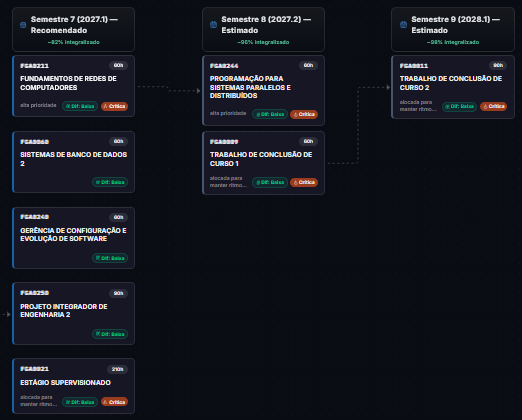
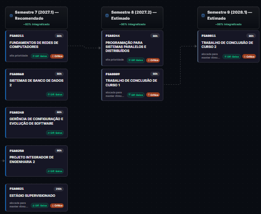
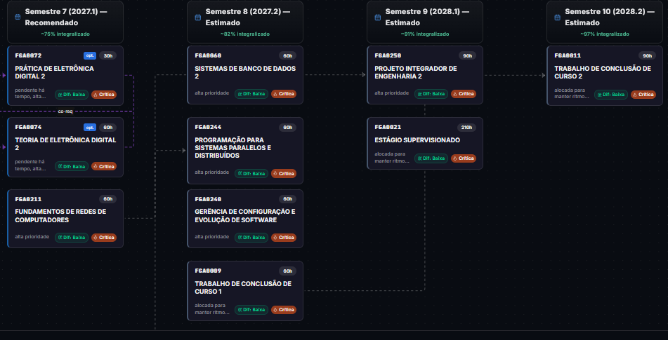
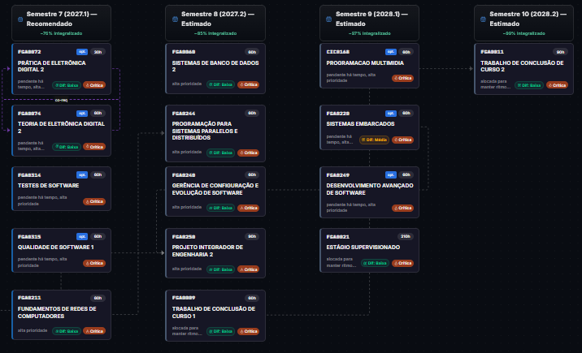

# Evidências da execução anterior

As dez capturas abaixo foram fornecidas por Gabriel e preservadas no commit [289a2a0](https://github.com/FCTE-Qualidade-de-Software-1/2026-2_T02_JEAN_SAMMET/commit/289a2a02674594fc05aed55ad7c8177ca8154bdd). São observações de execução, não resultados recalculados para H0.

## Entrada e cobertura

**Identificador: E-ANT-01.** O resumo da importação mostra 39 obrigatórias, 25 concluídas e 14 pendentes; H0 mostra 24 concluídas e 15 pendentes. A origem exata da entrada e as configurações de cada captura devem ser confirmadas pelo avaliador. Não renomear essa execução como H0 nem preencher os CSVs atuais a partir de totais agregados.

As capturas podem orientar os testes de H0 e sustentar observações limitadas ao que exibem. Para recuperar percentuais, registrar as unidades examinadas, a regra, o cenário e a evidência correspondente. A existência de imagens não comprova cobertura de todas as disciplinas, status ou equivalências.

## Capturas preservadas

*CT-01 — FGA0170/FGA0211 no fluxograma; conferir entrada e distinguir matriz de plano gerado. Fonte: captura fornecida por Gabriel, identificada como execução de 15/11; horário, ambiente e versão não informados.*

*CT-01 — Sequência TCC 1/2; confirmar a fonte oficial da regra. Fonte: captura fornecida por Gabriel, identificada como execução de 15/11; horário, ambiente e versão não informados.*

*CT-02 — Par de optativas em semestres diferentes; julgar cada direção segundo satisfação simultânea ou prévia aplicável. Fonte: captura fornecida por Gabriel, identificada como execução de 15/11; horário, ambiente e versão não informados.*

*CT-03 — Trecho do plano; cobertura exige comparar a lista completa de pendências com todos os semestres e não alocadas. Fonte: captura fornecida por Gabriel, identificada como execução de 15/11; horário, ambiente e versão não informados.*

*CT-04 — Resumo da importação da entrada anterior. Não demonstra conferência individual dos registros de H0. Fonte: captura fornecida por Gabriel, identificada como execução de 15/11; horário, ambiente e versão não informados.*

*CT-05 — Duas obrigatórias com indicação de equivalência; não comprova as oito relações de H0. Fonte: captura fornecida por Gabriel, identificada como execução de 15/11; horário, ambiente e versão não informados.*

*CT-06 — Estado anterior; falta identificar a opção alterada e as condições controladas. Fonte: captura fornecida por Gabriel, identificada como execução de 15/11; horário, ambiente e versão não informados.*

*CT-06 — Estado posterior; sem requisito de efeito esperado, ausência de mudança não prova falha. Fonte: captura fornecida por Gabriel, identificada como execução de 15/11; horário, ambiente e versão não informados.*

*CT-07 — Saída relatada para carga sugerida de 240h; a configuração escolhida não aparece neste recorte. Fonte: captura fornecida por Gabriel, identificada como execução de 15/11; horário, ambiente e versão não informados.*

*CT-07 — Saída relatada para carga sugerida de 360h; conferir seleção de optativas e equivalência das demais configurações. Fonte: captura fornecida por Gabriel, identificada como execução de 15/11; horário, ambiente e versão não informados.*

## Limitações

- A captura do cenário de 480h/saída relatada de 540h não foi fornecida. O relato não comprova o resultado visual.
- O pacote não contém o PDF `H0_sanitizado.pdf` nem o lembrete anteriormente citado. Não há links para esses arquivos ausentes.
- As tabelas antigas de julgamento estão preservadas no histórico Git, mas divergem do H0 atual, dos CSVs vazios e entre si. Não são a tabela vigente de resultados.
- A avaliação vigente de H0 permanece em [Dados brutos](dadosBrutos.md) e [Análise dos resultados](analiseResultados.md).

## Histórico de versão

| Nome do Membro | Contribuição | Data | Commit |
|---|---|---|---|
| [Gabriel Mota](https://github.com/Gabro-MO) | Capturas dos casos funcionais | 15/11 | [289a2a0](https://github.com/FCTE-Qualidade-de-Software-1/2026-2_T02_JEAN_SAMMET/commit/289a2a02674594fc05aed55ad7c8177ca8154bdd) |
| [Gustavo Fornaciari](https://github.com/GUGOFO) | Organização das capturas e identificação da entrada e das limitações | 15/11 | [f454d2c](https://github.com/FCTE-Qualidade-de-Software-1/2026-2_T02_JEAN_SAMMET/commit/f454d2c099e16a6dd593b92420b541a18262b086) |
