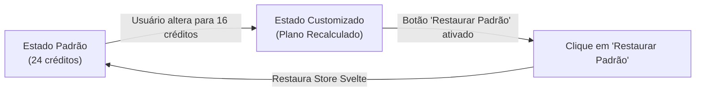

# Ação de Melhoria — Métricas Operacionais (Fase 4)

Este documento especifica a **Ação de Melhoria concreta** decorrente da avaliação prática de qualidade segundo o processo **ISO/IEC 25040:2011/2024**, priorizada a partir dos dados brutos e do julgamento das métricas operacionais na Fase 4.

---

## 1. Justificativa e Origem da Melhoria

A análise comparativa na Fase 4 demonstrou que, embora a aplicação alcance o nível Aceitável de usabilidade ($TCH = 70{,}0\%$), a principal fricção ergonômica reside no **Item 3 do Checklist de Nielsen (Controle e Liberdade do Usuário)**, classificado com **Severidade 3 (Maior)**:

> **Problema Diagnosticado:** Ao alterar os parâmetros de créditos por semestre na tela `/plano-formatura`, a interface recalcula a projeção curricular sem oferecer ao estudante uma forma direta de reverter a ação. Para retornar ao plano original de formatura, o usuário é obrigado a recarregar a página inteira (`F5`) ou lembrar mentalmente o valor padrão anterior.

Esse atrito viola o princípio ergonômico da "saída de emergência" (ISO 9241-11 e Nielsen), gerando insegurança na exploração de diferentes cenários de formatura.

---

## 2. Especificação Técnica da Melhoria Proposta

A proposta consiste em introduzir um **mecanismo reativo de reversão de estado (*Reset / Undo*)** diretamente no painel de controle de créditos da tela de planejamento.



### 2.1 Especificação do Componente no Frontend (SvelteKit)

No componente de controle de parâmetros da tela `/plano-formatura`, sugere-se a adição de um botão de ação com escuta reativa:

```svelte
<!-- Componente: ControleCreditos.svelte -->
<script lang="ts">
  import { RotateCcw } from 'lucide-svelte';
  
  export let limiteCreditosPadrao: number = 24;
  export let limiteCreditosAtual: number;
  export let onRestaurarPadrao: () => void;

  $: foiModificado = limiteCreditosAtual !== limiteCreditosPadrao;
</script>

<div class="flex items-center gap-4 p-3 bg-card rounded-lg border">
  <div class="flex-1">
    <label for="creditos" class="text-sm font-medium">
      Limite de Créditos por Semestre
    </label>
    <input 
      id="creditos" 
      type="number" 
      bind:value={limiteCreditosAtual}
      min="4" 
      max="36"
      class="input input-bordered w-full mt-1"
    />
  </div>

  {#if foiModificado}
    <button 
      type="button"
      class="btn btn-outline btn-sm flex items-center gap-1.5 self-end"
      on:click={onRestaurarPadrao}
      title="Restaurar valor padrão inicial (24 créditos)"
    >
      <RotateCcw class="w-4 h-4" />
      <span>Restaurar Padrão</span>
    </button>
  {/if}
</div>
```

---

## 3. Impacto Estimado nas Métricas de Usabilidade

A implementação desta melhoria simples e não intrusiva eleva substancialmente a qualidade ergonômica da funcionalidade:

| Métrica de Usabilidade | Valor Atual (Antes da Melhoria) | Valor Projetado (Após a Melhoria) | Ganho Qualitativo Obtido |
| :--- | :---: | :---: | :--- |
| **`MET-OP-01` (TCH)** | **`70,0%`** (Aceitável) | **`80,0%`** (Aceitável Elevado) | O Item 3 passa de 0 para 1 (+1 item conforme no checklist). |
| **`MET-OP-01b` (ISVH)** | **`6 pontos`** (Aceitável) | **`3 pontos`** (**`EXCELENTE`**) | **Eliminação de 100% das falhas maiores ($N_{\text{maior}} = 0$)**, promovendo o índice $ISVH$ para a faixa de **Excelência** ($\le 5$). |
| **Hipótese $H\text{-}OP\text{-}01$** | Confirmada com severidade maior | Risco ergonômico mitigado | Elimina a principal causa de atrito de navegação relatada pelos discentes. |

---

## 4. Rastreabilidade com o Artigo Científico e Entregas

Esta Ação de Melhoria cumpre diretamente os requisitos da **ISO/IEC 25040 (Atividade 4: Concluir a Avaliação)** e da **Entrega 2 da disciplina**, compondo a seção de **Discussão de Melhorias e Trabalhos Futuros** da versão final do artigo científico.

---

## Histórico de versão

| Nome do Membro | Contribuição | Data | Commit |
| :--- | :--- | :--- | :--- |
| [Giovani De Oliveira Teodoro Coelho](https://github.com/Gotc2607) | Elaboração da ação de melhoria de usabilidade, prototipação em SvelteKit e projeção de impacto nas métricas | 14/11/2026 | [6594e5c](https://github.com/FCTE-Qualidade-de-Software-1/2026-2_T02_JEAN_SAMMET/commit/6594e5c2349ee5fc4dc632f07b97bc8191357819) |

