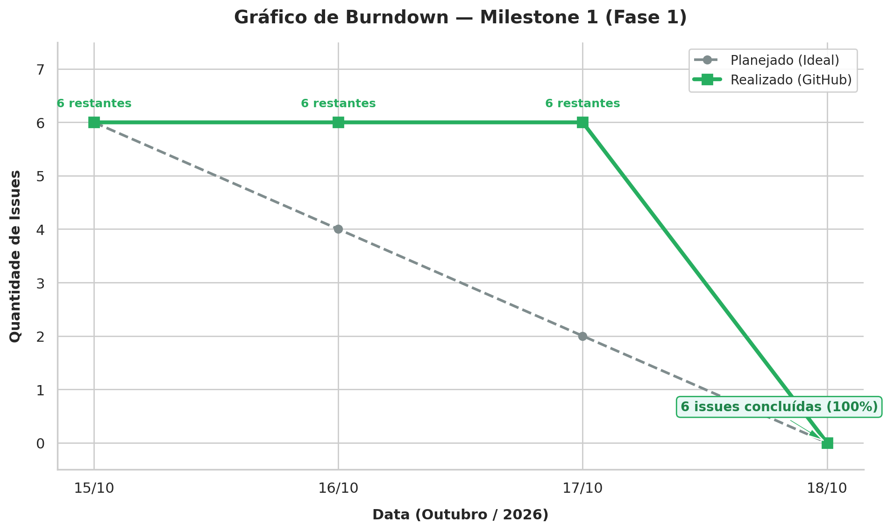

# Acompanhamento do Projeto

## 1. Introdução

O acompanhamento do projeto utiliza dados do repositório Git para observar a evolução das atividades, a distribuição do trabalho e o cumprimento do planejamento da equipe.

Os dados apresentados nesta página servem como referência para a aplicação das métricas descritas nas páginas de [Calendário e Progresso](calendario-progresso.md), [Recursos e Custos](recursos-custos.md) e [Desempenho do Processo](desempenho-processo.md).

## 2. Visão geral das Issues e Milestone

A tabela a seguir apresenta a amostragem das Issues cadastradas no repositório para a execução da Fase 1. Os dados fornecem uma referência para o acompanhamento do trabalho, o cálculo do tempo médio de ciclo e a análise da distribuição das tarefas.

| ID da Issue | Título da Tarefa | Atribuído a | Estado | Data de Abertura | Data de Conclusão |
| :--- | :--- | :--- | :--- | :--- | :--- |
| [**#1**](https://github.com/FCTE-Qualidade-de-Software-1/2026-2_T02_JEAN_SAMMET/issues/1) | Introdução e Referencial Teórico | Yasmin e Gustavo | Concluída | 15/10/2026 | 18/10/2026 |
| [**#2**](https://github.com/FCTE-Qualidade-de-Software-1/2026-2_T02_JEAN_SAMMET/issues/2) | Objetivos, Questões e Métricas (GQM) | Gabriel e Giovani | Concluída | 15/10/2026 | 18/10/2026 |
| [**#3**](https://github.com/FCTE-Qualidade-de-Software-1/2026-2_T02_JEAN_SAMMET/issues/3) | Gráfico Hierárquico GQM | Gabriel e Giovani | Concluída | 15/10/2026 | 18/10/2026 |
| [**#4**](https://github.com/FCTE-Qualidade-de-Software-1/2026-2_T02_JEAN_SAMMET/issues/4) | Configurar Gestão PSM/CID | Ana Beatriz e Victor | Concluída | 15/10/2026 | 18/10/2026 |
| [**#5**](https://github.com/FCTE-Qualidade-de-Software-1/2026-2_T02_JEAN_SAMMET/issues/5) | Estruturar GitPage | Yasmin e Gustavo | Concluída | 15/10/2026 | 18/10/2026 |
| [**#6**](https://github.com/FCTE-Qualidade-de-Software-1/2026-2_T02_JEAN_SAMMET/issues/6) | Compilar 1ª Versão em LaTeX | Ana Beatriz e Victor | Concluída | 15/10/2026 | 18/10/2026 |
Os dados devem ser atualizados conforme o estado real das Issues no repositório.

### 2.1. Acompanhamento do Milestone

O acompanhamento dos marcos do projeto é realizado diretamente na infraestrutura do repositório Git.

- **Milestone:** [Milestone 1 (Entrega 1)](https://github.com/FCTE-Qualidade-de-Software-1/2026-2_T02_JEAN_SAMMET/milestone/1).

- **Escopo:** Fase 1 — Definição e Caracterização.

- **Prazo limite:** 18/10/2026.

- **Status do progresso:** 6 de 6 Issues concluídas.

- **Taxa de Conclusão de Tarefas (TCT):** 100%.

A Taxa de Conclusão de Tarefas (TCT) é calculada pela razão entre o número de Issues concluídas e o total de Issues planejadas, multiplicada por 100.

**Fórmula:**

TCT = (Nconc / Nplanejado) × 100

Em que:

- `Nconc` representa o número de Issues concluídas.

- `Nplanejado` representa o número total de Issues planejadas.

Aplicando os valores observados:

TCT = (6 / 6) × 100 = 100%

A meta de conclusão do Milestone 1 foi atingida, considerando o encerramento das seis Issues até o prazo estabelecido.

## 3. Resultados das Medições por Categoria PSM/CID

### 3.1. Calendário e Progresso

**Indicador:** Taxa de Conclusão de Tarefas (TCT).

**Fórmula:** TCT = (Nconc / Nplanejado) × 100

| Parâmetro | Valor Observado |
| :--- | :---: |
| Issues planejadas (Nplanejado) | 6 |
| Issues concluídas (Nconc) | 6 |
| Taxa de Conclusão de Tarefas (TCT) | **100,00%** |
| Prazo limite do Milestone | 18/10/2026 |
| Situação da meta do grupo | **Atingida** |
#### Gráfico de Burndown

O gráfico de Burndown permite acompanhar a evolução das tarefas restantes ao longo do período do Milestone, facilitando a comparação entre o progresso observado e o planejamento.

**Figura 1: Acompanhamento da evolução de tarefas do Milestone 1.**

**Análise e interpretação gerencial**

A equipe atingiu a meta de 100% de conclusão dentro do prazo limite estipulado para o Milestone 1, em 18/10/2026. A curva real reflete a dinâmica de desenvolvimento em lote, na qual as demandas foram elaboradas continuamente e encerradas formalmente na data limite do Milestone.

A interpretação do gráfico deve considerar as datas efetivas de conclusão das Issues, de modo que o comportamento da curva represente adequadamente a evolução do trabalho ao longo do período.

### 3.2. Recursos e Custos (Esforço em Horas e Custo Equivalente)

Esta categoria analisa o esforço estimado e realizado pela equipe, a variação entre esses valores e o custo financeiro equivalente, utilizando um valor didático por hora profissional como referência.

**Indicadores:**

- Esforço Total Estimado (<code>Ee</code>).

- Esforço Total Realizado (<code>Er</code>).

- Variação do Esforço (<code>Ve</code>).

- Custo Financeiro Equivalente.

**Fórmulas:**

- Esforço Total Realizado: <code>Er = &Sigma; Hr</code>

- Variação do Esforço: <code>Ve = (|Er − Ee| / Ee) × 100</code>

- Custo Equivalente Estimado: <code>Ce = Ee × Vh</code>

- Custo Equivalente Realizado: <code>Cr = Er × Vh</code>

Em que:

- <code>Hr</code> representa as horas realizadas em cada atividade.

- <code>Ee</code> representa o esforço total estimado.

- <code>Er</code> representa o esforço total realizado.

- <code>Ve</code> representa a variação percentual absoluta entre o esforço estimado e o realizado.

- <code>Vh</code> representa o valor didático da hora profissional.

- <code>Ce</code> representa o custo financeiro equivalente estimado.

- <code>Cr</code> representa o custo financeiro equivalente ao esforço realizado.

| Métrica / Parâmetro | Valor Estimado | Valor Realizado |
| :--- | :---: | :---: |
| Esforço Total da Equipe | 21,0 horas | **20,0 horas** |
| Média de Esforço por Integrante (6 membros) | 3,5 h/membro | **3,33 h/membro** |
| Variação do Esforço (<code>Ve</code>) | - | **4,76%** (dentro do limite de 10%) |
| Valor Didático da Hora Profissional (<code>Vh</code>) | R$ 50,00/hora | R$ 50,00/hora |
| **Custo Financeiro Equivalente Total** | **R$ 1.050,00** | **R$ 1.000,00** |

**Análise e interpretação gerencial**

O esforço estimado para a equipe foi de 21,0 horas, enquanto o esforço realizado foi de 20,0 horas. A diferença absoluta corresponde a uma variação de 4,76%, dentro do limite de 10% definido como critério de adequação.

Considerando seis integrantes, o esforço médio foi de 3,5 horas por membro na estimativa e de aproximadamente 3,33 horas por membro na realização. Esses valores representam médias aritméticas e não necessariamente a distribuição efetiva das horas entre os integrantes.

Para fins exclusivamente didáticos, foi adotado o valor de R$ 50,00 por hora profissional. Com esse parâmetro, o custo financeiro equivalente estimado foi de R$ 1.050,00, enquanto o custo equivalente ao esforço realizado foi de R$ 1.000,00. Esses valores não representam necessariamente despesas financeiras efetivamente incorridas pelo grupo.

### 3.3. Desempenho do Processo

Esta categoria analisa o tempo necessário para concluir as tarefas e identifica possíveis períodos prolongados sem atividade registrada.

**Indicadores:**

- Tempo Médio de Ciclo (TC médio).

- Tempo sem Atividade (TSA).

**Fórmulas:**

<code>TC = Data de Conclusão − Data de Criação</code>

<code>TCmédio = Soma dos tempos de ciclo / Número de Issues concluídas</code>

<code>TSA = Data de Referência − Data da Última Atividade</code>

Em que:

- <code>TC</code> representa o intervalo entre a abertura e a conclusão de uma Issue.

- <code>TCmédio</code> representa a média dos tempos de ciclo das Issues concluídas.

- <code>TSA</code> representa o tempo transcorrido desde a última atividade registrada, considerando a data de referência adotada.

| Métrica | Valor Calculado | Critério de Decisão | Situação |
| :--- | :---: | :--- | :--- |
| Tempo Médio de Ciclo (TC médio) | 3,0 dias | Meta: até 2,0 dias | Tolerável — avaliar o fechamento em lote |
| Tempo sem Atividade (TSA) | 0,0 dias | Alerta para tarefas paradas: acima de 3,0 dias | Conforme — nenhuma tarefa identificada como estagnada na data de referência |
**Análise e interpretação gerencial**

O tempo médio de ciclo de 3,0 dias decorreu do intervalo entre a abertura das Issues, em 15/10/2026, e a conclusão registrada em 18/10/2026. O resultado ultrapassa a meta de até 2,0 dias e deve ser interpretado considerando o encerramento concentrado das tarefas na data limite do Milestone.

O TSA de 0,0 dias indica que, na data de referência utilizada, não foram identificadas tarefas que ultrapassassem o limite estabelecido para alerta. Essa interpretação depende da atualização correta das datas de atividade no repositório.

---

## 4. Decisões de Gestão Registradas

Com base nos resultados observados para o Milestone 1, foram registradas as seguintes decisões gerenciais:

1. **Aprovação do Milestone 1:** considerando que a TCT atingiu 100%, com seis das seis Issues concluídas até o prazo limite de 18/10/2026, o marco foi considerado concluído para fins de acompanhamento da entrega da Fase 1.

2. **Acompanhamento do Esforço e Custo Equivalente (Recursos e Custos):** O esforço total realizado na Fase 1 foi de **20,0 horas**, apresentando uma variação de apenas 4,76% em relação às 21,0 horas estimadas (<code>Ve ≤ 10%</code>), resultando em um custo financeiro equivalente de **R$ 1.000,00**. A alocação de esforço acompanhou a complexidade de cada tarefa e o procedimento de consolidação por consenso retroativo da equipe mostrou-se adequado, devendo ser mantido para a Fase 2.

3. **Atenção ao tempo de ciclo:** o tempo médio de ciclo de 3,0 dias ficou acima da meta de até 2,0 dias. Para os próximos marcos, recomenda-se acompanhar mais detalhadamente as datas de início, andamento e conclusão das Issues, evitando que o registro do progresso dependa predominantemente do fechamento concentrado das tarefas.

4. **Manutenção da atualização dos registros:** as informações sobre estado, responsáveis, datas e atividades devem continuar sendo atualizadas no repositório, permitindo que as métricas reflitam a execução real do projeto.

## 5. Considerações Finais

A especificação e o acompanhamento das métricas têm como finalidade apoiar a equipe no monitoramento do projeto e na identificação de oportunidades de melhoria.

Os resultados observados deverão ser interpretados considerando o planejamento, o contexto e as limitações dos dados coletados. A atualização periódica das informações permite que a equipe identifique desvios e avalie a necessidade de ajustes na distribuição das tarefas e no cronograma.

## 6. Histórico de Versão

| Nome do Membro | Contribuição | Data | Commit |
| :--- | :--- | :--- | :--- |
| [Ana Beatriz](https://github.com/AnnaBeatrizAraujo) | Criação da página de Gestão do Projeto | 15/10/2026 | [2802ef9](https://github.com/FCTE-Qualidade-de-Software-1/2026-2_T02_JEAN_SAMMET/commit/2802ef9469c1cff7f5ce41cc6c2f11972e9caac1) |
| [Ana Beatriz](https://github.com/AnnaBeatrizAraujo) | Atualização da página | 15/10/2026 | [e2f479f](https://github.com/FCTE-Qualidade-de-Software-1/2026-2_T02_JEAN_SAMMET/commit/e2f479f359f3d6d70d4b4e3ddc55e29e50edb7d4) |
| [Ana Beatriz](https://github.com/AnnaBeatrizAraujo) | Atualização das tabelas de Issues e Milestones | 16/10/2026 | [b67ec2c](https://github.com/FCTE-Qualidade-de-Software-1/2026-2_T02_JEAN_SAMMET/commit/b67ec2c61c4df05d6c193b73a98f3b8eeaac7c32) |
| [Ana Beatriz](https://github.com/AnnaBeatrizAraujo) | Organização da seção Gestão do Projeto | 16/10/2026 | [e372470](https://github.com/FCTE-Qualidade-de-Software-1/2026-2_T02_JEAN_SAMMET/commit/e372470367e2d110094e26eaac1220c5a3bd2fe9) |
| [Ana Beatriz](https://github.com/AnnaBeatrizAraujo) | Atualização do progresso das issues | 18/10/2026 | [d2b77cf](https://github.com/FCTE-Qualidade-de-Software-1/2026-2_T02_JEAN_SAMMET/commit/d2b77cf6bb91436494b004f225c771eed33ba46f) |
| [Ana Beatriz](https://github.com/AnnaBeatrizAraujo) | Atualização da conclusão das Issues | 18/10/2026 | [0e35ba5](https://github.com/FCTE-Qualidade-de-Software-1/2026-2_T02_JEAN_SAMMET/commit/0e35ba589c078941f61ef6b425882fe07b0e9dff) |
