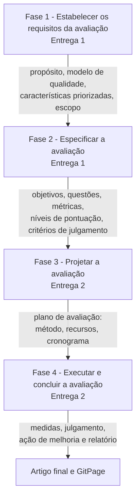

# Processo de Avaliação SQuaRE (ISO/IEC 25040)

O projeto segue o processo de avaliação de produto da ISO/IEC 25040, organizado nas quatro fases usadas na disciplina. Esta página descreve, para cada fase, as atividades previstas, as normas SQuaRE de apoio, os produtos gerados e onde eles estão documentados.

## 1. Fases do processo

A ISO/IEC 25040 define cinco atividades: estabelecer os requisitos, especificar, projetar, executar e concluir a avaliação. A disciplina agrupa a conclusão junto com a execução, o que resulta em quatro fases. As atividades de cada fase abaixo foram descritas com base na ISO/IEC 25040 e na aula de Processo de Avaliação de Produto da disciplina. A Figura 2 mostra as fases e o que cada uma entrega para a seguinte.

*Figura 2 - Fases do processo de avaliação e produtos que passam de uma fase para a outra. Fonte: elaboração da equipe com base na ISO/IEC 25040 e no material da disciplina.*

## 2. Detalhamento por fase

### 2.1 Fase 1 - Estabelecer os requisitos da avaliação

A Fase 1 responde a quais requisitos precisam estar definidos antes de escolher métricas ou coletar dados. A primeira atividade é estabelecer o propósito da avaliação, apoiada na ISO/IEC 25040 e na ISO/IEC 25041, e está documentada em [Propósito e Stakeholders](../fases/fase1/propositoEStakeholders.md). Em seguida vêm os requisitos de qualidade do produto, obtidos com o apoio da ISO/IEC 25030 e da ISO/IEC 25010, que resultaram no [Modelo de Qualidade](../fases/fase1/modeloDeQualidade.md) e na priorização em [Características de Qualidade](../fases/fase1/caracteristicasDeQualidade.md).

As partes do produto incluídas na avaliação foram identificadas em [Software Escolhido](../fases/fase1/softwareEscolhido.md) e [Escopo](../fases/fase1/escopo.md), e o rigor da avaliação, ou seja, sua profundidade, está definido na seção "Limites de validade dos resultados" do Escopo. A relação com os ODS é uma exigência da disciplina que não faz parte da SQuaRE e está em [ODS](../fases/fase1/ODS.md).

A fase é considerada concluída quando o propósito e o uso pretendido estão descritos, os stakeholders estão mapeados, o modelo de qualidade está adaptado e representado em diagrama, de três a quatro características estão priorizadas com método explícito e o escopo deixa claro o que fica de fora.

### 2.2 Fase 2 - Especificar a avaliação

A Fase 2 responde a como métricas, níveis de pontuação e critérios de julgamento se articulam para permitir a avaliação. A seleção das medidas de qualidade usa o GQM, com a ISO/IEC 25023 e a ISO/IEC 25020 como referência, e os objetivos e questões estão em [Métricas Funcionais](../fases/fase2/funcionais/GQM.md) e na [Visão Geral Operacional](../fases/fase2/operacionais/visaoGeral.md).

Os critérios de decisão de cada medida ficam no campo "Critério/meta proposta" das [fichas funcionais](../fases/fase2/funcionais/GQM.md) e no campo "Critérios de Interpretação e Níveis de Julgamento" das fichas de [usabilidade](../fases/fase2/operacionais/usabilidade.md) e [segurança](../fases/fase2/operacionais/seguranca.md). Os critérios de decisão da avaliação combinam essas medidas para responder às questões e aos objetivos. Para que a especificação seja repetível, como pede a ISO/IEC 25040, a coleta está descrita no [Protocolo funcional](../fases/fase2/funcionais/testes.md) e no [Protocolo operacional](../fases/fase2/operacionais/protocolo.md).

Na Fase 2, a equipe segue algumas regras. Todo objetivo GQM deriva de uma característica priorizada na Fase 1 e de um stakeholder mapeado, e essa ligação aparece explicitamente na documentação. Cada métrica tem uma ficha com definição, fórmula, unidade, fonte dos dados, procedimento de coleta, critério de interpretação e limitações, conforme exige a premissa 2 do trabalho. As métricas devem ser simples, objetivas e válidas, e cada uma responde diretamente a uma questão. Toda questão tem uma hipótese associada ou a justificativa de por que não foi possível formulá-la, e o gráfico GQM mostra os três níveis (conceitual, operacional e quantitativo) cobrindo todos os objetivos.

### 2.3 Fase 3 - Projetar a avaliação

A Fase 3 trata do que caracteriza um plano de avaliação bem estruturado e de como ele liga a especificação à execução. Sua atividade é planejar a avaliação, o que resulta em um plano com o método de avaliação, as instruções passo a passo para o avaliador, os recursos e o ambiente (hardware, software, navegador e massa de dados sintética) e o cronograma alinhado à Fase 4. Cada método e recurso do plano deve ser rastreável a uma métrica e a um critério de julgamento da Fase 2. A página da Fase 3 será publicada em `fases/fase3/` na Entrega 2.

### 2.4 Fase 4 - Executar e concluir a avaliação

A Fase 4 trata de quais dados tornam possível transformar a coleta em julgamento de qualidade. Primeiro são realizadas as medições, gerando dados brutos (planilhas, registros, capturas de tela e gravações com consentimento) versionados no repositório. Os valores das métricas são então comparados aos níveis de pontuação da Fase 2, e os critérios de decisão da avaliação são aplicados para responder às questões e aos objetivos GQM, com apoio de gráficos e tabelas.

A conclusão da avaliação inclui revisar o resultado e elaborar o relatório, que é o artigo final, com julgamento coerente com o propósito da Fase 1. Também inclui dar retorno sobre a avaliação, apontando oportunidades de melhoria e executando ao menos uma ação de melhoria, e tratar os dados da avaliação, definindo as condições de acesso aos dados de participantes. A página da Fase 4 será publicada em `fases/fase4/` na Entrega 2.

## 3. Calendário e estado atual

A Entrega 1, em 26/10/2026, reúne as Fases 1 e 2 e inclui a GitPage atualizada até a Fase 2, a 1ª versão do artigo, a tabela de contribuição e a release E1. Depois dela há o ponto de controle, com as correções indicadas pela professora. A Entrega 2, na data do cronograma da disciplina, reúne as Fases 3 e 4 e inclui a GitPage até a Fase 4, a 2ª versão do artigo, a ação de melhoria, a tabela de contribuição e a release E2.

No momento, as Fases 1 e 2 estão documentadas, a primeira em [Fase 1](../fases/fase1/propositoEStakeholders.md) e a segunda em [Métricas Funcionais](../fases/fase2/funcionais/visaoGeral.md) e [Métricas Operacionais](../fases/fase2/metricasOperacionais.md). As Fases 3 e 4 estão previstas para a Entrega 2. O progresso de cada entrega é acompanhado pelas medições de [Calendário e Progresso](../gestaoProjeto/calendario-progresso.md).

---

## Histórico de versão

| Nome do Membro | Contribuição | Data | Commit |
| :--- | :--- | :--- | :--- |
| [Yasmim de Souza Santos](https://github.com/eii-yahs) | Criação da página do processo de avaliação SQuaRE | 18/10/2026 | [Preencher]() |
