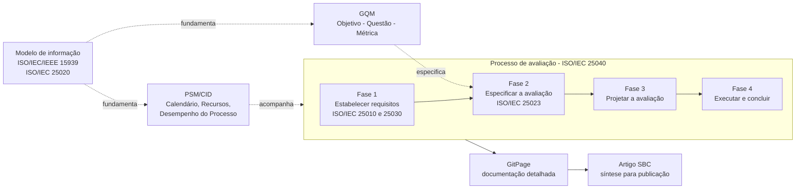

# Metodologia de Desenvolvimento do Projeto

Esta seção documenta a metodologia escolhida pela equipe para conduzir a avaliação do No Fluxo UnB e para produzir o artigo final. O conteúdo aqui é a base da seção "Metodologia de desenvolvimento do projeto" do artigo.

## 1. Metodologia escolhida

A equipe adota uma metodologia composta e adaptada pela própria equipe, orientada pela família ISO/IEC 25000 (SQuaRE). Ela não é uma metodologia com nome próprio publicada na literatura. É a combinação de três abordagens já estabelecidas, cada uma com papel e referência próprios, organizada em ciclos iterativos, um por entrega da disciplina.

O processo de avaliação da ISO/IEC 25040 é a espinha dorsal do trabalho. Ele define as fases, as atividades e os produtos da avaliação, com base na própria norma e no material da disciplina, e está detalhado em [Processo de Avaliação](processoSquare.md). O método GQM (Goal-Question-Metric), de Basili, Caldiera e Rombach (1994), é o instrumento usado para especificar a avaliação na Fase 2, ligando o propósito definido na Fase 1 às medidas de qualidade; sua aplicação está em [Métricas Funcionais](../fases/fase2/funcionais/visaoGeral.md) e [Métricas Operacionais](../fases/fase2/metricasOperacionais.md). Já o PSM/CID, descrito por McGarry et al. (2001) e no framework PSM/CID v2.1 (2021), mede a gestão do próprio projeto, acompanhando cronograma, recursos e desempenho do processo da equipe em [Gestão do Projeto](../gestaoProjeto/psm-cid.md).

Algumas partes não vêm de nenhuma dessas referências e são adaptações da equipe: a forma de integrar as três abordagens (seção 4), o ciclo de trabalho descrito em [Organização e Fluxo de Trabalho](fluxoDeTrabalho.md) e a correspondência de termos entre GQM, PSM e SQuaRE (seção 5). A produção do artigo é tratada separadamente em [Elaboração do Artigo](elaboracaoArtigo.md).

## 2. Justificativa da escolha

A especificação do trabalho recomenda seguir o processo de avaliação de produto da SQuaRE, exige o GQM para definir as métricas e o PSM/CID para acompanhar o projeto. Além de atender a essas exigências, a combinação traz rastreabilidade: o processo da ISO/IEC 25040 encadeia propósito, requisitos de qualidade, medidas, critérios de decisão e julgamento, de modo que cada resultado do artigo pode ser rastreado até a decisão da Fase 1 que o motivou.

As duas frentes de medição também falam a mesma língua. A medição de qualidade da SQuaRE (ISO/IEC 25020) e o PSM se apoiam no modelo de informação da ISO/IEC/IEEE 15939, então a avaliação do produto e a gestão da equipe usam os mesmos conceitos de necessidade de informação, medida básica, medida derivada, indicador e critério de decisão.

Por fim, a ISO/IEC 25040 pede que a especificação seja detalhada o suficiente para que a avaliação seja repetível e reprodutível, o que orienta as fichas de métricas e os protocolos de coleta. A organização em ciclos que acompanham as entregas E1 e E2 e o ponto de controle permite que a equipe corrija a direção a cada entrega, com base nas medições do PSM e no retorno da professora.

## 3. Normas da família SQuaRE utilizadas

A família SQuaRE é dividida em cinco divisões principais, e a equipe usa pelo menos uma norma de cada uma delas.

Da divisão de gestão da qualidade (2500n), a ISO/IEC 25000 serve como guia da SQuaRE, fornecendo a terminologia comum e a visão geral das divisões usadas no referencial teórico do artigo. Da divisão de modelo de qualidade (2501n), a ISO/IEC 25010:2011 é a base do modelo de qualidade de produto adaptado na Fase 1, com Adequação Funcional, Segurança e Usabilidade e suas subcaracterísticas, como descrito em [Modelo de Qualidade](../fases/fase1/modeloDeQualidade.md).

Na divisão de medição da qualidade (2502n), a ISO/IEC 25020 descreve a estrutura de medição, isto é, a relação entre característica, medida de qualidade e elemento de medida, e é o que permite ligar o GQM às normas. A ISO/IEC 25023:2016, da mesma divisão, é a referência para definir as medidas de qualidade de produto nas fichas de métricas da Fase 2. Da divisão de requisitos de qualidade (2503n), a ISO/IEC 25030 orienta a derivação de requisitos de qualidade a partir das necessidades das partes interessadas, o que aparece na Fase 1 no propósito, nos stakeholders e na priorização.

Na divisão de avaliação da qualidade (2504n), a ISO/IEC 25040 é o processo de avaliação adotado e define as fases e atividades do projeto, enquanto a ISO/IEC 25041, guia de avaliação para desenvolvedores, adquirentes e avaliadores independentes, situa o papel da equipe, que atua como avaliadora independente em contexto acadêmico. As normas da divisão de extensão, como a ISO/IEC 25051, não se aplicam, porque o No Fluxo UnB não está sendo avaliado como produto pronto para uso (RUSP) nem para certificação.

Sobre a edição do modelo de qualidade, a equipe usa a ISO/IEC 25010:2011, já adotada na Fase 1. A edição de 2023 renomeia algumas características (por exemplo, Usabilidade passa a ser chamada de "Capacidade de interação"). Se o artigo passar a citar a edição de 2023, os nomes das características devem ser atualizados em todo o texto.

## 4. Visão integrada

O processo SQuaRE conduz a avaliação do produto, o GQM especifica as medidas da Fase 2 e o PSM/CID acompanha a execução do projeto. Os resultados de todas as frentes alimentam a GitPage e, a partir dela, o artigo, como mostra a Figura 1.

*Figura 1 - Visão integrada da metodologia do projeto. Fonte: elaboração da equipe com base na ISO/IEC 25040, no método GQM e no PSM/CID.*

## 5. Correspondência de termos entre GQM, PSM e SQuaRE

Para manter a terminologia consistente na GitPage e no artigo, a equipe usa uma correspondência entre os termos das três abordagens, preferindo o termo SQuaRE sempre que houver equivalente. Essa correspondência foi definida pela equipe a partir das definições de cada fonte. Ela não aparece pronta em nenhuma das normas ou métodos citados e indica equivalências aproximadas, não sinônimos exatos.

O objetivo de medição do GQM, no nível conceitual, corresponde à necessidade de informação do PSM e da ISO/IEC/IEEE 15939 e, na SQuaRE, ao propósito da avaliação junto com a característica ou subcaracterística de qualidade. A questão do GQM, no nível operacional, corresponde ao conceito mensurável do PSM e a um requisito de qualidade a verificar. A métrica, no nível quantitativo, corresponde às medidas básica e derivada do PSM e, na SQuaRE, ao elemento de medida de qualidade e à medida de qualidade. A hipótese do GQM corresponde ao valor esperado no PSM e ao critério de decisão para a medida na ISO/IEC 25040. Por fim, a interpretação das respostas corresponde ao indicador e à interpretação do PSM e ao julgamento da avaliação na SQuaRE.

## 6. Limites da metodologia

A combinação das três abordagens não foi validada como metodologia independente, e a equipe revisa sua adequação ao fim de cada entrega. A equipe também não é um laboratório de avaliação acreditado: a aplicação da ISO/IEC 25040 é acadêmica e não resulta em certificação. As normas são usadas como referência de processo e de terminologia, a partir dos materiais da disciplina e das fontes listadas em [Referências](../referencias/fase1.md).

O GQM é aplicado pela própria equipe avaliadora. Os pontos de vista dos estudantes e dos mantenedores são representados pela equipe, sem presumir a participação direta dos mantenedores, conforme descrito em [Propósito e Stakeholders](../fases/fase1/propositoEStakeholders.md).

---

## Histórico de versão

| Nome do Membro | Contribuição | Data | Commit |
| :--- | :--- | :--- | :--- |
| [Yasmim de Souza Santos](https://github.com/eii-yahs) | Criação da página de metodologia de desenvolvimento do projeto | 18/10/2026 | [Preencher]() |
